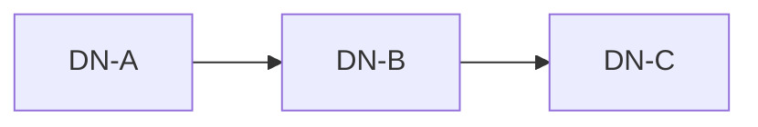

# 一、HDFS 写入

## 前置概念

### 1.1 RPC

RPC 全称是 Remote Procedure Call，中文叫远程过程调，拆开来看：

- Remote：代码在另一个进程、容器或机器上

- Procedure：函数、方法或操作

- Call：调用它并获得结果

所以 RPC 的本质是：一个程序请求另一个进程执行某个方法，并把执行结果返回。

例如订单服务需要查询用户信息：`var user = await userServiceClient.GetUserAsync(userId);` 代码看起来**像普通方法调用**，但 GetUserAsync 的真正业务逻辑可能运行在另一台机器上的用户服务中。

#### RPC和本地方法调用的区别

本地方法调用： `var result = calculator.Add(10, 20);` 执行过程是：

- 当前进程找到 `Add` 方法；
- CPU 执行当前进程中的代码；
- 参数和结果在本机内存中传递；
- 返回 `30`。

这里真正的 **Add 实现代码在当前程序或者当前程序加载的依赖包**中。

RPC 调用：`var result = await calculatorClient.AddAsync(10, 20);`执行过程是：

- 当前进程调用本地的 `AddAsync` 代理方法；
- 代理把 `10`、`20` 序列化成网络消息；
- 消息通过网络发送到远程服务；
- 远程服务执行真正的 `Add` 方法；
- 远程服务把 `30` 序列化后发回来；
- 本地代理将结果反序列化为 `int`；
- 最终向调用者返回 `30`。

也就是说 RPC 和本地方法调用的区别就在于，内部实现的位置不同，RPC需要作为代理给远程服务发出网络请求，实际的计算过程是在远程服务端。（只是**代码的写法和使用体验**和本地调用相似，不是远程代码被下载到了本机）

### 1.2 网络拓扑 Network Topology

在海量数据处理中，其主要限制因素是节点之间数据的传输速率——带宽，带宽的提升一般都比较贵。而我们希望带宽不变的前提下减少数据传输的耗时，那就要引入网络拓扑了。根据网络拓扑可以判断节点之间的“网络距离”。以`Client`向`NameNode`请求存放数据的`DataNode`的过程为例：

`NameNode` 会把 `DataNode` 按照网络位置组织成一种树形逻辑结构，然后根据这个拓扑判断节点之间的“网络距离”，在相同带宽下，距离越近数据传输耗时越短，以`/data-center/rack/node`的层级为例：


一般来说按照网络距离从小到大就是：同一个节点的距离 < 同一个机架中的不同节点的距离 < 不同机架的节点的距离

也就是说：

- 同一个 DataNode 上不需要网络传输
- 同一机架内传输通常经过机架内部交换机
- 跨机架传输通常需要经过更上层的网络设备

### 1.3 机架感知 Rack Awareness

机架感知是指 `NameNode` 知道每个 `DataNode` 属于哪个机架，并在选择副本位置时利用这些信息。

假设集群有两个机架：

```plain
Rack-1：DN-A、DN-B、DN-C
Rack-2：DN-D、DN-E、DN-F
```

如果三个副本全部放在 Rack-1：

```plain
Rack-1：副本 1、副本 2、副本 3
Rack-2：无副本
```

一旦 Rack-1 的交换机、电源或者网络整体发生故障，三个副本可能同时不可用。所以 HDFS 通常会让副本分布到不同机架，这样即使一个机架整体故障，另一个机架仍然保存副本。

```plain
Rack-1：副本 1
Rack-2：副本 2、副本 3
```

机架感知主要在两个目标（可靠性、网络效率）之间进行平衡：

2. **可靠性**
   
   - 副本跨机架保存
   - 防止整个机架故障导致数据不可用

3. **网络效率**
   
   - 并非让每个副本都放到不同机架
   - 避免产生过多跨机架数据传输

### 1.4 副本机制 Replication

副本机制是指一个 HDFS Block 保存多少份副本。

例如文件大小是 300 MiB，Block 大小是 128 MiB，那么此文件就需要申请3个Block来存储数据：

```plain
文件
├── Block-1：128 MiB
├── Block-2：128 MiB
└── Block-3：44 MiB
```

如果副本系数为 3，那么针对每个Block都需要存储3个副本，所需的存储空间至少是之前的文件的3倍。

对于传统的默认副本放置策略，当副本系数为 3，并且写入 `Client` 就运行在集群内的 `DataNode` 上时，通常可以理解为这个Block的：

2. 第一个副本放在本地 `DataNode`
3. 第二个副本放在另一个机架的 `DataNode`
4. 第三个副本放在与第二个副本相同机架的另一个 `DataNode`

```plain
Rack-1
└── DN-A：副本 1，靠近 Client

Rack-2
├── DN-B：副本 2
└── DN-C：副本 3
```

两个机架+三个节点的组合下，既能抵抗一个机架故障，又再写一个 Block时只需要进行一次主要的跨机架传输。

---

> 如果 Client 是集群外部机器，或者 Client 所在节点不是 DataNode，就不能说“第一份放在本地 DataNode”。
> 
> 这种情况下，NameNode 通常选择一个合适并且相对接近的 DataNode 作为第一个副本位置。

注：每个 Block 的 DataNode 组合可以不同

| Block   | 副本位置           |
| ------- | -------------- |
| Block-1 | DN-A、DN-D、DN-E |
| Block-2 | DN-B、DN-E、DN-F |
| Block-3 | DN-C、DN-D、DN-F |

## 步骤1：Client 请求创建文件，完成元数据的创建

1）应用程序会调用类似下面的方法向`NameNode`获取元文件（确实很像本地调用）

```java
FSDataOutputStream outputStream = distributedFileSystem.create(new Path("/data/test.txt"));
```

这里的`distributedFileSystem`就是我们上面说的**RPC服务**，他向HDFS的 `NameNode` 发起上传文件到HDFS的请求，实际的执行是在`NameNode`处完成

2）`NameNode`检查：

- 父目录是否存在
- 用户是否有写权限
- 目标路径是否已经存在
- 文件名是否合法
- 是否满足配额等限制

4）检查通过后，`NameNode` 在内存中的 HDFS 命名空间创建文件元数据，并记录相应的编辑日志。

5）`NameNode` 返回创建成功，Client(应用程序) 得到一个 `FSDataOutputStream`返回值。其作用是给 Client 一个“可以往 HDFS 写数据的句柄 / 通道”，它内部包装了：

- `DFSOutputStream`（真正干活的类）
- HDFS 的 **Block 管理、Pipeline 管理、ACK、重试、校验**​ 等复杂逻辑

**FSDataOutputStream**很重要，因为**写文件是一个“先拿通道，再写数据”的过程**

这和本地文件系统是一模一样的：

```java
FileOutputStream fos = new FileOutputStream("/tmp/a.txt");
fos.write(...);   // 真正写数据
fos.close();
```

HDFS 也是这个模型：

```java
FSDataOutputStream out = fs.create(path); // 1️⃣ 创建文件（元数据）
out.write(...);                           // 2️⃣ 写数据（Block）
out.close();                              // 3️⃣ 提交文件
```

如果 `create()` 不返回流，后面就没办法写数据了。

## 步骤2：Client 对数据进行 Block 划分

步骤1只是`NameNode` 确认文件可以创建，并在HDFS 命名空间创建文件元数据。此时还没有真正把文件数据写入 `DataNode`。

Client 会根据文件大小按照一个Block 128 MB来切分文件（HDFS 2.x/3.x 环境默认是 128 MiB），第一个 Block 切出来后会向 `NameNode` 请求为该 Block 分配 `DataNode`

> 注：Client 通常不是先读取整个文件，然后一次性切成并申请的。HDFS 设计目标是流式写入 + 大文件(**几十 GB / TB**)，Client 不可能一次性读入内存，所以HDFS 是边读取、边缓存、边写入的

## 步骤3：NameNode 选择 DataNode

`NameNode` 收到Client的请求后，根据**网络拓扑和机架感知以及副本机制**为当前 Block 选择副本存放位置，并返回一个有顺序的 `DataNode` 列表（这个顺序随后用于建立数据 Pipeline）



`NameNode` 不是简单地随机选择3个 `DataNode`，而是综合考虑：

- 集群的副本放置策略、副本数量
- 存储类型要求
- Client 所在位置
- DataNode 所属机架、DataNode 是否存活（是否进入维护或退役状态）、DataNode 剩余磁盘空间、DataNode 当前负载、DataNode 是否已保存当前 Block 的副本

## 步骤4：Pipeline 建立过程

Client 收到后 NameNode 返回的有顺序的 `DataNode` 列表后，会与地址列表中的 DataNodeA 通信，DataNodeA 继续调用 DataNodeB，DataNodeB 再调用 DataNodeC，形成如下的 Pipeline：

```plain
Client ──连接──> DN-A
                  │
                  └──连接──> DN-B
                               │
                               └──连接──> DN-C
```

之前的Client 和 NameNode通过 RPC通信；

此时Client 和 DataNode Pipeline之间是实际数据传输，使用 Data Transfer Protocol 通过网络连接传输 Packet

| 维度                                | RPC（Client↔NN）              | Data Transfer（Client↔DN Pipeline） |
| --------------------------------- | --------------------------- | --------------------------------- |
| 执行过程                              | RPC是一个请求对应一个响应<br/>         | Client 建立 TCP 长连接                 |
| <br/>  → 不断往 Pipeline 里塞 Packet   |                             |                                   |
| <br/>  → DataNode 链式转发            |                             |                                   |
| <br/>  → ACK 反向流回来                |                             |                                   |
| <br/>  → 一个 Block 写完才断开（或复用）<br/> |                             |                                   |
| 特点                                | 一问一答：短连接、数据量小、双向请求-响应       | 持续推送数据流：长连接、数据量大、流式推送 + ACK       |
| **协议**​                           | Hadoop RPC（Protobuf + 自有框架） | 自定义二进制流式协议（往 TCP 管道里不断写二进制帧）      |
| **传什么**​                          | 文件名、权限、Block 位置等            | 真实文件字节 + checksum                 |

## 步骤5：Packet 数据传输

Client和DataNode的连接建立完成后，HDFS 会把 Block 中的数据组织成 Packet，通过 Pipeline 连续发送（A 收到一个 Packet 后发送给 B，B 再发送给 C）。Packet 的大小通常约为 64 KiB，Packet 中还包含校验和及控制信息，如：

- Packet Header
- 序列号
- 当前 Block 中的偏移量
- 数据长度
- 校验和
- 是否为最后一个 Packet 等标记

## 步骤6：ACK 应答流程

ACK 在 Pipeline 中反向传输，最终由第一个 DataNode 返回给 Client。

数据方向：Client → DN-A → DN-B → DN-C

ACK 方向：Client ← DN-A ← DN-B ← DN-C

最终Client 收到DN-A确认后，会将对应 Packet 从 ACK 等待队列中移除。

这里不一定要等一个 Packet 完整完成所有 ACK 后才发送下一个 Packet，可能第一个Packet才到达DN-B，下一个Packet就又从Client发出了，**这正是 Pipeline 提高吞吐量的原因**。

需要提一嘴，Client 端的发送节奏是持续不断的，但是 Packet 在 Pipeline 里是严格保序的，每个 Packet **严格按 1→2→3 的顺序**在这条链上流动，所以每个DataNode收到的Packet都是有序的，**每个 DataNode 都是按接收顺序写本地 tmp 文件的，不存在"乱序需要重组"的问题。**

| DataNode | 接收顺序                         | 写盘顺序                         |
| -------- | ---------------------------- | ---------------------------- |
| DN-A     | Packet1, Packet2, Packet3... | Packet1, Packet2, Packet3... |
| DN-B     | Packet1, Packet2, Packet3... | Packet1, Packet2, Packet3... |
| DN-C     | Packet1, Packet2, Packet3... | Packet1, Packet2, Packet3... |

你可能还有疑惑，如果网路出问题顺序还能对吗？这就不得不说Client↔DN Pipeline的连接协议，TCP协议！它保证了 **Packet 2 的字节永远在 Packet 1 的字节之后到达**。除非 TCP 连接断了（那整个 Pipeline 就废了，走恢复流程）

- 在同一个 TCP 连接里：字节流是严格保序的

- 同时Pipeline 中相邻两个节点之间是一条 TCP 连接

- Packet 是作为字节流写入这条连接的，

- TCP 保证对端按发送顺序收到。

## 步骤7：一个 Block 写完以后

## 步骤8：ACK 应答流程

# 二、HDFS读流程

1. Client向NameNode发送RPC请求。请求文件block的位置；
2. NameNode收到请求之后会检查用户权限以及是否有这个文件，如果都符合，则会视情况返回部分或全部的block列表，对于每个block，NameNode都会返回含有该block副本的DataNode地址；这些返回的DataNode地址，会按照集群拓扑结构得出DataNode与客户端的距离，然后进行排序，排序两个规则：网络拓扑结构中距离 Client 近的排靠前；心跳机制中超时汇报的DataNode状态为STALE，这样的排靠后；
3. Client选取排序靠前的DataNode来读取block，如果客户端本身就是DataNode,那么将从本地直接获取数据(短路读取特性)；
4. 底层上本质是建立Socket Stream（FSDataInputStream），重复的调用父类DatalnputStream的read方法，直到这个块上的数据读取完毕；
5. 当读完列表的block后，若文件读取还没有结束，客户端会继续向NameNode 获取下一批的block列表；
6. 读取完一个block都会进行checksum验证，如果读取DataNode时出现错误，客户端会通知NameNode，然后再从下一个拥有该block副本的DataNode 继续读；
7. read方法是并行的读取block信息，不是一块一块的读取；NameNode只是返回Client请求包含块的DataNode地址，并不是返回请求块的数据；
8. 最终读取来所有的block会合并成一个完整的最终文件；

HDFS NameNode高可用如何实现？需要哪些角色？

架构：**Active NameNode + Standby NameNode**

| 角色                 | 作用                           |
| ------------------ | ---------------------------- |
| Active NameNode    | 对外提供服务                       |
| Standby NameNode   | 热备，实时同步editlog               |
| JournalNode集群（≥3个） | 共享editlog，Active写入，Standby读取 |
| ZooKeeper          | 选主，记录谁是Active                |
| ZKFC               | 监控NameNode健康，触发自动切换          |

 

---

# 
