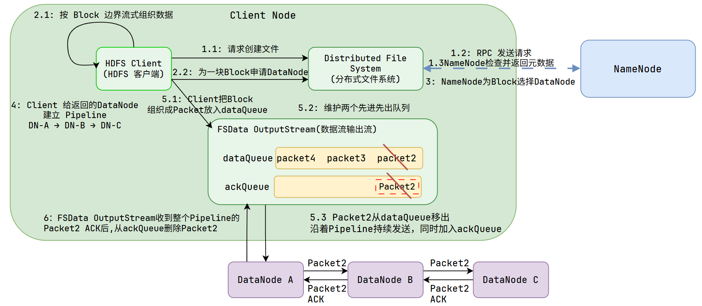
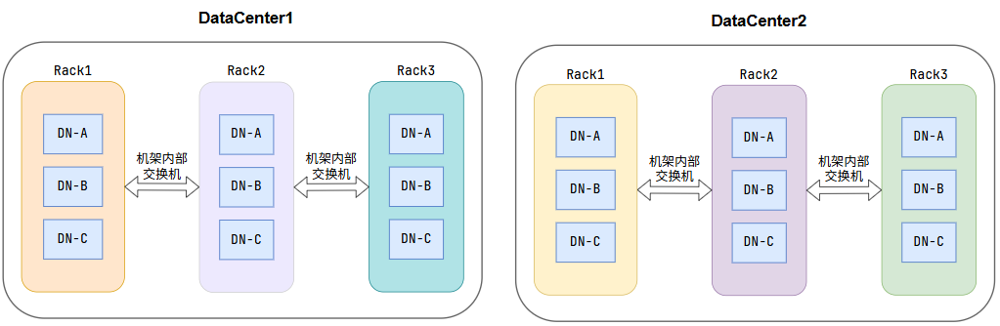
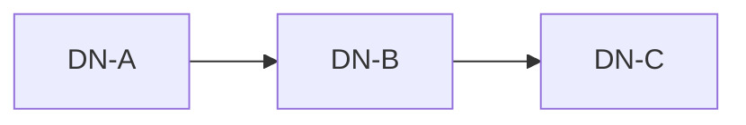
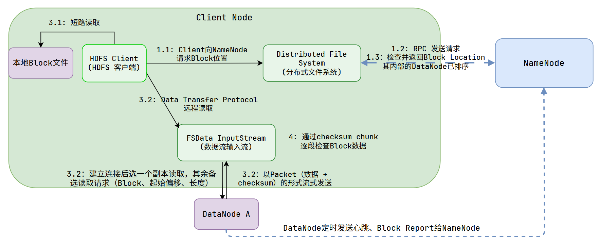

# 一、HDFS 写入

概要图如下，其中的数字和下面小标题的步骤是一一对应的，如图中的1.1，1.2，1.3都属于【步骤1：Client 请求创建文件，NameNode完成元数据的创建】的范畴



## 前置概念

### 1.1 RPC

RPC 全称是 Remote Procedure Call，中文叫远程过程调，拆开来看：

- Remote：代码在另一个进程、容器或机器上

- Procedure：函数、方法或操作

- Call：调用它并获得结果

所以 RPC 的本质是：一个程序请求另一个进程执行某个方法，并把执行结果返回。

例如订单服务需要查询用户信息：`var user = await userServiceClient.GetUserAsync(userId);` 代码看起来**像普通方法调用**，但 GetUserAsync 的真正业务逻辑可能运行在另一台机器上的用户服务中。

#### RPC和本地方法调用的区别

本地方法调用： `var result = calculator.Add(10, 20);` 执行过程是：

- 当前进程找到 `Add` 方法；
- CPU 执行当前进程中的代码；
- 参数和结果在本机内存中传递；
- 返回 `30`。

这里真正的 **Add 实现代码在当前程序或者当前程序加载的依赖包**中。

RPC 调用：`var result = await calculatorClient.AddAsync(10, 20);`执行过程是：

- 当前进程调用本地的 `AddAsync` 代理方法；
- 代理把 `10`、`20` 序列化成网络消息；
- 消息通过网络发送到远程服务；
- 远程服务执行真正的 `Add` 方法；
- 远程服务把 `30` 序列化后发回来；
- 本地代理将结果反序列化为 `int`；
- 最终向调用者返回 `30`。

也就是说 RPC 和本地方法调用的区别就在于，内部实现的位置不同，RPC需要作为代理给远程服务发出网络请求，实际的计算过程是在远程服务端。（只是**代码的写法和使用体验**和本地调用相似，不是远程代码被下载到了本机）

其实总结到这里我有个疑问：如果RPC是对网络请求的一次封装，那么RPC内部还是使用了http请求，也就是TCP协议，那么一次 RPC 就会重新建立一次 TCP 连接？为什么还要使用RPC调用而不是直接写一个HTTP请求？这不是脱裤子放屁，没有什么好处？

但实际上，在HDFS中Client向NameNode请求DataNode的RPC 过程是可复用的，Client和NameNode之间会维护一个可复用的RPC连接，在这条连接上可以连续发送请求，而不需要每次都重复创建连接。

### 1.2 网络拓扑 Network Topology

在海量数据处理中，其主要限制因素是节点之间数据的传输速率——带宽，带宽的提升一般都比较贵。而我们希望带宽不变的前提下减少数据传输的耗时，那就要引入网络拓扑了。根据网络拓扑可以判断节点之间的“网络距离”。以`Client`向`NameNode`请求存放数据的`DataNode`的过程为例：

`NameNode` 会把 `DataNode` 按照网络位置组织成一种树形逻辑结构，然后根据这个拓扑判断节点之间的“网络距离”，在相同带宽下，距离越近数据传输耗时越短，以`/data-center/rack/node`的层级为例：



一般来说按照网络距离从小到大就是：同一个节点的距离 < 同一个机架中的不同节点的距离 < 不同机架的节点的距离

也就是说：

- 同一个 DataNode 上不需要网络传输
- 同一机架内传输通常经过机架内部交换机
- 跨机架传输通常需要经过更上层的网络设备

### 1.3 机架感知 Rack Awareness

机架感知是指 `NameNode` 知道每个 `DataNode` 属于哪个机架，并在选择副本位置时利用这些信息。

假设集群有两个机架：

```plain
Rack-1：DN-A、DN-B、DN-C
Rack-2：DN-D、DN-E、DN-F
```

如果三个副本全部放在 Rack-1：

```plain
Rack-1：副本 1、副本 2、副本 3
Rack-2：无副本
```

一旦 Rack-1 的交换机、电源或者网络整体发生故障，三个副本可能同时不可用。所以 HDFS 通常会让副本分布到不同机架，这样即使一个机架整体故障，另一个机架仍然保存副本。

```plain
Rack-1：副本 1
Rack-2：副本 2、副本 3
```

机架感知主要在两个目标（可靠性、网络效率）之间进行平衡：

2. **可靠性**
   
   - 副本跨机架保存
   - 防止整个机架故障导致数据不可用

3. **网络效率**
   
   - 并非让每个副本都放到不同机架
   - 避免产生过多跨机架数据传输

### 1.4 副本机制 Replication

副本机制是指一个 HDFS Block 保存多少份副本。

例如文件大小是 300 MiB，Block 大小是 128 MiB，那么此文件就需要申请3个Block来存储数据：

```plain
文件
├── Block-1：128 MiB
├── Block-2：128 MiB
└── Block-3：44 MiB
```

如果副本系数为 3，那么针对每个Block都需要存储3个副本，所需的存储空间至少是之前的文件的3倍。

对于传统的默认副本放置策略，当副本系数为 3，并且写入 `Client` 就运行在集群内的 `DataNode` 上时，通常可以理解为这个Block的：

2. 第一个副本放在本地 `DataNode`
3. 第二个副本放在另一个机架的 `DataNode`
4. 第三个副本放在与第二个副本相同机架的另一个 `DataNode`

```plain
Rack-1
└── DN-A：副本 1，靠近 Client

Rack-2
├── DN-B：副本 2
└── DN-C：副本 3
```

两个机架+三个节点的组合下，既能抵抗一个机架故障，又再写一个 Block时只需要进行一次主要的跨机架传输。

---

> 如果 Client 是集群外部机器，或者 Client 所在节点不是 DataNode，就不能说“第一份放在本地 DataNode”。
> 
> 这种情况下，NameNode 通常选择一个合适并且相对接近的 DataNode 作为第一个副本位置。

注：每个 Block 的 DataNode 组合可以不同

| Block   | 副本位置           |
| ------- | -------------- |
| Block-1 | DN-A、DN-D、DN-E |
| Block-2 | DN-B、DN-E、DN-F |
| Block-3 | DN-C、DN-D、DN-F |

### 1.5 STALE/Dead DataNode是什么

DataNode 会**定期**（ 默认每 3 秒）向 NameNode 发送心跳和 Block Report。

- **心跳Heartbeat** 是NameNode 用来判断DataNode "活着没、响应快不快？"，最终判定DataNode的状态**stale / dead**。Heartbeat携带的信息包括
  - DataNode 当前状态（正常、正在下线等）
  - 存储状态（磁盘是否正常）
  - 缓存状态
  - 一些容量信息
- **Block Report**​ 是NameNode 用来确定DataNode上 "有哪些 Block？" ，**决定块映射关系**

与之对应的 NameNode 内部会维护每个 DataNode 的**最后心跳时间戳：lastHeartbeatTime**，然后和配置的阈值比较：

| 阈值参数                                      | 默认值  | 含义                         |
| ----------------------------------------- | ---- | -------------------------- |
| `dfs.namenode.stale.datanode.interval`    | 30 秒 | 超过这个时间没心跳 → 标记为 **stale**​ |
| `dfs.namenode.heartbeat.recheck-interval` | 5 分钟 | 超过这个时间没心跳 → 标记为 **dead**   |

标记为stale：意味着超过阈值时间没有发出心跳，就需要怀疑是不是DataNode出问题了，但此时仍认为DataNode节点是活着可用的，只是被降权。

标记为dead：意味着DataNode已经丢失，不能再认认为是可靠的节点，需要开始复制其副本。

### 1.6 STALE/Dead DataNode的影响

当 NameNode 收到**读请求**（Client 要读某个 Block），需要返回一组 DataNode 列表时：

**排序策略（开启 `dfs.namenode.avoid.read.stale.datanode=true` 时）** 会把 stale节点排在后面

```text
返回 DataNode 列表的优先级：
  正常节点  → 高优先级
  stale节点 → 低优先级（排在后面，只有正常节点都不可用时，才 fallback 到 stale 节点）
```

---

不只是读，**写 Block 时选 Pipeline 也会避开 stale 节点**，防止把数据写到"可能马上就挂"的节点上

```text
选 DataNode 建 Pipeline 的优先级：
  正常节点 > stale节点
```

## 步骤1：Client 请求创建文件，NameNode完成元数据的创建

1）应用程序会调用类似下面的方法向`NameNode`获取元文件（确实很像本地调用）

```java
FSDataOutputStream outputStream = distributedFileSystem.create(new Path("/data/test.txt"));
```

这里的`distributedFileSystem`就是我们上面说的**RPC服务**，他向HDFS的 `NameNode` 发起上传文件到HDFS的请求，实际的执行是在`NameNode`处完成

2）`NameNode`检查：

- 父目录是否存在
- 用户是否有写权限
- 目标路径是否已经存在
- 文件名是否合法
- 是否满足配额等限制

4）检查通过后，`NameNode` 在内存中的 HDFS 命名空间创建文件元数据，并记录相应的编辑日志

为什么要创建文件元数据？

一开始 NameNode 的命名空间里没有待创建文件，如果 Client 直接问：给我的 Block-1 分配三个 DataNode；NameNode 会有一个问题：这个 Block 属于哪个文件？可以理解为NameNode 中出现如下内容，这样后面申请Block时就可以直接找到位置

```plain text
/data/a.txt
    │
    ├── owner
    ├── permission
    ├── replication = 3
    ├── length = 0
    ├── blocks = [] (此时一个 Block 都还没有)
    └── 状态 = under construction
```

5）`NameNode` 返回创建成功，Client(应用程序) 得到一个 `FSDataOutputStream`返回值。其作用是给 Client 一个“可以往 HDFS 写数据的句柄 / 通道”，它内部包装了：

- `DFSOutputStream`（真正干活的类）
- HDFS 的 **Block 管理、Pipeline 管理、ACK、重试、校验**​ 等复杂逻辑

**FSDataOutputStream**很重要，因为**写文件是一个“先拿通道，再写数据”的过程**

这和本地文件系统是一模一样的：

```java
FileOutputStream fos = new FileOutputStream("/tmp/a.txt");
fos.write(...);   // 真正写数据
fos.close();
```

HDFS 也是这个模型：

```java
FSDataOutputStream out = fs.create(path); // 1️⃣ 创建文件（元数据）
out.write(...);                           // 2️⃣ 写数据（Block）
out.close();                              // 3️⃣ 提交文件
```

如果 `create()` 不返回流，后面就没办法写数据了。

## 步骤2：Client 将数据划分成 Block，向NameNode请求DataNode

步骤1只是`NameNode` 确认文件可以创建，并在HDFS 命名空间创建文件元数据。此时还没有真正把文件数据写入 `DataNode`。

Client 会根据文件大小按照一个Block 128 MB来切分文件（HDFS 2.x/3.x 环境默认是 128 MiB），第一个 Block 切出来后会向 `NameNode` 请求为该 Block 分配 `DataNode`（后续紧接步骤3-8），当这个Block完成后Client会为下一个 Block向NameNode 再次发出请求分配 `DataNode`（有几个Block就会请求几次）

> 注：Client 通常不是先读取整个文件，然后一次性切成并申请的。HDFS 设计目标是流式写入 + 大文件(**几十 GB / TB**)，Client 不可能一次性读入内存，所以HDFS 是边读取、边缓存、边写入的

但每次发出的请求是不完全一样的，通常是：

- 创建文件时，有一次 `create()` RPC；
- 每需要创建一个新 Block，调用一次类似 `addBlock()` 的 RPC；
- 文件写完后，还会有 `complete()` 等 RPC；
- 如果 DataNode 故障，还可能发起 Block recovery 相关的 RPC。

## 步骤3：NameNode 选择 DataNode

`NameNode` 收到Client的请求后，根据**网络拓扑和机架感知以及副本机制**为当前 Block 选择副本存放位置，并返回一个有顺序的 `DataNode` 列表（这个顺序随后用于建立数据 Pipeline）



`NameNode` 不是简单地随机选择3个 `DataNode`，而是综合考虑：

- 集群的副本放置策略、副本数量
- 存储类型要求
- Client 所在位置
- DataNode 所属机架、DataNode 是否存活（是否进入维护或退役状态）、DataNode 剩余磁盘空间、DataNode 当前负载、DataNode 是否已保存当前 Block 的副本

## 步骤4：Client 给返回的DataNode建立 Pipeline

Client 收到后 NameNode 返回的有顺序的 `DataNode` 列表后，会与地址列表中的 DataNodeA 通信，DataNodeA 继续调用 DataNodeB，DataNodeB 再调用 DataNodeC，形成如下的 Pipeline：

```plain
Client ──连接──> DN-A
                  │
                  └──连接──> DN-B
                               │
                               └──连接──> DN-C
```

之前的Client 和 NameNode是通过 RPC通信；此时Client 和 DataNode Pipeline之间是实际数据传输，使用的是 Data Transfer Protocol 建立的TCP长连接，可以协议可以长时间保持网络连接源源不断地传输 Packet。二者区别如下：

| 维度       | RPC（Client↔NN）              | Data Transfer（Client↔DN Pipeline）                                                                                    |
| -------- | --------------------------- | -------------------------------------------------------------------------------------------------------------------- |
| **执行过程** | RPC是一个请求对应一个响应<br/>         | Client 建立 TCP 长连接<br/> → 不断往 Pipeline 里塞 Packet<br/>→ DataNode 链式转发<br/> → ACK 反向流回来<br/> → 一个 Block 写完才断开（或复用）<br/> |
| **特点**   | 一问一答：短连接、数据量小、双向请求-响应       | 持续推送数据流：长连接、数据量大、流式推送 + ACK                                                                                          |
| **协议**​  | Hadoop RPC（Protobuf + 自有框架） | 自定义二进制流式协议（往 TCP 管道里不断写二进制帧）                                                                                         |
| **传什么**​ | 文件名、权限、Block 位置等            | 真实文件字节 + checksum                                                                                                    |

## 步骤5：Client把Block组织成Packet 便于后续数据传输

Client和DataNode的TCP长连接建立完成后，HDFS 会把 Block 中的数据组织成 Packet，同时维护两个队列：dataQueue（存放等待发送的 Packet）、ackQueue（存放已经发送，但还未收到完整 ACK 的 Packet）保证Pipeline的所有节点能够完整收到Packet数据。 Packet会沿着已经构建好的Pipeline 连续发送（A 收到一个 Packet 后发送给 B，B 再发送给 C）。

一个 HDFS Packet 的大小通常约为 64 KiB，可以抽象成如下的元数据结构，用于确定每个Packet的位置和顺序

```plain
Packet Header
├── packetLen
├── offsetInBlock（当前数据在 Block 中的偏移量）
├── sequenceNumber （Packet 序号）
├── lastPacketInBlock（是不是该 Block 的最后一个 Packet）
└── dataLength（这个 Packet 中包含多少数据）

Checksum Area
├── checksum 1 （验证数据是否损坏）
├── checksum 2
└── ...

Data Area
├── chunk 1
├── chunk 2
└── ...
```

举例：

| Packet   | seqno | offsetInBlock | dataLen |
| -------- | ----- | ------------- | ------- |
| Packet 0 | 0     | 0             | 65,024  |
| Packet 1 | 1     | 65,024        | 65,024  |
| Packet 2 | 2     | 130,048       | 65,024  |

DataNode 会根据：`Block ID + offsetInBlock + seqno` 判断 Packet 属于哪个 Block、应该写在什么位置、顺序是否正确

Packet 0：我是 Block X，从 offset 0 开始
Packet 1：我是 Block X，从 offset 65024 开始
Packet 2：我是 Block X，从 offset 130048 开始

可以类比为数组按照索引范围的分段写入：每段不需要携带前一段内容，只需要知道自己的起始位置。

```plain
data[0:65024]
data[65024:130048]
data[130048:195072]
```

最终按照偏移量连续写进同一个 Block X文件：`[Packet 1 data][Packet 2 data][Packet 3 data]...`

想必你肯定会疑惑为什么Packet 要设计成64K，这么小？

答：如果必须攒够 128 MB 才发送：数据的延迟会非常高，Client 内存占用大；

- DataNode B 和 C 必须等待DataNode A完成128MB的写入，**使用约 64 KB 的的packet则可以让 Pipeline 流动起来，后面的DataNode 可以边接收组装、边发送数据，而不必等完整 Block**（多个 Packet 可以同时处于 Pipeline 的不同位置）
- 出错后可能需要重传大量数据，**使用约 64 KB 的的packet则只需要针对尚未确认的数据执行恢复，而不是重新发送整个 128 MB Block**

注意：HDFS Packet 是应用层概念，实际传输时 TCP 会继续把 HDFS Packet 拆成更小的 TCP Segment，再由 IP 层传输。

```plain
HDFS Packet，约 64 KB
   ↓
多个 TCP Segment，通常每个约 1460 bytes payload
   ↓
多个 IP Packet
```

## 步骤6：Pipeline的 ACK 应答流程

ACK 在 Pipeline 中反向传输，最终由第一个 DataNode 返回给 Client。

数据方向：Client → DN-A → DN-B → DN-C

ACK 方向：Client ← DN-A ← DN-B ← DN-C。具体来说是：C 收到并处理 Packet并把自己的状态返回给 B；B 收到 C 的 ACK，并附加自己的状态返回给 A；A 收到 B、C 的结果，并附加自己的状态返回 Client；

Client 收到整个 Pipeline 的确认后，才从 ackQueue 删除这个 Packet，可视化过程如下

```plain
Client 组装 Packet
    ↓
Packet 放入 dataQueue
    ↓
DataStreamer 取出并发送Packet到DataNode
    ↓
Packet 移动到 ackQueue
    ↓
Client 收到完整 ACK
    ↓
从 ackQueue 删除
```

这里不一定要等一个 Packet 完整完成所有 ACK 后才发送下一个 Packet，可能第一个Packet才到达DN-B，下一个Packet就又从Client发出了，**这正是 Pipeline 提高吞吐量的原因**。

### Packet的顺序保证

需要提一嘴，Client 端的发送节奏是持续不断的，但是 Packet 在 Pipeline 里是严格保序的，每个 Packet **严格按 1→2→3 的顺序**在这条链上流动，所以每个DataNode收到的Packet都是有序的，**每个 DataNode 都是按接收顺序写本地 tmp 文件的，不存在"乱序需要重组"的问题。**

| DataNode | 接收顺序                         | 写盘顺序                         |
| -------- | ---------------------------- | ---------------------------- |
| DN-A     | Packet1, Packet2, Packet3... | Packet1, Packet2, Packet3... |
| DN-B     | Packet1, Packet2, Packet3... | Packet1, Packet2, Packet3... |
| DN-C     | Packet1, Packet2, Packet3... | Packet1, Packet2, Packet3... |

你可能还有疑惑，如果网路出问题顺序还能对吗？这就不得不说Client↔DN Pipeline的连接协议，TCP协议！它保证了 **Packet 2 的字节永远在 Packet 1 的字节之后到达**。除非 TCP 连接断了（那整个 Pipeline 就废了，走恢复流程）

- 在同一个 TCP 连接里：字节流是严格保序的

- 同时Pipeline 中相邻两个节点之间是一条 TCP 连接

- Packet 是作为字节流写入这条连接的，

- TCP 保证对端按发送顺序收到。

### 什么是 dataQueue/ackQueue

由于生产数据和网络发送速度可能不同，所以需要引入一个中间产物dataQueue来接受再发送数据保证相对的稳定：

- 应用线程：不断产生数据

- DataStreamer：不断通过网络发送数据

**dataQueue 队列把两者解耦，应用线程不必亲自完成每次网络发送**

Client 收到Packet在整个 Pipeline 的确认后，才从 ackQueue 删除这个 Packet，所以ackQueue就是用来处理：

- DataNode 崩溃；
- Packet “丢失”
- TCP 连接中断；
- ACK 超时；
- 磁盘写入失败；
- checksum 验证失败；
- Pipeline 中某个节点不可达。

### Packet的丢失恢复

**案例1 如果 Packet 在 DataNode B 处丢失，常见恢复过程是：**

- Client 检测失败：Client 发现 TCP connection 被关闭；ACK 长时间未返回；ACK 明确报告 B 写入失败。此时 ackQueue 中还有尚未完成确认的 Packet（仍保留在 Client 内存中）。

- 停止旧 Pipeline：旧的pipeline `Client → A → B → C`已经不能再被认为可靠，因此不会只是盲目沿同一条连接重复发送。

- 把未确认 Packet 放回待发送位置：从最早未确认的 Packet 开始，按照FIFO的原则将其重新放回发送流程。

- 重建 Pipeline：如果确认 B 是故障节点，可以把它从 Pipeline 中移除，然后重新建立连接，并协调 Block 的当前写入状态。（写入期间暂时只剩两个健康副本，后续 NameNode 也可以发现副本数不足并安排 replication）

- 从未确认位置重新发送。

**案例2 如果 Packet 10数据已经写入了DataNodeB，但 ACK 丢了：**

此时 Client 会认为 Packet 10 尚未确认，HDFS 不能简单地把 Packet 10 再追加一次，否则可能变成：

```plain
正确：
[Packet 9][Packet 10][Packet 11]

错误重复：
[Packet 9][Packet 10][Packet 10][Packet 11]
```

为避免无脑重复追加恢复，各 DataNode 会协调它们已经写到的 Block 长度和状态再重发 Packet：

- 确认哪些 Packet 已经完成

- 找到共同且安全的 Block 边界

- 更新 Pipeline/Block generation

- 从最早未确认的 offset 恢复写入

## 步骤7：一个 Block 写完以后

当前 Block 写满或文件结束，则开始下一轮循环，重复执行步骤1-6。

## 步骤8：文件写入完成：close 和 complete

Client 通知 NameNode：该文件的所有 Block 已写入完毕，可以完成文件元数据

- Client 侧对输出流执行关闭操作，调用 `FSDataOutputStream.close()`
- Client 刷新尚未发送的数据
- Client 等待所有 Packet 的 ACK
- Client 确保最后一个 Block 完成
- Client 通知 NameNode 完成文件
- NameNode 检查 Block 是否达到所需的最小副本条件（副本数不足并安排 replication）
- NameNode 将文件从“正在写入”状态转换为“已完成”状态

## 完整步骤总结：

1. Client 调用 HDFS API 创建目标文件，并通过 RPC 向 NameNode 发送创建请求。
2. NameNode 检查目标路径、文件是否已存在、用户权限、命名空间配额等信息。
3. 检查通过后，NameNode 创建文件元数据并返回创建成功。此时尚未写入实际文件数据。
4. Client 通过 `FSDataOutputStream` 流式写入数据。当需要写入第一个 Block 时，Client 向 NameNode 申请新的 Block。
5. NameNode 根据副本系数、副本放置策略、网络拓扑、机架感知、节点存活状态、磁盘空间和负载等因素，为当前 Block 选择 DataNode。
6. NameNode 向 Client 返回有顺序的 DataNode 列表，例如 `DN-A → DN-B → DN-C`。
7. Client 与 DN-A 建立连接，DN-A 与 DN-B 建立连接，DN-B 与 DN-C 建立连接，从而形成 DataNode Pipeline。
8. Client 将 Block 数据组织成 Packet，并按照 `Client → DN-A → DN-B → DN-C` 的方向连续发送。
9. DataNode 一边把数据写入本地存储，一边将 Packet 转发给 Pipeline 中的下一个 DataNode。
10. ACK 按照 `DN-C → DN-B → DN-A → Client` 的方向返回。Client 收到成功 ACK 后，从等待确认队列中删除对应 Packet。
11. 当前 Block 写满后，Client 向 NameNode 申请下一个 Block。NameNode为新 Block 重新选择副本位置，并建立新的 Pipeline。
12. 所有数据写完后，Client 关闭输出流，等待未确认 Packet 完成，并通知 NameNode 完成文件。
13. NameNode 确认 Block 达到最小副本要求后，将文件标记为完整状态。

# 二、HDFS读流程



## 步骤1：Client 向 NameNode 请求一批 Block 位置

1）应用程序调用 FileSystem.open() 打开 HDFS 文件，Client 会调用类似下面的方法向`NameNode`发起RPC请求（实际的执行是在`NameNode`处完成），请求文件元数据以及目标读取范围涉及的 Block 位置信息。

```java
FSDataInputStream inputStream = fileSystem.open(new Path("/data/test.txt"));
```

FSDataInputStream 是 HDFS 提供给应用程序的输入流接口（继承自 Java 的 DataInputStream）

大致调用链是：

```plain text
应用程序
   ↓ read()
FileSystem.open()
   ↓
DistributedFileSystem.open()
   ↓
DFSClient
   ↓ RPC
NameNode
```

需要注意，客户端`getBlockLocations`请求的并不是文件的所有 Block，而是从当前读偏移量开始的一批，默认最多返回 10 个 Block（`dfs.client.read.max.blocks.per.call`，旧版本为 1）

读完这批后再发起下一次 RPC 请求后续 Block。所以"单次请求一批 Block"是对的，但"一批"通常不等于"全部"。

## 步骤2：NameNode 检查并返回 Block Location

NameNode 会先检查元文件信息：

- 路径是否有效、文件是否存在
- Client 是否有读取权限
- 文件是否处于可读取状态（通过心跳判断DataNode的active/stale/dead状态）

然后返回文件元数据及部分或全部 Block 位置信息，结构类似如下：

对于每个 Block，返回保存其副本的 DataNode 列表。

```plain text
文件长度：300 MiB、Block 大小：128 MiB

Block-1：
  offset = 0
  length = 128 MiB
  replicas = [DN-A, DN-D, DN-E]

Block-2：
  offset = 128 MiB
  length = 128 MiB
  replicas = [DN-B, DN-E, DN-F]

Block-3：
  offset = 256 MiB
  length = 44 MiB
  replicas = [DN-C, DN-D, DN-F]
```

其中每个Block中包含有该Block副本的DataNode地址，如 [DN-C, DN-D, DN-F]，这些返回的DataNode地址是根据网络拓扑对副本位置排序的。排序规则和写入时请求分配DataNode一样，都是按照网络距离由近到远。

具体来说，NameNode 拿到某个 Block 的多个副本位置后，会优先选择：

2. 本地 DataNode
3. 同一节点组或相近网络位置的节点
4. 同机架 DataNode
5. 不同机架 DataNode

只有正常节点都不可用时，才 fallback 到 心跳机制中超时汇报的DataNode状态为STALE的节点。

## 步骤3 Client向DataNode发起读取请求

Client收到NameNode返回的 Block Location 后，DFSInputStream 读一个 Block 时，向对应最优的DataNode 建立一条 TCP 连接；读完关闭（或归还 SocketsCache，默认缓存 16 个 socket、过期时间约 3 秒）。下一个 Block 如果由另一个 DataNode 保存，一定新建连接；即使恰好选中同一台 DN，旧连接通常也已关闭。

### 步骤3.1：如果符合短路读取，Client直接读取本地Block

如果收到的Block所在DataNode恰好和Client是同一个DataNode，同时

- 集群启用了短路读取

- DataNode 配置了相应的本地通信路径

- Client 与 DataNode 满足本地访问条件

- Client 有权限访问相关本地文件或文件描述符

- 当前本地 DataNode 上确实有该 Block 的副本

就可以使用短路读取 Short-Circuit Local Reads，此时由于Client和待读取的Block在同一个DataNode(同一个机器)，可以直接**本地读取**。避免了Client和DataNode之间使用TCP长连接来传输数据，读取会更快。

### 步骤3.2：如果只能读取远程副本，Client与DataNode 建立数据连接再读取

如果收到的Block所在DataNode和客户端不是同一个DataNode，则使用 `FSDataInputStream` 提供的读取接口，其底层的 `DFSInputStream` 根据当前文件偏移找到对应 Block，并通过 `BlockReader` 与选中的 DataNode 建立数据连接，再读取当前 Block 的数据。

这个HDFS 的远程读取同样使用 Data Transfer Protocol。DataNode 不会把一个 128 MiB Block 一口气塞进一个 TCP 消息发给 Client，而是把数据组织成一系列 Packet，通过网络流式发送。

```plain text
Application
     │
     │ read(buffer)
     ▼
FSDataInputStream
     │
     ▼
DFSInputStream
     │
     ▼
BlockReader
     │
     │ 请求读取某 Block 的某个范围
     ▼
================ TCP Connection ================
     ▲
     │ Packet 1
     │ Packet 2
     │ Packet 3
     │ ...
     │
DataNode
     │
     ▼
Block 文件
```

需要注意的是，同样是使用Data Transfer Protocol，读取不需要ACK应答

写入：Client 把唯一的一份新数据交给 HDFS，HDFS 必须通过ACK应答保证这些数据真的成功写到了目标副本。

读取：数据已经存在于 HDFS，DataNode 只是把已有数据发送给 Client。

DataNode 连续发送 Packet-1 Packet-2 Packet-3，Client 不需要每收到一个 Packet 就返回 ACK Packet-1。但**读取不是完全没有响应/确认机制**，而是没有写入 Pipeline 那种“每 Packet 逐级反向 ACK”的机制。

因为Data Transfer Protocol底层的TCP 自身也有 TCP ACK、重传等可靠传输机制

```plain text
Client ← TCP 数据 ← DataNode
Client → TCP ACK  → DataNode
```

只是Client写入数据到DataNode时Data Transfer Protocol增加了一层 HDFS 写入 Pipeline ACK机制。

## 步骤4：Client通过checksum chunk 逐段检查Block数据

DataNode 向 Client 远程发送 Block 数据时，会同时提供对应的 checksum 信息：

```Plain Text
Block（例如 128 MiB）
 │
 │ 远程读取
 ▼
Packet
 │
 ├── checksum 信息
 │     ├── checksum1:CRC(data1) = 0x82A15...
 │     ├── checksum2:CRC(data1) = 0x82A15...
 │     └── ...
 │
 └── data
       ├── chunk1:512 Bytes
       ├── chunk2:512 Bytes
       └── ...
```

这里的checksum1表示的是一个函数`CRC(chunk1) = 0x82A15...`，即Checksum是错误检测算法CRC32C，丢入chunk1应该得到的值是`0x82A15...`

Client 的 BlockReader 根据收到后就知道：每 512 Bytes 执行一次CRC32C算法得到checksum1'，再与 DataNode 提供的 checksum 值逐段比较，从而验证读取数据的完整性。

根据幂等性：相同输入 + 相同算法 ⇒ 应该得到相同输出。

```Plain Text
chunk1 → 自己计算 checksum → 与 checksum1 比较
chunk2 → 自己计算 checksum → 与 checksum2 比较
chunk3 → 自己计算 checksum → 与 checksum3 比较
...
↓
一致：继续读取
不一致：认为副本可能损坏
```

Client 边收边校验，Block的所有的chunk都校验后，整个 Block 会被放进 ReaderStrategy 的缓存，供后续 read() 直接取用。

> 如果整个 128 MiB Block 只有一个 checksum，必须读完整块才能发现错误；按小 chunk 校验，则能够在读取过程中及时发现损坏。

### 检查失败/DataNode 读取失败

如果检查时发生：

- 网络连接中断
- DataNode 无响应
- Checksum 不匹配
- DataNode 返回读取错误

HDFS Client 会尝试：

2. 将当前 DataNode **标记**为当前读取过程中的**失败节点**
3. 放弃当前这条连接，**切换**使用同一 Block 的另一个 DataNode
4. **从当前尚未完成的**读取位置**继续读取**
5. 在数据损坏等情况下，将相关故障信息报告给 NameNode

例如：

```Plain Text
Block-1 副本：
DN-A
DN-B
DN-C
```

首先读取：Client ← DN-A，读取到 Block 内偏移 60 MiB 时 DN-A 失败：

```Plain Text
0～60 MiB：已经成功返回
60～128 MiB：尚未读取
```

Client 可以改为：Client ← DN-B

然后从适当的偏移位置继续读取，而不一定需要从该 Block 的第 0 字节重新开始。

## 步骤5： 获取下一批 Block 位置

当读完列表的block后，若文件读取还没有结束，客户端会继续向NameNode 获取下一批的block列表。

因为NameNode 不一定在第一次请求中返回整个大文件的所有 Block Location。

例如一个文件包含 10,000 个 Block，如果一次返回全部信息：

- RPC 响应会非常大
- Client 可能只读取文件开头
- 很多返回的 Block 信息最终不会使用
- Block 位置在长时间读取过程中还可能发生变化

因此，Client 可以按需获取后续读取范围对应的 Block Location，而不要求 NameNode 一次返回整个文件的全部位置信息，如：

```plain text
第一次：Block 1～Block 20
第二次：Block 21～Block 40
第三次：Block 41～Block 60
```

## 步骤6：Client通过输入流连续将数据返回给应用程序，并结束

Client 按照各 Block 在文件中的偏移顺序，将数据通过同一个输入流连续返回给应用程序。应用程序看到的是完整连续的文件内容，通常不需要感知 Block 边界。

文件读取完成后，应用程序关闭 `FSDataInputStream`，释放与 DataNode 的连接及相关客户端资源。

## 总结

1. 应用程序调用 `FileSystem.open()` 打开 HDFS 文件，Client 通过 RPC 向 NameNode 请求文件信息及目标读取范围对应的 Block Location。

2. NameNode 检查文件是否存在、Client 是否有读取权限，并返回文件元数据及部分或全部 Block 位置信息。对于每个 Block，返回保存其副本的 DataNode 列表。

3. HDFS Client 根据网络拓扑对副本位置排序，优先选择距离 Client 较近的 DataNode，并降低 stale DataNode 的优先级，避开已知不可用的节点。

4. 如果 Client 所在机器上存在目标 Block 的本地副本，并且集群正确启用了短路读取，Client 可以通过 Short-Circuit Local Read 直接读取本地 Block 文件。

5. 如果读取远程副本，`FSDataInputStream` 底层的 `DFSInputStream` 会通过 `BlockReader` 与选中的 DataNode 建立数据连接，并读取当前 Block 的数据。

6. 应用程序不断调用 `read()`。对于单个输入流的普通顺序读取，HDFS Client 按照文件偏移顺序读取当前 Block，读完后自动切换到下一个 Block。

7. Client 在读取数据的过程中，根据 checksum chunk 逐段验证数据完整性，而不是等整个 Block 读完后统一校验。

8. 如果 DataNode 读取失败，Client 会选择保存同一 Block 的其他 DataNode 副本，并从合适的文件或 Block 偏移位置继续读取。如果发现 checksum 错误等副本损坏问题，Client 会向 NameNode 报告损坏副本。

9. 如果当前获取的 Block Location 已经使用完，而文件还有后续数据，Client 会再次向 NameNode 请求下一批 Block Location。

10. Client 按照各 Block 在文件中的偏移顺序，将数据通过同一个输入流连续返回给应用程序。应用程序看到的是完整连续的文件内容，通常不需要感知 Block 边界。

11. 文件读取完成后，应用程序关闭 `FSDataInputStream`，释放与 DataNode 的连接及相关客户端资源。
