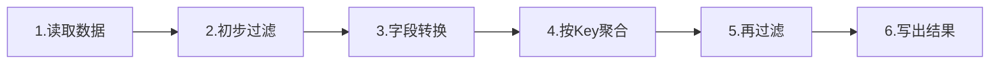
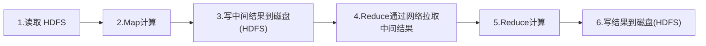
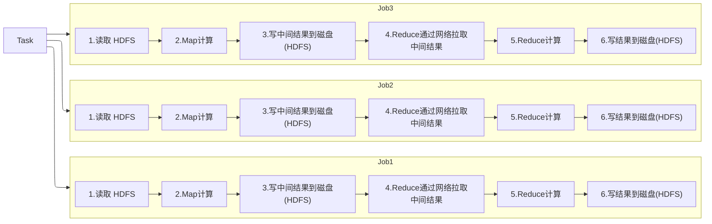
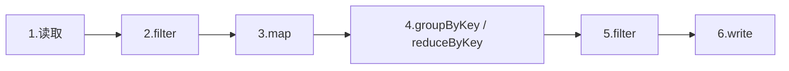
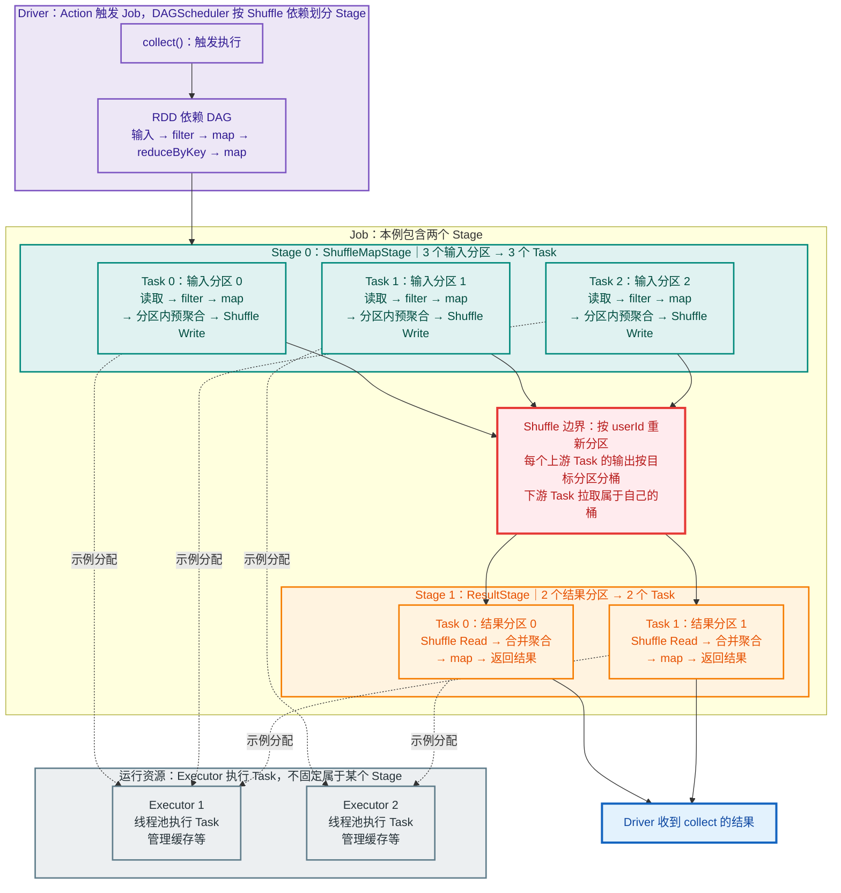

事先声明：内容大部分整理自书籍《Spark快速大数据分析 (图灵程序设计丛书) 》，部分总结和人话是原创，顺便提一嘴书，写的超级好理解，推荐大家读原文展开自己的思考！


**定义**

Spark 是一个用来实现快速而通用的集群计算的平台。可以说它是一个大一统的软件栈，为各种不同应用场景专门设计了多个紧密集成的高级组件，如下：


在速度方面，Spark 扩展了广泛使用的 MapReduce 计算模型，而且高效地支持更多计算模式，包括批处理、迭代算法、交互式查询、流处理。

## 1.1 Spark Core

**park Core** 实现了 Spark 的基本功能，包含**任务调度、内存管理、错误恢复、与存储系统交互**等模块。

Spark Core 中还包含了对弹性分布式数据集（resilient distributed dataset，简称 RDD）的 API 定义

- RDD 表示分布在多个计算节点上可以并行操作的元素集合，是 Spark 主要的编程抽象。

- Spark Core 提供了创建和操作这些集合的多个 API。

## 1.2 Spark SQL

**Spark SQL** 是 Spark 用来**操作结构化数据**的程序包。

- 通过 Spark SQL，我们可以使用 SQL 或者 Hive SQL（HQL）来查询数据。Spark SQL 支持多种数据源，比如 Hive 表、Parquet 以及 JSON 等。

- 除了为Spark 提供了一个 SQL 接口，Spark SQL 还支持开发者将 SQL 和传统的RDD 编程的数据操作方式相结合，不论是使用 Python、Java 还是 Scala，开发者都可以在单个的应用中同时使用 SQL 和复杂的数据分析。

> 通过与Spark 所提供的丰富的计算环境进行如此紧密的结合，Spark SQL 得以从其他开源数据仓库工具中脱颖而出。
> 
> Spark SQL 是在 Spark 1.0 中被引入的。
> 
> 在 Spark SQL 之前，加州大学伯克利分校曾经尝试修改 Apache Hive 以使其运行在 Spark 上，当时的项目叫作 Shark。现在，由于 Spark SQL 与 Spark 引擎和 API 的结合更紧密，Shark 已经被 Spark SQL 所取代

## 1.3 Spark Streaming

**Spark Streaming** 是 Spark 提供的对**实时数据进行流式计算**的组件。

- 比如生产环境中的网页服务器日志，或是网络服务中用户提交的状态更新组成的消息队列，都是数据流。

- Spark Streaming 提供了用来操作数据流的 API，并且与 Spark Core 中的 RDD API 高度对应。这样一来，程序员编写应用时的学习门槛就得以降低，不论是操作内存或硬盘中的数据，还是操作实时数据流，程序员都更能应对自如。

从底层设计来看，Spark Streaming 支持与Spark Core 同级别的容错性、吞吐量以及可伸缩性。

## 1.4 MLlib

Spark 中还包含一个提供常见的机器学习（ML）功能的程序库，叫作MLlib。

- **MLlib** 提供了很多种**机器学习算法**，包括分类、回归、聚类、协同过滤等，还提供了模型评估、数据导入等额外的支持功能。

- MLlib 还提供了一些更底层的机器学习原语，包括一个通用的梯度下降优化算法。所有这些方法都被设计为可以在集群上轻松伸缩的架构。

## 1.5 GraphX

GraphX 是用来操作图（比如社交网络的朋友关系图）的程序库，可以进行并行的图计算。

- 与 Spark Streaming 和 Spark SQL 类似，GraphX 也扩展了Spark 的 RDD API，能用来创建一个顶点和边都包含任意属性的有向图。

- GraphX 还支持针对图的各种操作（比如进行图分割的 subgraph 和操作所有顶点的 mapVertices），以及一些常用图算法（比如 PageRank 和三角计数）。

## 1.6 集群管理器

就底层而言，Spark 设计为可以高效地在一个计算节点到数千个计算节点之间伸缩计算。

为了实现这样的要求，同时获得最大灵活性，Spark 支持在各种集群管理器（cluster manager）上运行，包括 Hadoop YARN、Apache Mesos，以及 Spark 自带的一个简易调度器，叫作独立调度器。

- 如果要在没有预装任何集群管理器的机器上安装 Spark，那么 Spark 自带的独立调度器可以让你轻松入门；

- 而如果已经有了一个装有 Hadoop YARN 或 Mesos 的集群，通过 Spark 对这些集群管理器的支持，你的应用也同样能运行在这些集群上。

# 2、Spark 的用途

我概括一下，可以分成两类：

- 预处理机器学习/深度学习的数据集，执行计算任务 ——> AI 研发岗算法工程师

- 优化后端代码以及数据库的大量数据的计算 ——> 大数据开发工程师/数据仓库工程师

## 2.1 数据科学任务

数据科学是过去几年里出现的新学科，关注的是数据分析领域。

数据科学家（data scientist）就是主要负责分析数据并建模的人，他们具备 SQL、统计、预测建模（机器学习）等方面的经验，以及一定的使用 Python、Matlab 或 R 语言进行编程的能力。例如，在数据科学家完成初始的调研之后，我们可能最终会得到一个生产环境中的推荐系统，可以整合在网页应用中，为用户提供产品推荐。

数据科学家在使用 Python 或 Pandas 等传统数据分析工具时所能处理的数据集/训练模型始终受限于单机（GPU只存在一台电脑上），而有了 Spark，再加上购买的云计算资源就能处理更大数据规模的问题。

```plain text
上面是搬运了英文书籍的原文，按我们中国话来说这个岗位对应的人，在大学读计算机视觉/自然语言的研究生毕业找到的AI研发岗工作啦
```

## 2.2 数据处理应用

开发者一般有基本的软件工程概念，比如封装、接口设计以及面向对象的编程思想，他们通常有计算机专业的背景，并且能使用工程技术来设计和搭建软件系统，以实现业务用例。

Spark 已经为工程师提供了足够的接口来快速实现常见的任务，以及对应用进行监视、审查和性能调优。其 API 模块化的特性（基于传递分布式的对象集）使得利用程序库进行开发以及本地测试大大简化。

```plain
上面是搬运了英文书籍的原文，简单来说就是数据量太大啦，即使充分利用 关系型数据库全部性能 + 代码的多线程计算 还是很慢的任务（因为就算是把代码部署到网页服务器上，实际可利用的也是单机的CPU计算资源），此时就要考虑将传统数据库升级为数据仓库，同时将数据的处理逻辑从代码迁移到数仓任务中，利用分布式计算框架即Spark（通常可以利用>=3台计算机资源）来加速计算过程
```

# 3、Spark简史

Spark 是于 2009 年作为一个研究项目在加州大学伯克利分校 RAD 实验室（AMPLab 的前身）诞生。

实验室中的一些研究人员曾经用过 Hadoop MapReduce。他们发现MapReduce 在迭代计算和交互计算的任务上表现得效率低下。因此，Spark从一开始就是为交互式查询和迭代算法设计的，同时还支持内存式存储和高效的容错机制。

2011 年，AMPLab 开始基于 Spark 开发更高层的组件，比如 Shark（Spark上的 Hive）1 和 Spark Streaming。（Shark 已经被 Spark SQL 所取代）

Spark 最早在 2010 年 3 月开源，并且在 2013 年 6 月交给了 Apache 基金会，现在已经成了 Apache 开源基金会的顶级项目。

| 阶段       | 年份        | 版本      | 一句话                               | 解决了什么            |
| -------- | --------- | ------- | --------------------------------- | ---------------- |
| ① 起步     | 2009–2012 | 闭源      | 用**内存 + DAG**​ 替代 MapReduce 的反复落盘 | 迭代计算（如机器学习）太慢    |
| ② 统一     | 2014      | 1.0     | 一套引擎跑批、流、SQL、ML、图                 | 以前要学好几个框架        |
| ③ 声明式    | 2015–2016 | 1.x→2.0 | RDD → DataFrame/SQL，优化器接管         | 用户手写代码，引擎没法优化    |
| ④ 榨干 CPU | 2015–2018 | 2.x     | Tungsten + 代码生成                   | JVM 对象、GC 成了新瓶颈  |
| ⑤ 自适应    | 2020      | 3.0     | AQE、动态分区裁剪                        | 静态计划猜不准真实数据      |
| ⑥ 服务化    | 2023–2025 | 3.4→4.0 | Spark Connect、云原生、ANSI SQL        | 从"本地库"变成"远程数据服务" |

4、Spark

分布式计算有个绕不开的现实问题：**一个算子算完的结果，下游算子怎么拿到？**

两个算子可能跑在不同的机器上，上游某个 task 的输出，下游某个 task 要作为输入来读。解决办法是找个地方"寄存"一下，再网络传输。看一下在Hadoop MapReduce和Spark中都是怎么实现的

# 4、Spark的出现契机

> 实验室中的一些研究人员曾经用过 Hadoop MapReduce。他们发现MapReduce 在迭代计算和交互计算的任务上表现得效率低下。因此，Spark从一开始就是为交互式查询和迭代算法设计的，同时还支持内存式存储和高效的容错机制。

这里我想展开说一下，众所周知新技术的出现一般是因为现有的技术无法解决或纯因为人懒，Spark的出现正是如此，因为随着时代发展数据量的增大，MapReduce处理数据的效率变低，达到人们的忍耐上限啦，所以必须重新设计一个计算模型来解决喽！

先用一个简单的例子看看一样的数据处理逻辑交给MapReduce和Spark会发生什么？

已知一段数据的处理执行逻辑如下



## 4.1、Hadoop MapReduce

Hadoop MapReduce采用的就是最朴素的做法：**每一步的上游算完，都把结果写进 HDFS，下游再从 HDFS 读出来**，同时执行模型相对固定，阶段之间必须将中间结果落盘



复杂逻辑通常要拆成多个 MapReduce Job（每个 Job 之间通常以文件系统作为边界）



落盘(存入HDFS)看着无害，其实开销巨大：

- **磁盘 I/O**：数据从内存刷到磁盘
- **序列化**：对象要变成字节流才能写
- **HDFS 多副本**：写一份数据默认要复制 3 份到不同机器

一次落盘就是一次"内存 → 磁盘 → 网络 → 磁盘 → 内存"的往返。如果你的 pipeline 有 10 个算子，每一步都落盘，那就是 10 次这样的往返。**这是 MapReduce 慢的根本原因之一**。

## 4.2、Spark

Spark 通过**窄依赖整合** Pipeline，再按 Shuffle 边界**切分**为 Stage，最终**组合**成全局 DAG。
——Spark 的优化逻辑分三层递进：**先整合，再切分，最后编排**。

### 窄依赖：Pipeline 得以成立的前提

Spark 为什么能"不落盘"？——关键在**窄依赖（Narrow Dependency）**。

依赖说的是：**下游的每一个分区，只由上游的少数几个分区计算而来**。

- **窄依赖**（如 `map`、`filter`、`select`）：下游一个分区只依赖上游**一个**分区。既然数据没重分布，上下游算子可以安排给**同一台机器、同一个 task 串行执行**——中间结果不用存，直接拿对象在内存里传下去，这就是**流水线（pipeline）**

```
map → filter → map  全在一个 task 里一气呵成，中间不落盘
```

- **宽依赖**（如 `groupByKey`、`join`）：下游一个分区依赖上游**很多**分区，必须**Shuffle**——数据要按 key 重新分发到不同机器。这一步不可避免要落盘 + 网络传输。

所以准确说法是：

> **窄依赖之间不落盘，可以流水线；遇到宽依赖（Shuffle）才必须落盘。**

### 三个粒度：Pipeline / Stage / DAG

这三者的关系，是**执行方式 → 逻辑边界 → 全局编排**的递进：

| 概念            | 粒度           | 具体描述                                        |
| ------------- | ------------ | ------------------------------------------- |
| **Pipeline**​ | Task 内部/局部视角 | 同一个 Stage 内部，窄依赖的算子被串成一条链，一个 Task 一口气跑完     |
| **Stage**​    | 逻辑边界/切分结果    | 遇到宽依赖（Shuffle 边界）就切一刀，刀前刀后各成一个 Stage        |
| **DAG**​      | 全局视角         | 整个作业的所有算子、所有 Stage 连成一张有向无环图，描述"谁依赖谁、整体怎么走" |

具体步骤：

1、Spark 记录用户写下的一系列转换关系，形成逻辑上的 DAG：



这张图里的 6 个方块，其实是 6 个 RDD 对象 + 它们之间的关系（依赖关系），串成图就是DAG。 filter、map、groupByKey 这些都是 transformation（变换），它们的执行结果是一个新的 RDD 引用。

```plain text
rdd0 = sc.textFile("...")          // RDD 0：读取
rdd1 = rdd0.filter(...)            // RDD 1：filter 变换
rdd2 = rdd1.map(...)               // RDD 2：map 变换
rdd3 = rdd2.groupByKey(...)        // RDD 3：shuffle 变换
rdd4 = rdd3.filter(...)            // RDD 4：filter 变换
```

2、Spark 按**宽依赖（Shuffle 边界）**切分得到 stages

Driver 上的 DAGScheduler 沿 RDD 依赖分析计算：

```textile
[ Stage 0: map → filter → map ]   ← 全是窄依赖，这一条就是一个pipeline
            ↓ Shuffle（落盘 + 网络）
[ Stage 1: groupByKey → map ]
```

3、切分之后，执行引擎再对每个 Stage 做两件事：

- **Pipeline 化**：把 Stage 内的窄依赖算子合成一条管道，消除中间物化；

- **Task 化**：把这条管道切成 N 个并行 Task，分发到集群中的 Executor 上运行。

```textile
SQL / DataFrame
      │
      ▼
Catalyst 逻辑计划 ──(优化)──▶ 物理计划
      │
      ▼
按 Shuffle 边界切分为 Stage
      │
      ▼
每个 Stage 内部 Pipeline 化（窄依赖算子合成一条管道）
      │
      ▼
每条 Pipeline 切成 N 个 Task，分发到集群
      │
      ▼
同一台机器上的多个 Task 共享 Executor 的 JVM / 内存池
```

Stage 0 的 Task 执行上游 Pipeline

3 个输入分区，对应 3 个 Task。

例如 Task 0 在 Executor 1 上处理输入分区 0：

1. 读取一条订单。
2. `filter` 判断是否有效。
3. 有效订单通过 `map` 转成 `(userId, amount)`。
4. 在本分区内合并相同用户的金额。
5. 按目标分区写出 Shuffle 数据。

**不是先执行完所有分区的 `filter`，再启动另一批 Task 执行 `map`。**

这些操作在同一个 Task 内衔接执行。对于 `filter`、`map` 这类操作，通常通过迭代器逐条传递；预聚合等操作则可能维护状态、缓冲数据，必要时溢写磁盘。

### 第四步：Shuffle 把相同 Key 汇集到一起

假设三个输入分区中都有用户 `"A"` 的订单：

- 输入分区 0：`("A", 10)`、`("A", 20)`
- 输入分区 1：`("A", 5)`
- 输入分区 2：`("A", 15)`

上游预聚合后，分别得到 `"A"` 的金额 `30`、`5`、`15`。

Partitioner 保证这些 `"A"` 的输出属于**同一个目标分区**。负责这个目标分区的下游 Task 会读取三个上游 Task 的相关输出。

Shuffle 不是一个集中处理数据的单独进程，而是**上游写出、下游拉取的分布式数据交换过程**。

### 第五步：Stage 1 的 Task 执行下游 Pipeline

本例设置了 2 个结果分区，因此 Stage 1 有 2 个 Task。

负责 `"A"` 所在分区的 Task：

1. 读取对应的 Shuffle 数据。
2. 合并金额，得到 `("A", 50)`。
3. 执行后面的 `map`，生成 `"A,50"`。
4. 将结果返回 Driver。

在这个简单 Job 中，上游 Shuffle 输出准备好后，下游 Stage 才能执行。

### 第六步：Executor 提供资源，不决定计算边界

Executor 可以：

- 同时执行多个 Task，具体取决于可用核数及 Task 资源需求。
- 先执行 Stage 0 的 Task，再执行 Stage 1 的 Task。
- 执行不同 Stage、不同 Job 的任务。

所以，**Stage 是计算的划分，Executor 是运行计算的资源，两者不是一一对应关系**


总结： Spark 的优势通常来自多方面+

1. **DAG 执行模型**，不局限于固定的 Map → Reduce 两阶段。
2. **窄依赖可以流水线执行**，不必在每个算子之间落盘。
3. **数据可以 Cache/Persist**，适合多次复用。
4. **Lazy Evaluation**，可以先记录转换关系，遇到 Action 再执行。
5. DataFrame/SQL 还能通过优化器优化执行计划。




