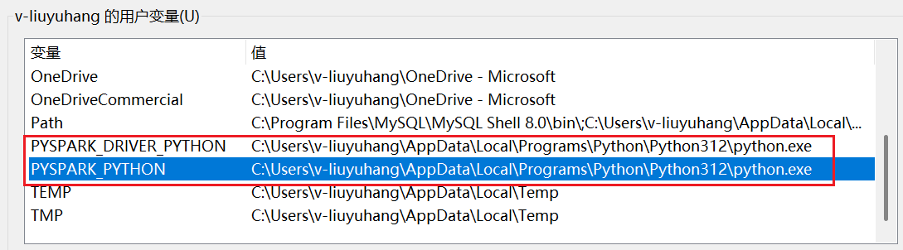
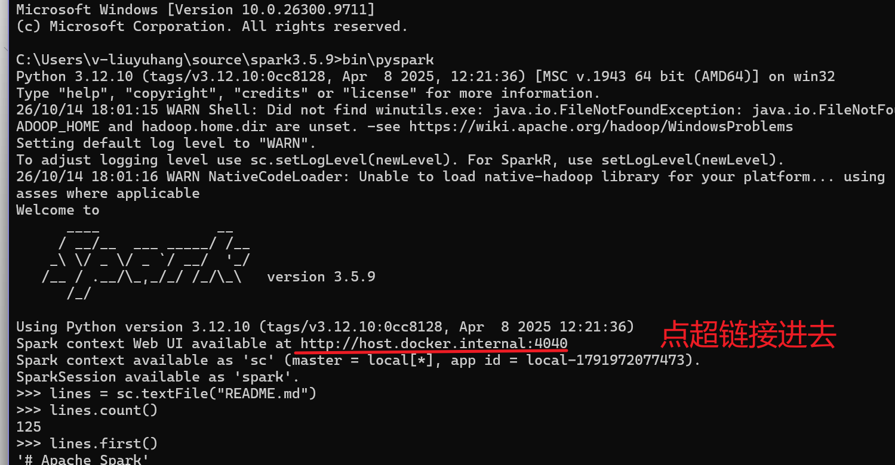
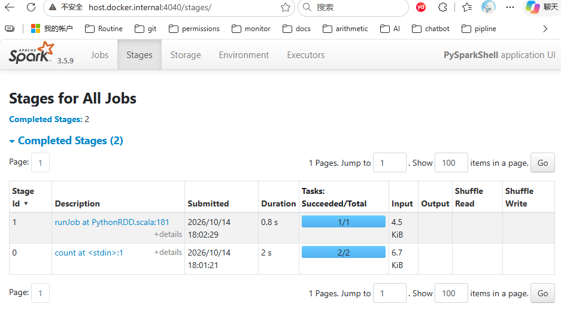
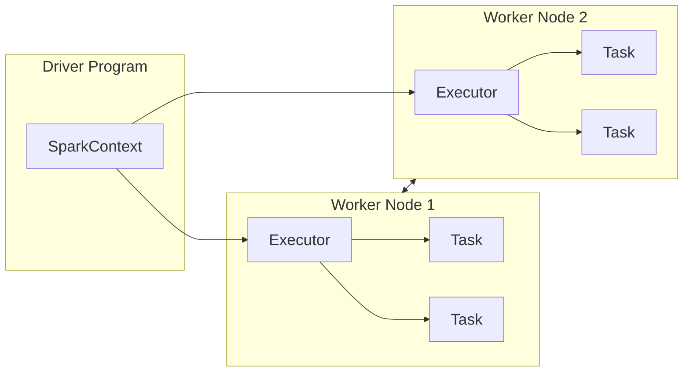

过程参考：Spark官网的[Quick Start - Spark 4.2.0 Documentation](https://spark.apache.org/docs/latest/quick-start.html)

# 1、下载

选择所需要的包类型 http://spark.apache.org/ ，得到spark-3.5.9-bin-hadoop3.tgz包并解压


运行前还需确保

1、已安装并配置 Python

如果没有安装 Python，需要先安装 **Python 3.8～3.11**并添加到环境变量中

```shell
python --version
```

输出

```shell
C:\Users\v-liuyuhang\source\spark3.5.9>python --version
Python 3.12.10
```

用户变量中新增环境变量设置

- **Driver 使用 Python 3.12**：`PYSPARK_DRIVER_PYTHON`
- **Worker 使用 Python 3.12**：`PYSPARK_PYTHON`



图中两个变量均指向 Python 3.12 的解释器路径，仅记录本次配置；版本选择仍需以所用 Spark 版本的兼容要求为准。

在系统环境变量中新增Spark安装路径 `C:\Users\v-liuyuhang\source\spark3.5.9\bin`

2、已安装 Java并设置 `JAVA_HOME`

**64 位 JDK 8**，可以运行 **Apache Spark 3.5.9**，满足最低要求

```shell
java -version
```

输出

```shell
C:\Users\v-liuyuhang\source\spark3.5.9>java -version
java version "1.8.0_503"
Java(TM) SE Runtime Environment (build 1.8.0_503-b01)
Java HotSpot(TM) 64-Bit Server VM (build 25.503-b01, mixed mode)
```

检查 JAVA_HOME（如果你使用了 JRE 而不是 JDK，Spark 运行时可能出问题，最好确认目录中存在`%JAVA_HOME%\bin\java.exe`和`%JAVA_HOME%\bin\javac.exe`）

```shell
set JAVA_HOME
```

输出

```shell
C:\Users\v-liuyuhang>set JAVA_HOME
JAVA_HOME=C:\Program Files\Java\jdk1.8.0_503\
```

# 2、Spark中的Python shell

## 2.1 启动shell

进入一开始解压的目录 `C:\Users\v-liuyuhang\source\spark3.5.9\` 打开cmd，执行

```shell
bin\pyspark
```

可以看到

```shell
C:\Users\v-liuyuhang\source\spark3.5.9>bin\pyspark
Python 3.12.10 (tags/v3.12.10:0cc8128, Apr  8 2025, 12:21:36) [MSC v.1943 64 bit (AMD64)] on win32
Type "help", "copyright", "credits" or "license" for more information.
26/10/14 17:25:56 WARN Shell: Did not find winutils.exe: java.io.FileNotFoundException: java.io.FileNotFoundException: HADOOP_HOME and hadoop.home.dir are unset. -see https://wiki.apache.org/hadoop/WindowsProblems
Setting default log level to "WARN".
To adjust logging level use sc.setLogLevel(newLevel). For SparkR, use setLogLevel(newLevel).
26/10/14 17:25:56 WARN NativeCodeLoader: Unable to load native-hadoop library for your platform... using builtin-java classes where applicable
Welcome to
      ____              __
     / __/__  ___ _____/ /__
    _\ \/ _ \/ _ `/ __/  '_/
   /__ / .__/\_,_/_/ /_/\_\   version 3.5.9
      /_/

Using Python version 3.12.10 (tags/v3.12.10:0cc8128, Apr  8 2025 12:21:36)
Spark context Web UI available at http://host.docker.internal:4040
Spark context available as 'sc' (master = local[*], app id = local-1791969960653).
SparkSession available as 'spark'.
>>>
```

在 Spark 中，我们通过对分布式数据集的操作来表达我们的计算意图，这些计算会自动地在集群上并行进行。这样的数据集被称为弹性分布式数据集（resilient distributed dataset），简称 RDD。RDD 是 Spark 对分布式数据和计算的基本抽象。

## 2.2 使用python shell 即时统计

先来使用 shell 从本地文本文件创建一个RDD 来作一些简单的即时统计。

```pyspark
>>> lines = sc.textFile("README.md") # 创建一个名为lines的RDD,读取README.md文档
>>> lines.count() # 统计RDD中的元素个数
125
>>> lines.first() # 输出这个RDD中的第一个元素，也就是README.md的第一行
'# Apache Spark' 
>>>
```

要退出任一 shell，按 Ctrl-D

## 2.3 spark UI

日志的输出中可以由这个地址访问 Spark 用户界面，查看关于任务和集群的各种信息。



点击日志中的 Web UI 地址，再进入 **Stages** 页面，可以查看已执行的 Stage。



图中展示了前面 `count()` 和 `first()` 两次操作产生的 Stage；仅凭 Stage 列表不能判断是否发生了宽依赖切分，具体依赖关系需要查看对应 Job 的 DAG。

# 3、Spark核心概念简介

从上层来看，每个 Spark 应用都由一个驱动器程序（driver program）来发起集群上的各种并行操作。驱动器程序包含应用的 main 函数，并且定义了集群上的分布式数据集，还对这些分布式数据集应用了相关操作。在前面的例子里，实际的驱动器程序就是 Spark shell 本身。

驱动器程序通过一个 SparkContext 对象来访问 Spark。这个对象代表对计算集群的一个连接。shell 启动时已经自动创建了一个 SparkContext 对象，是一个叫作 sc （SparkContext的缩写）的变量。我们可以通过例 2-3 中的方法尝试输出 sc 来查看它的类型。

```shell
>>> sc
<SparkContext master=local[*] appName=PySparkShell>
```

Spark 会自动将函数（比如`line.contains("Python")`）发到各个执行器节点（executor）上。这样就可以在单一的驱动器程序中编程，并且让代码自动运行在多个节点上。



# 4、独立应用

除了上面shell那样的交互式运行之外，Spark 也可以在 Java、Scala 或 Python 的独立程序中被连接使用。

| 对比项  | Spark shell                                                 | 独立 Spark 程序              |
| ---- | ----------------------------------------------------------- | ------------------------ |
| 使用方式 | 在交互式窗口中逐条输入代码                                               | 编写完整程序，再启动运行             |
| 常见形式 | `spark-shell`、`pyspark`                                     | Scala / Java / Python 应用 |
| 初始化  | shell 通常预先创建好 <br/>`sc`（SparkContext）、`spark`（SparkSession） | 程序负责创建或获取上下文、会话          |
| 常见用途 | 探索数据、验证逻辑、调试                                                | 批处理任务、生产数据管道             |

**shell和独立程序的主要区别在于你需要自行初始化SparkContext，它们不是两套执行引擎，而是同一套 Spark 执行能力的两种使用方式。**

例如，同样执行 `filter → groupBy → count`，无论代码来自 shell 还是独立程序，后续都要经过执行计划、Stage 划分、Task 调度和 Executor 执行。

## 4.1 Spark和Hive

Spark shell和独立 Spark 程序这种划分方式，很容易联想到Hive的Hive CLI和程序化客户端，也是交互式运行和程序化运行，这里简单区分一下

| 划分维度     | Spark 示例                       | Hive 示例                      |
| -------- | ------------------------------ | ---------------------------- |
| 交互式使用    | Spark shell、PySpark shell      | Hive CLI、Beeline             |
| 程序化使用    | Scala / Java / Python Spark 应用 | Java JDBC 程序等                |
| 客户端连接服务端 | Spark Connect 等另行讨论            | Beeline / JDBC → HiveServer2 |

但针对程序化使用来说，**不能简单理解成**：~~Spark 独立程序和 Hive JDBC 程序一样，都是连接远端查询服务器、发送查询~~。二者的区别在于是否包含了负责组织计算的 Driver。

- Hive JDBC 程序通常是“查询请求的发起者”，不包含计算
  
  ```plain text
  1. 建立与 HiveServer2 的连接。
  2. 将 SQL 文本提交给 HiveServer2（HiveServer2 及其执行链路负责“理解查询并组织计算）
  3. 等待执行引擎的查询执行。
  4. 读取返回的结果。
  ```
  
  > Java 程序本身不负责把 SQL 编译成分布式执行计划，也不负责把计算拆成任务并调度到集群。
  > 
  > 具体计算可能交给 Tez、MapReduce 等执行引擎，取决于 Hive 的版本和配置。
  > 
  > MRAppMaster 向 YARN 申请 Container，在获得的 Container 中启动 Map/Reduce Task 的执行进程。详情参考[【十一】HiveSQL底层执行过程：SQL 编译、任务生成与 YARN 调度流程](https://eleanora-lyh.github.io/MyLearningNotes/posts/hive/11hivesql%E5%BA%95%E5%B1%82%E6%89%A7%E8%A1%8C%E8%BF%87%E7%A8%8B/)

- 传统 Spark 独立应用则包含“计算执行的组织者”，也就是 Driver

## 4.2 统计单词数

现在写 Spark 业务， Scala、PySpark、SQL 三者更常见。大致这样理解：

| 场景                                                    | 常见选择        |
| ----------------------------------------------------- | ----------- |
| 学习 Spark 原理<br/>（Spark 底层框架、性能敏感组件、强类型 Dataset、函数式转换） | 优先 Scala    |
| Spark SQL、日常ETL、数据分析                                  | SQL、PySpark |
| 公司已有 Java 服务体系                                        | Java        |
| 快速开发、算法与数据科学、Notebook 交互分析                            | PySpark     |

> Scala/Java 两者调用的最终都是 Spark 的执行引擎，
> 
> - Scala 的 lambda、集合操作、模式匹配与 Spark API 更自然
> 
> - Java 更容易和传统 Java 工程、Spring 生态及现有公共库集成


### 前置检查

检查 Java，确保 JAVA_HOME 正确指向 JDK。

```shell
C:\Users\v-liuyuhang>java -version
java version "1.8.0_503"
Java(TM) SE Runtime Environment (build 1.8.0_503-b01)
Java HotSpot(TM) 64-Bit Server VM (build 25.503-b01, mixed mode)

C:\Users\v-liuyuhang>javac -version
javac 1.8.0_503

C:\Users\v-liuyuhang>echo %JAVA_HOME%
C:\Program Files\Java\jdk1.8.0_503\
```

---

检查 Spark 和 Scala 版本

```shell
C:\Users\v-liuyuhang>spark-submit --version
Welcome to
      ____              __
     / __/__  ___ _____/ /__
    _\ \/ _ \/ _ `/ __/  '_/
   /___/ .__/\_,_/_/ /_/\_\   version 3.5.9
      /_/

Using Scala version 2.12.18, Java HotSpot(TM) 64-Bit Server VM, 1.8.0_503
Branch HEAD
Compiled by user holden on 2026-07-12T18:40:50Z
Revision 7c14a3c28b141cc97a330c4d0f5d2a6da7267f85
Url https://github.com/apache/spark
Type --help for more information.
```

在这一堆里输出里可以找到：Spark version 3.5.9、Scala version 2.12.18、Java version 1.8.0_503

---

检查 sbt，没有安装的话，以管理员身份打开cmd执行 `choco install sbt`

```shell
C:\Users\v-liuyuhang>sbt --version
sbt version in this project: 1.9.9
sbt script version: 1.9.9
```

`sbt` 是 Scala 项目常用的构建工具，作用类似：

- Java 的 Maven 或 Gradle
- .NET 的 dotnet CLI
- Python 的部分依赖管理和打包工具

### 创建项目目录

如果是windows系统则中执行

```shell
mkdir spark-line-count\project
mkdir spark-line-count\data
mkdir spark-line-count\src\main\scala\com\example

type nul > spark-line-count\build.sbt
type nul > spark-line-count\project\build.properties
type nul > spark-line-count\data\input.txt
type nul > spark-line-count\src\main\scala\com\example\LineCountApp.scala
```

如果是linux系统则执行

```shell
mkdir -p spark-line-count/project
mkdir -p spark-line-count/data
mkdir -p spark-line-count/src/main/scala/com/example

cd spark-line-count
```

完成后在 `spark-line-count\data\input.txt` 加几行文字作为测试的输入

### build.sbt

`build.sbt` 就是 Spark 项目的「配置文件 + 依赖清单」。编译、打包时 sbt 启动会读取它，生成一个**键值对 Map**​ 来描述整个项目。决定：

| 配置项                   | 作用                     |
| --------------------- | ---------------------- |
| `name`                | 项目名称                   |
| `version`             | 项目版本号                  |
| `scalaVersion`        | 使用哪个 Scala 版本          |
| `libraryDependencies` | 项目依赖哪些 jar（Spark、测试库等） |
| `assembly` 相关         | 控制打包行为（合并 / 排除冲突）      |

类比理解：

- Java 的 `pom.xml`
- Python 的 `requirements.txt + setup.py`

针对我当前的版本

```plain text
Spark        3.5.9
Scala        2.12.18
Java         1.8.0_503
sbt launcher 1.9.9
```

填入`build.sbt`得到

```scala
ThisBuild / organization := "com.example"
ThisBuild / scalaVersion := "2.12.18"
ThisBuild / version      := "1.0.0"

lazy val root = (project in file("."))
  .settings(
    name := "spark-line-count",

    // ========== 依赖 ==========
    libraryDependencies ++= Seq(
      "org.apache.spark" %% "spark-core" % "3.5.9" % "provided",
      "org.apache.spark" %% "spark-sql"  % "3.5.9" % "provided"
    ),
  )
```

`% "provided"` （适合最后使用`spark-submit`运行程序）表示：

- 编译项目时需要 Spark 依赖
- 打包 JAR 时不把完整 Spark 包塞进应用 JAR
- 运行时由本机 Spark 或集群提供 Spark 依赖


创建目录的时候已经创建了**sbt 版本配置文件** `spark-line-count\project\build.properties`，现在将其版本填入

```plain text
sbt.version=1.9.9
```

### 编写 Scala Spark 程序

```scala
package com.example

import org.apache.spark.sql.SparkSession

object LineCountApp {

  def main(args: Array[String]): Unit = {

    // 如果调用程序时传入了文件路径，就使用第一个参数；
    // 否则默认读取项目下的 data/input.txt。
    val inputPath =
      if (args.nonEmpty) args(0)
      else "data/input.txt"

    // 创建 SparkSession 对象
    val spark = SparkSession
      .builder()
      .appName("Scala Spark Line Count") //设置 Spark 应用名称
      .master("local[*]")// 设置本地运行模式为local，使用所有可用的 CPU 核心
      .getOrCreate()

    try {
      // 读取输入文件的所有行，返回Dataset[String]
      val lines = spark.read.textFile(inputPath)
      // 触发 Spark Job：计算输入文件的总行数
      val totalLineCount = lines.count()

      // 触发 Spark Job：计算非空行的总行数
      val nonEmptyLineCount = lines
        .filter(line => line.trim.nonEmpty)// 去掉行首和行尾空白。
        .count()

      println(s"Input file: $inputPath")
      println(s"Total line count: $totalLineCount")
      println(s"Non-empty line count: $nonEmptyLineCount")
    } finally {
      spark.stop()
    }
  }
}
```

### sbt 编译+打包

**先清理旧产物，再重新把 Scala 源代码编译成 JVM 可以执行的字节码(JAR)，但不会运行程序。**

```shell
sbt clean package
```

编译时会发生什么？

1. **读取构建配置**  
   sbt 根据 `build.properties` 选择 sbt 版本，再读取 `build.sbt` 中的 Scala 版本、依赖等配置。

2. **准备编译器和依赖**  
   首次编译时，可能需要下载 Scala 编译器和声明的依赖；已缓存的通常会复用。

3. **检查并编译源码**  
   例如检查 `LineCountApp.scala` 中的语法、类型，以及引用的类是否存在。

4. **生成 `.class` 文件**  
   编译成功后，通常输出到：`target\scala-<Scala二进制版本>\classes\`

编译成功会输出Compilation completed如下

```plain text
[info]   Compilation completed in 21.912s.
[success] Total time: 87 s (01:27), completed 2026-10-16 16:44:51
```

同时会生成文件

```plain text
target\scala-2.12\spark-line-count_2.12-1.0.0.jar
```

后缀的`2.12-1.0.0.jar` 分别表示scala-2.12、Scala 二进制版本1.0.0（来自`ThisBuild / version := "1.0.0"`）

### spark-submit 运行

**启动已经打包好的 Spark 应用**（通常流程如下，所以必须先编译）

```plain text
Scala 源码 → sbt 打包成 JAR → spark-submit 启动 → Spark 读取数据、执行计算
```

运行

```shell
spark-submit `
  --class com.example.LineCountApp `
  --master "local[*]" `
  target\scala-2.12\spark-line-count_2.12-1.0.0.jar `
  data\input.txt
```

参数含义：

| 参数                                 | 作用                           |
| ---------------------------------- | ---------------------------- |
| `--class com.example.LineCountApp` | 指定包含 `main` 方法的入口            |
| `--master "local[*]"`              | 在本机运行，使用所有可用 CPU 核心          |
| JAR 路径                             | 要运行的应用包                      |
| JAR 后面的参数                          | 传给应用的 `main(args)`，这里是输入文件路径 |

**Spark 的选项放在 JAR 前面，应用自己的参数放在 JAR 后面。**

执行成功的话会看到

```plain text
Input file: data/input.txt
Total line count: 6
Non-empty line count: 5
```

### 总结

```plain text
sbt package
    ↓
生成应用 JAR
    ↓
spark-submit 启动 Driver
    ↓
Driver 执行 main()
    ↓
创建 SparkSession / SparkContext
    ↓
textFile() 构建读取计划
    ↓
count() 触发 Spark Job
    ↓
Task 读取文件分区并计数
    ↓
Driver 汇总并输出行数
    ↓
spark.stop() 释放资源，程序退出
```
