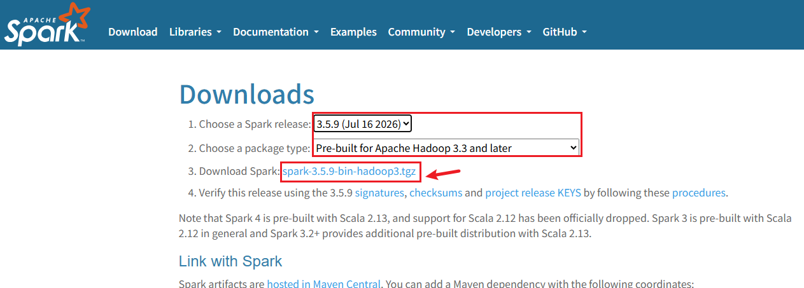
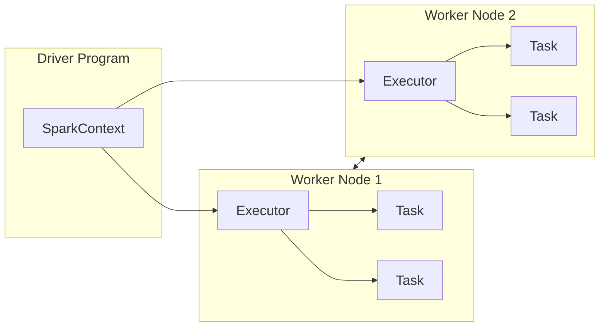

过程参考：Spark官网的[Quick Start - Spark 4.2.0 Documentation](https://spark.apache.org/docs/latest/quick-start.html)

# 1、下载

选择所需要的包类型 http://spark.apache.org/ ，得到spark-3.5.9-bin-hadoop3.tgz包并解压



运行前还需确保

1、已安装并配置 Python

如果没有安装 Python，需要先安装 **Python 3.8～3.11**并添加到环境变量中

```shell
python --version
```

输出

```shell
C:\Users\v-liuyuhang\source\spark3.5.9>python --version
Python 3.12.10
```

用户变量中新增环境变量设置

- **Driver 使用 Python 3.12**
- **Worker 找到 Python 3.13**


2、已安装 Java并设置 JAVA_HOME

**64 位 JDK 8**，可以运行 **Apache Spark 3.5.9**，满足最低要求

```shell
java -version
```

输出

```shell
C:\Users\v-liuyuhang\source\spark3.5.9>java -version
java version "1.8.0_503"
Java(TM) SE Runtime Environment (build 1.8.0_503-b01)
Java HotSpot(TM) 64-Bit Server VM (build 25.503-b01, mixed mode)
```

检查 JAVA_HOME（如果你使用了 JRE 而不是 JDK，Spark 运行时可能出问题，最好确认目录中存在`%JAVA_HOME%\bin\java.exe`和`%JAVA_HOME%\bin\javac.exe`）

```shell
set JAVA_HOME
```

输出

```shell
C:\Users\v-liuyuhang>set JAVA_HOME
JAVA_HOME=C:\Program Files\Java\jdk1.8.0_503\
```

# 2、Spark中的Python shell

## 2.1 启动shell

进入一开始解压的目录 `C:\Users\v-liuyuhang\source\spark3.5.9\` 打开cmd，执行

```shell
bin\pyspark
```

可以看到

```shell
C:\Users\v-liuyuhang\source\spark3.5.9>bin\pyspark
Python 3.12.10 (tags/v3.12.10:0cc8128, Apr  8 2025, 12:21:36) [MSC v.1943 64 bit (AMD64)] on win32
Type "help", "copyright", "credits" or "license" for more information.
26/10/14 17:25:56 WARN Shell: Did not find winutils.exe: java.io.FileNotFoundException: java.io.FileNotFoundException: HADOOP_HOME and hadoop.home.dir are unset. -see https://wiki.apache.org/hadoop/WindowsProblems
Setting default log level to "WARN".
To adjust logging level use sc.setLogLevel(newLevel). For SparkR, use setLogLevel(newLevel).
26/10/14 17:25:56 WARN NativeCodeLoader: Unable to load native-hadoop library for your platform... using builtin-java classes where applicable
Welcome to
      ____              __
     / __/__  ___ _____/ /__
    _\ \/ _ \/ _ `/ __/  '_/
   /__ / .__/\_,_/_/ /_/\_\   version 3.5.9
      /_/

Using Python version 3.12.10 (tags/v3.12.10:0cc8128, Apr  8 2025 12:21:36)
Spark context Web UI available at http://host.docker.internal:4040
Spark context available as 'sc' (master = local[*], app id = local-1791969960653).
SparkSession available as 'spark'.
>>>
```

在 Spark 中，我们通过对分布式数据集的操作来表达我们的计算意图，这些计算会自动地在集群上并行进行。这样的数据集被称为弹性分布式数据集（resilient distributed dataset），简称 RDD。RDD 是 Spark 对分布式数据和计算的基本抽象。

## 2.2 使用python shell 即时统计

先来使用 shell 从本地文本文件创建一个RDD 来作一些简单的即时统计。

```pyspark
>>> lines = sc.textFile("README.md") # 创建一个名为lines的RDD,读取README.md文档
>>> lines.count() # 统计RDD中的元素个数
125
>>> lines.first() # 输出这个RDD中的第一个元素，也就是README.md的第一行
'# Apache Spark' 
>>>
```

要退出任一 shell，按 Ctrl-D

## 2.3 spark UI

日志的输出中可以由这个地址访问 Spark 用户界面，查看关于任务和集群的各种信息。


点击Stages可以看到确实将DAG按照宽依赖切分成了Stage0、Stage1（可以和上一篇文章对应着看）

# 3、Spark核心概念简介

从上层来看，每个 Spark 应用都由一个驱动器程序（driver program）来发起集群上的各种并行操作。驱动器程序包含应用的 main 函数，并且定义了集群上的分布式数据集，还对这些分布式数据集应用了相关操作。在前面的例子里，实际的驱动器程序就是 Spark shell 本身。

驱动器程序通过一个 SparkContext 对象来访问 Spark。这个对象代表对计算集群的一个连接。shell 启动时已经自动创建了一个 SparkContext 对象，是一个叫作 sc （SparkContext的缩写）的变量。我们可以通过例 2-3 中的方法尝试输出 sc 来查看它的类型。

```shell
>>> sc
<SparkContext master=local[*] appName=PySparkShell>
```

Spark 会自动将函数（比如`line.contains("Python")`）发到各个执行器节点（executor）上。这样就可以在单一的驱动器程序中编程，并且让代码自动运行在多个节点上。



# 4、独立应用


