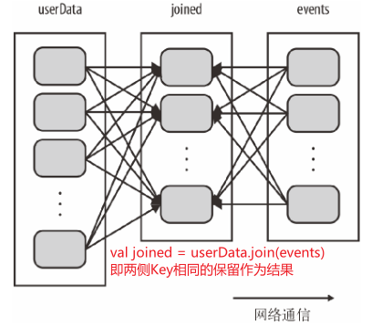
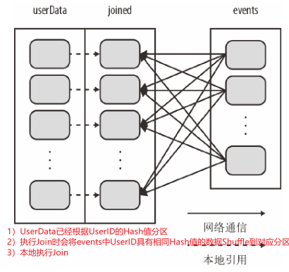
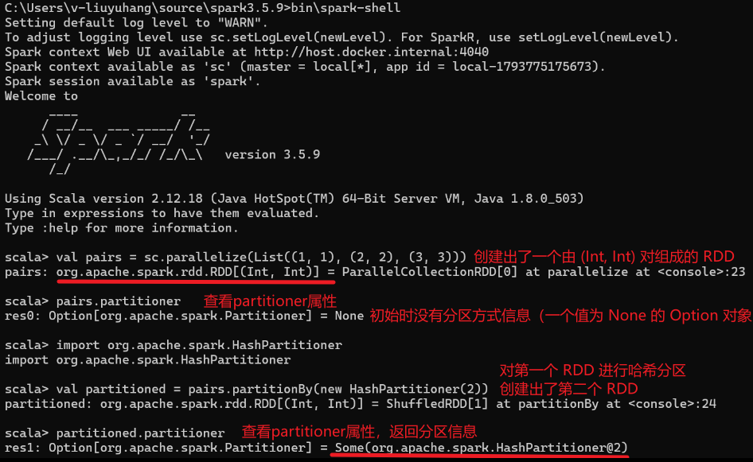
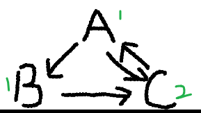

# 1、引入

上一篇文章我们操作的都是普通类型的RDD，但按**元素类型**RDD可以分成两大类：

- 普通类型的RDD：`RDD[T]`，T 是任意类型。（可以是String、Int、User等）

- 键值对 RDD：`PairRDD[K, V]`，**本质上是**元素为**二元组 (Key, Value) 的普通 RDD： RDD[(K, V)]**

**Pair RDD** 在普通 RDD 的分布式计算能力之上，**引入了 Key 这一层语义**，使 Spark 可以进行按 Key 的聚合、分区和 Join，并能够通过**分区内预聚合、复用 Partitioner 等机制**，从而减少 Shuffle 的数据量，或者在一些场景下**避免不必要的重复 Shuffle**。

**需要注意**：`PairRDD` 不是一个独立的类。打开源码你会发现，根本不存在 `PairRDD` 这个类——它只是对 `RDD[(K, V)]` 的**约定俗成的叫法**。所有"只对键值对生效"的算子（`reduceByKey`、`groupByKey`、`join`），本质上都是定义在普通 RDD 上的方法，只是通过隐式转换（`implicit`) 在编译期做了限制。

```scala
// 这两行声明的是同一个东西
val rdd1: RDD[(String, Int)] = ...
val rdd2: PairRDD[String, Int] = ...   // 并不存在这个类型
```

为什么这么设计？因为 Scala 的隐式类 `PairRDDFunctions` 会在你调用 `reduceByKey` 时自动包装：

```
RDD[(K, V)]  --隐式转换-->  PairRDDFunctions[K, V]
                                    │
                          reduceByKey / groupByKey / join ...
```

如果你对一个 `RDD[Int]` 调用 `reduceByKey`，编译器会报错——因为它找不到对应的隐式转换。**这就是 Spark 用类型系统在编译期拦住错误，而不是运行时报错。**

---

**配套示例索引**

下面所有小节的实例代码均可以在Git上直接下载并运行，详见下表

| 文章位置              | 配套文件                                                                                                                                                                                                                   | 练习内容                                                          |
| ----------------- | ---------------------------------------------------------------------------------------------------------------------------------------------------------------------------------------------------------------------- | ------------------------------------------------------------- |
| 2、创建 Pair RDD     | [PairRDD_2CreationOperationsApp.scala](https://github.com/Eleanora-lyh/BigDataDemoProjects/blob/main/Spark/ScalaApplicaton/spark-line-count/src/main/scala/com/example/PairRDD_2CreationOperationsApp.scala)           | 二元组集合、文本、`map`、`mapPartitions`、`keyBy`                        |
| 3.1 聚合操作          | [PairRDD_3_1AggregationOperationsApp.scala](https://github.com/Eleanora-lyh/BigDataDemoProjects/blob/main/Spark/ScalaApplicaton/spark-line-count/src/main/scala/com/example/PairRDD_3_1AggregationOperationsApp.scala) | `reduceByKey`、`foldByKey`、`aggregateByKey`、`combineByKey`     |
| 3.2 数据分组          | [PairRDD_3_2GroupingOperationsApp.scala](https://github.com/Eleanora-lyh/BigDataDemoProjects/blob/main/Spark/ScalaApplicaton/spark-line-count/src/main/scala/com/example/PairRDD_3_2GroupingOperationsApp.scala)       | `groupByKey`、两路和三路 `cogroup`、`groupBy`                        |
| 3.3 连接            | [PairRDD_3_3JoinOperationsApp.scala](https://github.com/Eleanora-lyh/BigDataDemoProjects/blob/main/Spark/ScalaApplicaton/spark-line-count/src/main/scala/com/example/PairRDD_3_3JoinOperationsApp.scala)               | 内连接、三种外连接、`subtractByKey`、多对多匹配                               |
| 3.4 数据排序          | [PairRDD_3_4SortingOperationsApp.scala](https://github.com/Eleanora-lyh/BigDataDemoProjects/blob/main/Spark/ScalaApplicaton/spark-line-count/src/main/scala/com/example/PairRDD_3_4SortingOperationsApp.scala)         | 全局排序、分区内排序、自定义 Key 顺序、多字段混合排序                                 |
| 3.5 Value 映射与键值提取 | [PairRDD_3_5ValueOperationsApp.scala](https://github.com/Eleanora-lyh/BigDataDemoProjects/blob/main/Spark/ScalaApplicaton/spark-line-count/src/main/scala/com/example/PairRDD_3_5ValueOperationsApp.scala)             | `mapValues`、`flatMapValues`、`keys`、`values`，对比 `map`、`filter` |
| 3.4 Top N、4 行动操作  | [PairRDD_4ActionOperationsApp.scala](https://github.com/Eleanora-lyh/BigDataDemoProjects/blob/main/Spark/ScalaApplicaton/spark-line-count/src/main/scala/com/example/PairRDD_4ActionOperationsApp.scala)               | `takeOrdered`、`top`、`countByKey`、`collectAsMap`、`lookup`      |
| 5.1～5.3、5.5 数据分区  | [PairRDD_5PartitioningOperationsApp.scala](https://github.com/Eleanora-lyh/BigDataDemoProjects/blob/main/Spark/ScalaApplicaton/spark-line-count/src/main/scala/com/example/PairRDD_5PartitioningOperationsApp.scala)   | 分区器属性、分区信息保留、用户事件连接、`groupWith`、自定义分区器                        |
| 5.4 PageRank      | [PairRDD_5PageRankApp.scala](https://github.com/Eleanora-lyh/BigDataDemoProjects/blob/main/Spark/ScalaApplicaton/spark-line-count/src/main/scala/com/example/PairRDD_5PageRankApp.scala)                               | 图数据读写、十轮迭代、缓存与分区复用、逐轮校验                                       |

所有示例都包含结果校验，运行需要先在Terminal中进入 `spark-line-count` 项目目录，再执行对应命令：

```shell
sbt "runMain com.example.PairRDD_3_1AggregationOperationsApp"
```

# 2、创建Pair RDD

综上在 Spark 中，**Pair RDD 并不是一种独立的 RDD 类型**，它本质上是元素为二元组 `(Key, Value)` 的普通 RDD。

所以构造Pair RDD也就是通过各种方式来构造出形式为`(Key, Value)` 的 RDD，这里列举了两种：

- (Key, Value)集合并行化，进而变为Pair RDD

- 普通 RDD通过转换，变为(Key, Value)格式的Pair RDD

下面的代码详见 [PairRDD_2CreationOperationsApp.scala](https://github.com/Eleanora-lyh/BigDataDemoProjects/blob/main/Spark/ScalaApplicaton/spark-line-count/src/main/scala/com/example/PairRDD_2CreationOperationsApp.scala)

## 2.1 (Key, Value)集合—>Pair RDD

### 使用parallelize将二元组集合并行化

用`parallelize`将二元组集合`Seq(("apple", 2), ("banana", 3), ("apple", 1))`并行化

```scala
// 方式一：直接将二元组集合并行化；相同的 key 可以出现多次。
val pairs: RDD[(String, Int)] = sc.parallelize(
  Seq(("apple", 2), ("banana", 3), ("apple", 1)),
  numSlices = 2
)
// 输出
val pairResult = pairs.collect().sorted.toSeq
println(s"parallelize tuples: ${pairResult.mkString("[", ", ", "]")}")
//[info] parallelize tuples: [(apple,1), (apple,2), (banana,3)]
```

### 从文本文件创建 Pair RDD

如果文本文件中存储数据格式是键值对，那么读取时会直接返回`(Key, Value)`对象，此时就可以直接构造出由其键值对数据组成的 pair RDD

假设文件内容为：

```plain
alice,90
bob,85
alice,95
```

解析为 (姓名, 分数)：

```scala
val linesRDD = sc.textFile("data/name_score.txt") // 配套项目已提供该文件
// 对linesRDD应用自定义的map函数，拆分后分别得到name和score，这里lambda表达式的写法把return省略掉了
val scorePairRDD = linesRDD.map { line =>
  //读进来的line是 RDD[String]，每一行是一条记录
  val fields = line.split(",")
  val name = fields(0)
  val score = fields(1).toInt

  (name, score)
}
// 将输出的scorePairRDD按照Key聚合，返回value的加和
// _ + _ 等价于 (x, y) => x + y（ _ 是匿名占位符）
val totalScores = scorePairRDD.reduceByKey(_ + _)
```

输出

```plain
(alice,185)
(bob,85)
```

## 2.2 普通 RDD —> Pair RDD

这里列了两种构造形式，分别使用转换操作`map()`和`keyBy()`，先举例子看下分别怎么使用

### map()

用`map`将普通 RDD 转成 Pair RDD，这里`map`的函数可以自定义

```scala
// word -> 1 与 (word, 1) 等价，常用于词频统计的准备阶段。
val words = sc.parallelize(Seq("spark", "scala", "spark"), numSlices = 2)
// map函数会应用到words的没一条记录，并返回以word为key，1为value的 键值对
val wordPairs: RDD[(String, Int)] = words.map(word => (word, 1))

val wordPairResult = wordPairs.collect().sorted.toSeq
println(s"map to pairs: ${wordPairResult.mkString("[", ", ", "]")}")
//[info] map to pairs: [(scala,1), (spark,1), (spark,1)]
```

具体过程如下

```plain
Driver
  |
  |-- sc.parallelize --> Partition0("spark")
  |                     Partition1("scala","spark")
  |
  |-- map --> Partition0("spark",1)
  |           Partition1("scala",1),("spark",1)
  |
  |-- collect() --> 拉回 Driver
  |
  |-- sorted --> 排序
  |
  |-- println --> 输出
```

这种写法通常用来统计文字出现的次数（有简写方式）

```scala
val words = sc.parallelize(Seq("spark", "scala", "spark"), numSlices = 2)
val wordPairs = words.map(word => (word, 1))
// 相同的key则返回加和
val wordCounts = wordPairs.reduceByKey((a, b) => a + b)
// 可以简写为
val wordCounts2 = words
        .map(word => (word, 1))
        .reduceByKey(_ + _)
```

当需要**按分区批量初始化资源或处理数据**时，也可以用`mapPartitions`返回键值对（语义层面和`map`是等价的）：

```scala
val pairRDD = words.mapPartitions { iterator =>
  iterator.map(word => (word, 1))
}
```

> 挖坑：`Map`案例的输入是`Seq("spark", "scala", "spark")`，那么如果输入变为`Seq("spark test1", "scala test2", "spark test1")`由该怎么统计每个单词出现的次数？
> 
> ——使用`flatMap(line => line.split("\\s+"))`先把string按照空格拆分（分词），具体详见 3.5的flatMap() 与 flatMapValues() 的区别
> 
> ```scala
> val wordCounts = words
>   .flatMap(line => line.split("\\s+"))
>   .map(word => (word, 1))
>   .reduceByKey(_ + _)
> ```

### keyBy()

如果已经有一个普通 RDD，并且想从对象中选取某个属性作为 Key，则可以使用 keyBy()将其变成 PairRDD。

```scala
def keyBy[K](f: T => K): RDD[(K, T)]
```

对 RDD 中的 每一个元素 `T`用函数 `f` 计算出一个 key `K`，最终返回 `(K, T)`（原来的元素整体变成 value）

```scala
val words = sc.parallelize(Seq("spark", "scala", "spark"), numSlices = 2)
// keyBy将每一个输入作为参数，返回输入单词的长度
val wordsByLength: RDD[(Int, String)] = words.keyBy(word => word.length)

val keyedResult = wordsByLength.collect().sorted.toSeq
println(s"keyBy length: ${keyedResult.mkString("[", ", ", "]")}")
// keyBy length: [(5,scala), (5,spark), (5,spark)]
```

### 区别

`keyBy` 和`map(x => (key, x))`是完全等价的，可以理解`keyBy`是特殊的一种`map`，其本质是语法糖

| 操作                 | Key | Value      |
| ------------------ | --- | ---------- |
| `map(x => (k, v))` | 自定义 | 自定义        |
| `keyBy(x => k)`    | 自定义 | 固定为原元素 `x` |

- `map()` 会把**原来的整个元素作为函数参数**，然后由你自定义输出的 **Key 和 Value**：（原来的元素 x 不一定作为 Key，Key 和 Value 都可以自由定义）

```scala
rdd.map(x => (自定义Key, 自定义Value))
```

- `keyBy()` 只让你定义如何从原元素中生成 **Key**，而 **Value 一定是原来的完整元素**

```scala
rdd.map(x => (自定义Key, x))
简写为
rdd.keyBy(x => 自定义Key)
```

# 3、Pair RDD的转化操作

**转化操作**返回新的 RDD，计算结果由后续的 Action 触发。

**总表的统一输入（输入只用于总表）如下**。每一行示例都独立操作原始 `rdd`，不是接着上一行的结果继续计算；连接、联合分组和按 Key 排除还会使用 `other`。

```scala
import org.apache.spark.HashPartitioner

val rdd = sc.parallelize(Seq((1, 2), (3, 4), (3, 6)), numSlices = 2)
val other = sc.parallelize(Seq((3, 9)), numSlices = 2)

// aggregateByKey / combineByKey 使用 (sum, count) 作为聚合器。
val createCombiner = (value: Int) => (value, 1)
val seqOp = (acc: (Int, Int), value: Int) => (acc._1 + value, acc._2 + 1)
val combOp = (left: (Int, Int), right: (Int, Int)) =>
  (left._1 + right._1, left._2 + right._2)
```

即 `rdd` 包含三条记录 `[(1, 2), (3, 4), (3, 6)]`，`other` 包含一条记录 `[(3, 9)]`，两者类型均为 `RDD[(Int, Int)]`。Key 为 3 的两条记录不会自动合并。表中按 Key 的聚合器结果为 `(sum, count)`，例如 Key 为 3 时得到 `(10, 2)`。

这里的转化操作我按照分类：聚合、分组、连接、排序，以及 Value 映射与键值提取依次展开，表格汇总下面 3.1～3.5 的转化操作。

| 分类                   | 函数                                                         | 作用                                            | 示例                                                                     | 结果 / 特点                                                                    |
| -------------------- | ---------------------------------------------------------- | --------------------------------------------- | ---------------------------------------------------------------------- | -------------------------------------------------------------------------- |
| **1. 按 Key 聚合**      | `reduceByKey(func)`                                        | 对相同 Key 的 Value 使用同一个函数聚合，无初始值                | `rdd.reduceByKey(_ + _)`                                               | `{(1, 2), (3, 10)}`                                                        |
|                      | `foldByKey(zeroValue)(func)`                               | 提供与 Value 同类型的零值，对每个 Key 聚合                   | `rdd.foldByKey(0)(_ + _)`                                              | `{(1, 2), (3, 10)}`；零值应为合并函数的单位元                                           |
|                      | `aggregateByKey(zeroValue)(seqOp, combOp)`                 | 提供初始聚合值，分别定义分区内累加和分区间合并；聚合结果类型可以不同于 Value     | `rdd.aggregateByKey((0, 0))(seqOp, combOp)`                            | `{(1, (2, 1)), (3, (10, 2))}`，Value 为 `(sum, count)`                       |
|                      | `combineByKey(createCombiner, mergeValue, mergeCombiners)` | 从每个分区中某 Key 的首个 Value 创建聚合器，再累加和合并；也有指定分区器的重载 | `rdd.combineByKey[(Int, Int)](createCombiner, seqOp, combOp)`          | `{(1, (2, 1)), (3, (10, 2))}`；可用 `mapValues` 进一步计算均值                       |
| **2. 按 Key 分组**      | `groupByKey()`                                             | 将同一 Key 的所有 Value 收集为 `Iterable`，不聚合、不去重      | `rdd.groupByKey()`                                                     | `{(1, [2]), (3, [4, 6])}`；组内顺序无保证                                          |
|                      | `reduceByKey(func)`（分组与聚合对比）                               | 按 Key 直接聚合，不返回 Value 集合；同一算子也列于聚合分类           | `rdd.reduceByKey((left, right) => math.max(left, right))`              | `{(1, 2), (3, 6)}`；等价于 `groupByKey().mapValues(_.max)` 的结果，可先在分区内合并        |
|                      | `mapValues(_ => 1).reduceByKey(_ + _)`                     | 先将每条记录转为 1，再统计每个 Key 的记录数                     | `rdd.mapValues(_ => 1).reduceByKey(_ + _)`                             | `{(1, 1), (3, 2)}`；不是对原 Value 求和                                           |
|                      | `cogroup(other)`                                           | 按 Key 对齐多个 RDD，各来源保留独立的 Value 集合              | `rdd.cogroup(other)`                                                   | `{(1, ([2], [])), (3, ([4, 6], [9]))}`；保留双方 Key 的并集，也支持三个 RDD              |
| **3. 连接与按 Key 排除**   | `join(other)`                                              | 内连接，仅保留双方都有的 Key，组合两侧 Value                   | `rdd.join(other)`                                                      | `{(3, (4, 9)), (3, (6, 9))}`                                               |
|                      | `leftOuterJoin(other)`                                     | 左外连接，保留左侧 `rdd` 的全部记录，右侧缺失用 `None` 表示         | `rdd.leftOuterJoin(other)`                                             | `{(1, (2, None)), (3, (4, Some(9))), (3, (6, Some(9)))}`                   |
|                      | `rightOuterJoin(other)`                                    | 右外连接，保留右侧 `other` 的全部记录，左侧缺失用 `None` 表示       | `rdd.rightOuterJoin(other)`                                            | `{(3, (Some(4), 9)), (3, (Some(6), 9))}`                                   |
|                      | `fullOuterJoin(other)`                                     | 全外连接，保留双方所有 Key，两侧 Value 都使用 `Option`         | `rdd.fullOuterJoin(other)`                                             | `{(1, (Some(2), None)), (3, (Some(4), Some(9))), (3, (Some(6), Some(9)))}` |
|                      | `subtractByKey(other)`                                     | 删除左侧 RDD 中 Key 出现在右侧 RDD 的记录，只比较 Key          | `rdd.subtractByKey(other)`                                             | `{(1, 2)}`；保留原始左侧记录                                                        |
| **4. 排序**            | `sortByKey(ascending, numPartitions)`                      | 按 Key 全局排序，可通过隐式 `Ordering[K]` 自定义 Key 顺序     | `rdd.sortByKey(ascending = true, numPartitions = 2)`                   | Key 顺序为 `1, 3, 3`；相同 Key 的 Value 顺序无保证，不接受 `partitioner` 参数                |
|                      | `sortBy(func, ascending, numPartitions)`                   | 按 Value 或函数提取的其他字段全局排序，也支持组合字段                | `rdd.sortBy(_._2, ascending = false)`                                  | `[(3, 6), (3, 4), (1, 2)]`；普通 RDD 也可使用                                     |
|                      | `repartitionAndSortWithinPartitions(partitioner)`          | 按指定分区器重分区，并在每个分区内按 Key 排序                     | `rdd.repartitionAndSortWithinPartitions(new HashPartitioner(2))`       | 两个 Key 都是奇数，记录均进入分区 1，分区 0 为空；只保证分区内有序，方向由 `Ordering[K]` 决定                |
| **5. Value 映射与键值提取** | `mapValues(func)`                                          | 对每条记录的 Value 应用函数，不改变 Key                     | `rdd.mapValues(x => x + 1)`                                            | `{(1, 3), (3, 5), (3, 7)}`；不会合并相同 Key                                      |
|                      | `flatMapValues(func)`                                      | 将每个 Value 展开为零条或多条记录，每条记录保留原 Key              | `rdd.flatMapValues(x => x to 5)`                                       | `{(1, 2), (1, 3), (1, 4), (1, 5), (3, 4), (3, 5)}`；`6 to 5` 为空             |
|                      | `flatMap(func)`                                            | 对完整二元组展开，可改变 Key 或输出类型；普通 RDD 也可使用            | `rdd.flatMap { case (key, value) => (value to 5).map(x => (key, x)) }` | 本例记录内容与上一行相同，但 Key 需自行构造，已有分区器会被丢弃                                         |
|                      | `keys`                                                     | 提取每条记录的 Key，返回普通 RDD                          | `rdd.keys`                                                             | `{1, 3, 3}`；不去重                                                            |
|                      | `values`                                                   | 提取每条记录的 Value，返回普通 RDD                        | `rdd.values`                                                           | `{2, 4, 6}`                                                                |

## 3.1 聚合操作

之前讲解过基础 RDD 上的 `reduce()`、`fold()`、`aggregate()` 等行动操作，Pair RDD 上也有**相应的**针对键的转化操作，这里可以对应着学习。

- 基础 RDD 的 `reduce()`、`fold()`、`aggregate()` 是对**整个 RDD**进行聚合，最终通常得到一个结果（普通 RDD 没有 `combine()`；）；

- Pair RDD 的 `reduceByKey()`、`foldByKey()`、`aggregateByKey()`、`combineByKey()` 则是**按照 Key 分组**，分别聚合每个 Key 对应的 Value。

假设有一个 Pair RDD，记录不同商品的销售额

```scala
val sales = sc.parallelize(
  Seq(
    ("Apple", 10),
    ("Banana", 20),
    ("Apple", 30),
    ("Banana", 40)
  ),
  numSlices = 2
)
```

先大致看一下不同的转换操作是怎么得到总销售额、整体平均值的

| 操作                                  | 验证结果                             |
| ----------------------------------- | -------------------------------- |
| `reduce()`、`fold()`                 | 总销售额 `100`                       |
| `reduceByKey()`、`foldByKey()`       | Apple：`40`，Banana：`60`           |
| `aggregate()`                       | `(100, 4)`，整体平均值 `25.0`          |
| `aggregateByKey()`、`combineByKey()` | Apple：`(40, 2)`，Banana：`(60, 2)` |
| 两种聚合后的 `mapValues()`                | Apple：`20.0`，Banana：`30.0`       |

下面的代码详见 [PairRDD_3_1AggregationOperationsApp.scala](https://github.com/Eleanora-lyh/BigDataDemoProjects/blob/main/Spark/ScalaApplicaton/spark-line-count/src/main/scala/com/example/PairRDD_3_1AggregationOperationsApp.scala)

### reduceByKey()

基础 RDD 的 `reduce()`不关心 Key，它会把**整个 RDD** 做一次聚合，即将所有销售额合并成一个值，即 `10 + 20 + 30 + 40 = 100`

```scala
val total = sales.values.reduce((x, y) => x + y) // 可以简写为 sales.values.reduce(_ + _)
//[info] sales = [(Apple,10), (Banana,20), (Apple,30), (Banana,40)]
//[info] reduce: total sales: 100
```

Pair RDD 的 `reduceByKey()`会针对 **每个 Key** 分别做一次聚合，即`Apple  → 10 + 30 = 40;Banana → 20 + 40 = 60`

```scala
val result = sales.reduceByKey((x, y) => x + y) //可以简写为sales.reduceByKey(_ + _)
// [info] reduceByKey: totals: WrappedArray((Apple,40), (Banana,60))
```

### foldByKey()

基础 RDD 的 `fold()` 需要提供一个初始值(零值)，**整个 RDD** 使用零值进行聚合

> 在分布式计算中，`fold()` 的零值会参与每个分区内部的计算，也会参与分区结果的合并。因此，零值通常应满足：`op(zeroValue, x) = x`（例如，加法使用 0，乘法使用1）

```scala
val total = sales.values.fold(0)((x, y) => x + y)
// [info] fold: total sales: 100
// 计算过程是 (0 + 10 + 20 + 30 + 40 = 100)
```

Pair RDD 的 `foldByKey()`会针对**每个 Key** 使用零值进行聚合，相当于对每个 Key 分别执行一次 `fold()`

```scala
val result = sales.foldByKey(0)((x, y) => x + y)
// [info] foldByKey: totals: WrappedArray((Apple,40), (Banana,60))
```

逻辑上可以理解为：

```Plain
Apple → 0 + 10 + 30 = 40
Banana → 0 + 20 + 40 = 60
```

### aggregateByKey()

基础 RDD 的 `aggregate()` 可以针对一个元素统计两个数值`(sum, count)`

```scala
// result得出的是针对10,20,30,40的sum和count
val result = sales.values.aggregate((0, 0))(
  (acc, value) => (acc._1 + value, acc._2 + 1),
  (left, right) => (left._1 + right._1, left._2 + right._2)
)

//整体平均值：average=100/4=25
val average = result._1.toDouble / result._2

// [info] aggregate: (sum, count): (100,4)
// [info] aggregate: average: 25.0
```

Pair RDD 的 `aggregateByKey()`

```scala
val result = sales.aggregateByKey((0, 0))(
  (acc, value) => (acc._1 + value, acc._2 + 1),
  (left, right) => (left._1 + right._1, left._2 + right._2)
)
// 分Key得到平均值：
val averages = result.mapValues {
  case (sum, count) => sum.toDouble / count
}
// [info] aggregateByKey: (sum, count): WrappedArray((Apple,(40,2)), (Banana,(60,2)))
// [info] aggregateByKey + mapValues: averages: WrappedArray((Apple,20.0), (Banana,30.0))
```

`result `得到的是Key分区下的`(sum, count)`结果

```plain
("Apple",  (40, 2))
("Banana", (60, 2))
```

`averages`取出后面的Values`(sum, count)`，再重新映射返回每个 Key 的平均值

```plain
(40, 2) -> 40/2=20
(60, 2) -> 60/2=30
```

所以最后返回

```plain
(Apple,20.0), (Banana,30.0)
```

### combineByKey()

`combineByKey` 可以看作是`aggregateByKey`的升级版本，定义如下：

```scala
def combineByKey[C](
  createCombiner: V => C, //每个分区的每个Key只执行一次
  mergeValue: (C, V) => C, //每个分区的Key执行多次
  mergeCombiners: (C, C) => C //shuffle 后的跨分区合并多个相同的Key
): RDD[(K, C)]
```

它内部一共有三个函数，允许你**完全自定义三件事**：

1. `createCombiner`用某个 Key 的第一个 Value 创建中间聚合器，解决**如何为“第一次出现的 Key”创建初始的累加值**
2. `mergeValue` 在分区内，将后续 Value 合并进中间聚合器，解决**如何在同一个分区内合并值**
3. `mergeCombiners` 合并不同分区的中间聚合器，解决**如何跨分区合并分区结果

举例如下

```scala
// createCombiner：每个分区中某 key 的第一个 value 创建 (销售额, 1)，即各个分区Key销售额初始值为value，累加器初始值为1。
 // mergeValue：把该分区中同 key 的后续 value 加入累加器。
 // mergeCombiners：合并不同分区中同 key 的累加器。
val combined: RDD[(String, (Int, Int))] = sales.combineByKey[(Int, Int)](
        (value: Int) => (value, 1),
        (acc: (Int, Int), value: Int) => (acc._1 + value, acc._2 + 1),
        (left: (Int, Int), right: (Int, Int)) =>
          (left._1 + right._1, left._2 + right._2)
      )
val averages = combined.mapValues { case (sum, count) => sum.toDouble / count }
//[info] combineByKey: (sum, count): WrappedArray((Apple,(40,2)), (Banana,(60,2)))
//[info] combineByKey + mapValues: averages: WrappedArray((Apple,20.0), (Banana,30.0))
```

这时你可能会有疑惑，这不就是之前使用`aggregateByKey`统计平均值的做法：

```scala
val result = sales.aggregateByKey((0, 0))(
  (acc, value) => (acc._1 + value, acc._2 + 1),
  (left, right) => (left._1 + right._1, left._2 + right._2)
)
val averages = result.mapValues {
  case (sum, count) => sum.toDouble / count
}
```

没错，这是因为这个例子使用`combineByKey`时使用的初始值刚好和`aggregateByKey`的(0,0)效果等价，实际上`combineByKey`可以使用更复杂函数作为初始值。

可以理解成 “`aggregateByKey` 是 `combineByKey` 的语法糖，底层完全一样，只是把 `createCombiner` 封装成了 `zeroValue + seqOp`”

### 总结

```plain
reduceByKey : 无零值 + 分区内外使用相同函数
    ↓ 增加初始值
foldByKey : 固定零值 + 分区内外使用相同函数
    ↓ 允许聚合结果与 Value 类型不同，并区分分区内和分区间函数
aggregateByKey : 固定零值 + 分区内外使用不同函数
    ↓ 不直接提供固定初始值，而是从每个 Key 的第一个 Value 创建聚合器
combineByKey : 根据第一个 Value 动态创建聚合器 + 分区内外使用不同函数
```

| 操作               | 理解                                                                  | 特点                             |
| ---------------- | ------------------------------------------------------------------- | ------------------------------ |
| `reduceByKey`    | 对每个 Key 的 Value 使用同一个函数进行聚合                                         | 无初始值，分区内外使用相同函数，输入输出类型相同       |
| `foldByKey`      | 对每个 Key 的 Value 进行聚合，并提供一个与 Value 同类型的初始值                           | **有固定初始值**，分区内外使用相同函数，输入输出类型相同 |
| `aggregateByKey` | 为每个 Key 提供初始聚合值，并分别定义分区内聚合`seqOp`和分区间合并`combOp`，聚合结果可以与原 Value 类型不同 | 有固定初始值，**分区内外使用不同函数，输入输出类型不同** |
| `combineByKey`   | 为每个 Key 从第一个 Value 创建中间聚合器，再定义 Value 如何加入聚合器，以及不同分区的聚合器如何合并         | **有可变初始值**，分区内外使用不同函数，输入输出类型不同 |

## 3.2 数据分组

下面的代码详见 [PairRDD_3_2GroupingOperationsApp.scala](https://github.com/Eleanora-lyh/BigDataDemoProjects/blob/main/Spark/ScalaApplicaton/spark-line-count/src/main/scala/com/example/PairRDD_3_2GroupingOperationsApp.scala)

pairRDD中的分组是`groupByKey()`，如果不仅需要分组还需要聚合则使用 `reduceByKey`

> 需要注意：上面的聚合需要让同一个 Key 的数据最终参与同一组计算，**但 Spark 不需要先把每个 Key 的所有 Value 完整收集到同一个节点**。通常先在各分区内局部聚合，再通过 Shuffle 在 Executor 端合并同一 Key 的中间结果；只有 `collect()` 等 Action 才把最终结果取回 Driver。

### groupByKey()

`groupByKey()` 是真正把 Value 分组出来的操作，它按 key 直接 shuffle 收集对应的 value 到同一个节点，在 reduce 端计算。（重复值会被保留、组内顺序不保证）

```scala
val scores = sc.parallelize(
  Seq(("Alice", 80), ("Bob", 70), ("Alice", 90), ("Bob", 70), ("Cindy", 100)),
  numSlices = 2
)
// groupByKey() 返回 RDD[(String, Iterable[Int])]。
// 再执行 mapValues 求和，groupedTotals 的类型为 RDD[(String, Int)]。
val groupedTotals = scores
  .groupByKey()
  .mapValues(values => values.sum)
```

执行过程如下

```plain
所有 Value 经过 Shuffle 
        ↓
形成 Key → Iterable[Value]：
Alice → [80, 90]；Bob → [70, 70]；Cindy → [100]
        ↓
对 Iterable 求和：
Alice → 170；Bob → 140；Cindy → 100
```

### reduceByKey()

`reduceByKey(_ + _)` 与 `groupByKey().mapValues(_.sum)` 得到相同的按 Key 求和结果，但不等同于只执行 `groupByKey()`：前者返回聚合值，后者返回 Value 集合。`reduceByKey` 可以先在分区内局部合并，通常能减少 Shuffle 数据量，无需生成完整的 `Iterable[Value]`。

```scala
val scores = sc.parallelize(
  Seq(("Alice", 80), ("Bob", 70), ("Alice", 90), ("Bob", 70), ("Cindy", 100)),
  numSlices = 2
)
val reducedTotals = scores.reduceByKey(_ + _)
// [(Alice,170), (Bob,140), (Cindy,100)]，展示时按 Key 排序。

val counts = scores.mapValues(_ => 1).reduceByKey(_ + _)
// [(Alice,2), (Bob,2), (Cindy,1)]

val maxima = scores.reduceByKey((left, right) => math.max(left, right))
// [(Alice,90), (Bob,70), (Cindy,100)]
```

后者的过程如下

```plain
分区内先局部聚合
Partition 0: ("Alice", 80), ("Bob", 70)
Partition 1: ("Alice", 90), ("Bob", 70), ("Cindy", 100)
        ↓
局部聚合结果（每个分区中的 Key 恰好各出现一次，因此这里无法减少记录数）
Partition 0: ("Alice", 80), ("Bob", 70)
Partition 1: ("Alice", 90), ("Bob", 70), ("Cindy", 100)
        ↓
Shuffle 同一 Key 的中间结果，并在目标分区合并
Alice → 80 + 90 = 170
Bob   → 70 + 70 = 140
Cindy → 100
```

- 求和、最大值 / 最小值等**满足结合律和交换律**、且聚合结果类型与 Value 相同的操作，适合用 `reduceByKey`；计数需先将每条 Value 映射为 1。
- 需要**拿到某个 Key 的所有原始 Value**，适合用 `groupByKey`；聚合结果类型需要改变时，可使用 `aggregateByKey` 或 `combineByKey`。

### cogroup()

`groupByKey()/reduceByKey()` 主要对**一个 Pair RDD**按照 Key 分组。

`cogroup()` 则可以对**多个 Pair RDD**按照 Key 分组，并且分别保留每个 RDD 的 Value 集合。

假设有两组PairRDD，分别表示学生的成绩和兴趣，如下

```plain
scores = [(Alice,80), (Bob,70), (Alice,90), (Bob,70), (Cindy,100)]
clubs = [("Alice", "Chess"), ("Alice", "Music"), ("Bob", "Sports"), ("David", "Art")]
```

我们想得到所有的分数集合和兴趣集合就可以使用`cogroup()`

```scala
val cogrouped: RDD[(String, (Iterable[Int], Iterable[String]))] = scores.cogroup(clubs)
// 直接写成val cogrouped= scores.cogroup(clubs)就可以，带上类型是方便理解
```

输出中每一个Key，都有两组合并后的Value（记录了来自哪个 RDD）

```scala
//[info] cogroup: (scores, clubs): WrappedArray((Alice,(List(80, 90),List(Chess, Music))), (Bob,(List(70, 70),List(Sports))), (Cindy,(List(100),List())), (David,(List(),List(Art))))
```

整理一下就是

```plain
Alice → List(80, 90),List(Chess, Music)
Bob → List(70, 70),List(Sports)
Cindy → List(100),List()
David → List(),List(Art)
```

## 3.3 连接

下面的代码详见 [PairRDD_3_3JoinOperationsApp.scala](https://github.com/Eleanora-lyh/BigDataDemoProjects/blob/main/Spark/ScalaApplicaton/spark-line-count/src/main/scala/com/example/PairRDD_3_3JoinOperationsApp.scala)

Spark 对 `RDD[(K, V)]`（即 Pair RDD）提供了类似 SQL 的 Join 操作，通常会：

> **按照 Key 进行 Shuffle，然后把相同 Key 的数据拉到一起拼接**

`join()` 可以在概念上理解为：先 cogroup再对两边的 Value 做笛卡尔组合

```plain
sales：A → [10, 20]
costs：A → [7, 8]
```

执行 `sales.join(costs)` 后在概念上为

```plain
cogroup：
A → ([10, 20], [7, 8])

展开组合：
10 × 7
10 × 8
20 × 7
20 × 8

最的得到：
(A, (10, 7))
(A, (10, 8))
(A, (20, 7))
(A, (20, 8))
```

因此一个 Key 在两侧都有多个 Value 时，`join()` 可能产生很多结果：

左侧有 M 个 Value，右侧有 N 个 Value => 结果数量 = M × N

---

常见连接类型：

| 操作                   | 等价 SQL          | 说明          |
| -------------------- | --------------- | ----------- |
| 内连接`join`            | INNER JOIN      | 只保留两边都有 Key |
| 左外连接`leftOuterJoin`  | LEFT JOIN       | 左表全保留       |
| 右外连接`rightOuterJoin` | RIGHT JOIN      | 右表全保留       |
| 全连接`fullOuterJoin`   | FULL OUTER JOIN | 两边都保留       |
| 联合分组`cogroup`        | 按 Key 分组对齐      | 不拼接值，不是交叉连接 |

写法 `RDD[(K, V)].join(RDD[(K, W)]) -> RDD[(K, (V, W))]`

```scala
scores.join(clubs)
scores.leftOuterJoin(clubs)
scores.rightOuterJoin(clubs)
scores.fullOuterJoin(clubs)
scores.cogroup(clubs)
```

## 3.4 数据排序

下面的代码详见 [PairRDD_3_4SortingOperationsApp.scala](https://github.com/Eleanora-lyh/BigDataDemoProjects/blob/main/Spark/ScalaApplicaton/spark-line-count/src/main/scala/com/example/PairRDD_3_4SortingOperationsApp.scala)

Pair RDD 的排序可以分成两类：**按 Key 排序**和**按自定义规则排序**。另外还有一种常见需求是只获取最大或最小的前 N 条数据。

| 排序方式            | 排序依据       | 返回结果 | 是否全局有序     | 是否触发 Shuffle |
| --------------- | ---------- | ---- | ---------- | ------------ |
| `sortByKey()`   | Key        | RDD  | 是          | 是            |
| `sortBy()`      | 自定义函数返回的值  | RDD  | 是          | 是            |
| `takeOrdered()` | 自定义排序规则    | 本地数组 | 是，只返回前 N 条 | 通常不进行全局排序    |
| `top()`         | 自定义排序规则    | 本地数组 | 是，只返回前 N 条 | 通常不进行全局排序    |
| 分区内排序           | Key 或自定义字段 | RDD  | 否，仅分区内有序   | 取决于实现        |

假设有一个 Pair RDD

```scala
val rdd = sc.parallelize(
  Seq(
     (3, "a"), (1, "b"), (2, "c"),(2, "d"), (5, "e")
  )
)
```

### sortByKey()

`sortByKey()` 要求 Key 是可排序的类型，默认是升序，返回Key整体有序的RDD

```scala
def sortByKey(
  ascending: Boolean = true,
  numPartitions: Int = self.partitions.length
): RDD[(K, V)]
```

- `ascending` 控制全局排序方向，默认升序。
- `numPartitions` 指定目标分区数；范围分区器在不同 Key 很少时可能实际创建更少的分区。
- Scala 的 `sortByKey()` **没有 `partitioner` 参数**，它使用 `RangePartitioner` 按 Key 范围分区。
- 自定义 Key 比较规则通过隐式 `Ordering[K]` 提供，配套示例中演示了“偶数优先、组内升序”。

例如，全局降序并指定 4 个目标分区：

```scala
val sortByKeyDescending = rdd.sortByKey(
  ascending = false,
  numPartitions = 4
)
sortByKeyDescending.collect().foreach(println)
```

输出的 Key 顺序为 `5, 3, 2, 2, 1`。两个 Key 为 2 的记录之间不保证 Value 顺序。

| 分区器                | 主要目的           | 特点                     |
| ------------------ | -------------- | ---------------------- |
| `HashPartitioner`  | 按 Key 聚合、分组或连接 | 相同 Key 进入相同分区，但不保证大小顺序 |
| `RangePartitioner` | 按 Key 排序       | 按 Key 范围分区，使分区之间也有顺序   |
| `自定义 partitioner`  | 按你的规则          |                        |

如果需求是**按 Hash 分区，并仅在每个分区内降序**，应使用 `repartitionAndSortWithinPartitions()`：

```scala
import org.apache.spark.HashPartitioner

val sortByKeyInPartition = {
  implicit val descendingOrdering: Ordering[Int] = Ordering.Int.reverse
  rdd.repartitionAndSortWithinPartitions(new HashPartitioner(2))
}
```

这里分区数由 `HashPartitioner(2)` 决定，为 2；接口没有 `ascending` 参数，排序方向由 `Ordering[Int]` 决定。

| Partition | 分区内降序结果                          |
| --------- | -------------------------------- |
| 0         | `(2, "c")`、`(2, "d")`，两者先后顺序不保证  |
| 1         | `(5, "e")`、`(3, "a")`、`(1, "b")` |

按分区号拼接时 Key 顺序为 `2, 2, 5, 3, 1`，**分区内有序不等于全局有序**。配套代码检查真实的分区内容，不在 `collect()` 后重新排序来掩盖差异。

### sortBy()

sortBy() 并不是 Pair RDD 独有的方法，普通 RDD 也可以使用。它允许通过函数指定排序依据。

```scala
def sortBy[K: scala.reflect.ClassTag](
  f: T => K, //排序字段提取函数
  ascending: Boolean = true, //是否升序
  numPartitions: Int = this.partitions.length //分区数
)(implicit ord: Ordering[K]): RDD[T]
```

- `f: T => K` 指的就是从元素中提取用于排序的字段，可以自定义，所以`sortBy()`可以适配任何的排序规则

- `ascending: Boolean = true` 是针对整体的排序，如果排序字段是Key+Value，那么会先按第一个字段升序，第一个相等时再按第二个字段升序排（如果想分别控制则必须使用下面介绍的`ord`参数）

- `ord: Ordering[K]` 可以定义每个字段的排序规则。默认是`Ordering.Tuple2(ord1, ord2)`即先按第一个字段排，第一个相等时再按第二个字段排（详见例3）
  
  - 升序：`ord1/odr2`=`Ordering.String`
  
  - 降序：`ord1/odr2`=`Ordering.String.reverse`

举例1：下面是三种等价的**按 Value 升序**(不写`ascending`默认是升序)

```scala
//写法1：对每条 (key, value)，提取 value 作为排序键，再按 value 排序
val sortByValueAsc = rdd.sortBy {
  case (key, value) => value
}

//写法2：可以使用匿名参数占位符简写为： _._2 表示“取元组的第二个元素”，也就是 value
val sortByValueAscAbb = rdd.sortBy(_._2)

//写法3：普通 lambda，显式命名参数
val sortByValueAscLam = rdd.sortBy(pair => pair._2)
```

举例2：**按 Value 降序**

```scala
val sortByValueDesc = rdd.sortBy(
  pair => pair._2,
  ascending = false
)
```

举例3：**按 Key 升序再按 Value 降序** (利用`Ordering`)

```scala
import scala.reflect.classTag

// 写法1：显式提供 Ordering；排序字段类型为 (Int, String)。
val sortByKeyAscValueDesc1 = rdd.sortBy(
  pair => (pair._1, pair._2),          // 排序依据
  ascending = true                // 整体升序
)(Ordering.Tuple2(Ordering.Int, Ordering.String.reverse), classTag[(Int, String)])
//(1,b),(2,d),(2,c),(3,a),(5,e)

// 写法2：提取 Ordering 为变量，使用局部作用域避免与写法3的隐式变量冲突。
locally {
val ordering = Ordering.Tuple2(
  Ordering.Int,               // key: 升序
  Ordering.String.reverse    // value: 降序
)
val sortByKeyAscValueDesc2 = rdd.sortBy(
  pair => (pair._1, pair._2),
  ascending = true
)(ordering, classTag[(Int, String)])
}

// 写法3：定义为隐式 Ordering传入
locally {
implicit val ordering: Ordering[(Int, String)] = Ordering.Tuple2(
  Ordering.Int,
  Ordering.String.reverse
)
// 自动使用隐式 Ordering
val sortByKeyAscValueDesc3 = rdd.sortBy(pair => (pair._1, pair._2))
}
```

按照除了使用`ord`参数，针对此次操作的pairRDD还有个意想不到的实现方式，**用反转降序模拟升序**

```scala
val sortByKeyAscValueDesc4 = rdd.sortBy(
  pair => (-pair._1, pair._2),          // 排序依据时将Key变为-Key
  ascending = false                // 整体降序
)
```

过程如下

```plain
input如下，排序依据是-pair._1，同时整体降序 等价 Key 升序
(3, "a"), (1, "b"), (2, "c"),(2, "d"), (5, "e")
反转后得到
(-3, "a"), (-1, "b"), (-2, "c"),(-2, "d"), (-5, "e")
整体降序排列得到
(-1, "b"), (-2, "d"), (-2, "c"), (-3, "a"), (-5, "e")
```

> 需要注意：
> 
> 非数值字段不能“反转”
> 
> 对 `Int.MinValue` 取负存在溢出风险。通用代码优先使用 `Ordering`，不要靠取负控制方向。

### takeOrdered(n) / top(n)

下面的代码详见 [PairRDD_4ActionOperationsApp.scala](https://github.com/Eleanora-lyh/BigDataDemoProjects/blob/main/Spark/ScalaApplicaton/spark-line-count/src/main/scala/com/example/PairRDD_4ActionOperationsApp.scala)

如果不需要完整的有序 RDD，只想取得**最小/大的 N 条数据**，可以使用 `takeOrdered(n)` / `top(n)`。两者分别按给定的 `Ordering[T]` 取最小、最大的 N 条，并不只比较 Key；只有排序规则相同时，才可与排序后 `take(n)` 对比。

方法定义如下（两者都返回 `Array[T]`（Driver 端内存），不是 RDD）

```scala
// takeOrdered: 按 Ordering[T] 升序返回最小的 n 个。
def takeOrdered(num: Int)(implicit ord: Ordering[T]): Array[T]

// top: 按 Ordering[T] 降序返回最大的 n 个。
def top(num: Int)(implicit ord: Ordering[T]): Array[T]
```

举例：

```scala
val ranked = sc.parallelize(
  List(("b", 2), ("a", 3), ("a", 1), ("b", 1), ("a", 2)),
  numSlices = 2
)
val byKey: Ordering[(String, Int)] = Ordering.by[(String, Int), String](_._1)
val takeMin2 = ranked.takeOrdered(2)(byKey)
val takeMax3 = ranked.top(3)(byKey)
//返回类型不是 RDD，而是 Driver 端的数组Array[(String, Int)]
```

只比较 Key 时，相同 Key 的记录先后顺序不保证。配套行动操作示例还使用 `Ordering.Tuple2(Ordering.String, Ordering.Int)`，演示用 Value 作为次级字段获得确定的完整记录顺序。

#### 内部执行逻辑复杂度分析

假设总数为N个，需要取出最大的n个元素，一共M个分区

1）每个分区内维护一个容量为n的有界优先队列（小顶堆），遍历所有元素时更新堆

- 当前元素不够大：通常只与堆顶比较，$O(1)$
- 当前元素进入 Top n：删除堆顶并插入新元素，$O(log n)$

2）理想状态下M个分区对应了M 个可并行运行的 Task 槽位，那么各个分区都可以并行计算，每个分区内部的元素数为 N/M，那么此时单个分区的最坏时间复杂度是：$ O\left(\frac{N}{M} \log n\right) $

3）M个分区各自独立取出 Top n后，最多得到 M*n 个候选值，此时继续使用容量为n的有界优先队列取Top n，合并阶段的复杂度就为 $O(M*n logn)$

4）如果写了Ordering 最后还可能需要把最终 n 个元素按照结果顺序排列，返回 Driver，复杂度为$O(nlogn)$

综上得到整体复杂度 ：

$$
O\left(\frac{N}{M} \log n\right) + O(M*n logn) + O(nlogn) = O(\frac{N}{M} \log n + M*n logn + nlogn)
$$

当n是很小的固定常量时，可以简化为 $ O\left(\frac{N}{M} + nM\right)   $

```plain
分区 1: top(3) → [a1, a2, a3]
分区 2: top(3) → [b1, b2, b3]
分区 3: top(3) → [c1, c2, c3]
        ↓
  全局 top(3) → 从 9 个候选中选最大的 3 个
```

## 3.5 Value 映射与键值提取

下面的代码详见 [PairRDD_3_5ValueOperationsApp.scala](https://github.com/Eleanora-lyh/BigDataDemoProjects/blob/main/Spark/ScalaApplicaton/spark-line-count/src/main/scala/com/example/PairRDD_3_5ValueOperationsApp.scala)

前面的聚合、分组和连接围绕 **Key** 组织数据；本节则关注如何处理每条记录的 **Value**，或者单独提取 Key / Value。这些操作本身不会把相同 Key 的记录合并。

继续使用总表中的数据：

```scala
val rdd = sc.parallelize(Seq((1, 2), (3, 4), (3, 6)), numSlices = 2)
```

### mapValues()

`mapValues()` 只把每条记录的 Value 传给函数，Key 原样保留。返回的 Value 类型可以与原类型不同：

```scala
// RDD[(K, V)] -> RDD[(K, U)]，其中函数类型为 V => U。
val mappedValues = rdd.mapValues(x => x + 1)
println(mappedValues.collect().sorted.toSeq)
// [(1,3), (3,5), (3,7)]
```

相同 Key 为 3 的两条记录仍然是两条，**映射不等于按 Key 聚合**。

对比普通 RDD 的 `map()`、`filter()`：它们接收的是完整二元组，可以同时查看 Key 和 Value；`map()` 还可以改变 Key。

```scala
val mapped = rdd.map { case (key, value) => (key + 1, value + 1) }
// [(2,3), (4,5), (4,7)]

val filtered = rdd.filter { case (_, value) => value > 2 }
// [(3,4), (3,6)]
```

如果只需要改变 Value，优先用 `mapValues()` 表达意图。对于已设置分区器的 Pair RDD，`mapValues()` 会保留分区器；普通 `map()` 即使原样保留 Key，也会丢弃分区器信息。

---

举例2：

```scala
val words = sc.parallelize(
  Seq(("fruit", "apple banana"), ("drink", "tea")),
  numSlices = 2
)
// 此时 words 数据是 RDD[(String, String)]
val tokens = words.MapValues(_.split(" "))
println(tokens.collect().sorted.toSeq)
//  WrappedArray((fruit,Array(apple, banana)), (drink,Array(tea)))
```

执行过程如下

```plain
("fruit", "apple banana")，其Value为"apple banana"
执行mapValues(_.split(" ")) 得到 Array("apple", "banana")
Key不变，最终组合得到("fruit", Array("apple", "banana"))

同理("drink", "tea").flatMapValues(_.split(" "))
得到("drink", Array("tea"))
```

可以用spark shell 实时验证，依次执行：

```cmd
cd C:\Users\v-liuyuhang\source\spark3.5.9

bin\spark-shell

val words = sc.parallelize(
  Seq(("fruit", "apple banana"), ("drink", "tea")),
  numSlices = 2
)

val tokens1 = words.mapValues(_.split(" "))

tokens1.collect().toSeq
```

### flatMapValues()

`flatMapValues()` 对每条记录的 Value 应用一个返回可遍历结果的函数，再将结果展开为零条、一条或多条记录，**每条输出记录都保留原 Key**。

举例1：

```scala
val expandedValues = rdd.flatMapValues(x => x to 5)
println(expandedValues.collect().sorted.toSeq)
// [(1,2), (1,3), (1,4), (1,5), (3,4), (3,5)]
```

展开过程：

```plain
(1, 2) → 2 to 5 → (1,2), (1,3), (1,4), (1,5)
(3, 4) → 4 to 5 → (3,4), (3,5)
(3, 6) → 6 to 5 → 空 Range，不产生输出
```

注意：`6 to 5` 默认步长为正数，因此结果为空，并不是 `[6, 5]`。

---

举例2（典型用途）：

保留分类 Key，将文本 Value 切分为多个单词：

```scala
val words = sc.parallelize(
  Seq(("fruit", "apple banana"), ("drink", "tea")),
  numSlices = 2
)
// 此时 words 数据是 RDD[(String, String)]
val tokens = words.flatMapValues(_.split(" "))
println(tokens.collect().sorted.toSeq)
// [(drink,tea), (fruit,apple), (fruit,banana)]
```

- `mapValues`会对每条记录执行函数`_.split(" ")`并返回处理好的 Value

- 而`flatMapValues(_.split(" "))` 则在`mapValues`的基础上把返回的数组全部展开，各自和Key匹配为一条记录。

> 和 `mapValues()` 一样，`flatMapValues()` 会保留原分区器，但不会去重或合并相同 Key。

### flatMap() 与 flatMapValues() 的区别

`flatMap()` 是普通 RDD 的通用转化操作，不是 Pair RDD 专属算子。对 Pair RDD 调用时，函数接收**完整的 `(Key, Value)`**，可以为每条输入生成零个、一个或多个任意类型的元素。

沿用上面的 `words`，以下两种写法产生相同的键值对记录：

```scala
// flatMap：自己构造每条输出的 Key 和 Value。
val tokensByFlatMap = words.flatMap { case (key, text) =>
  text.split(" ").map(word => (key, word))
}

// flatMapValues：只处理 Value，自动保留原 Key。
val tokensByFlatMapValues = words.flatMapValues(_.split(" "))

println(tokensByFlatMap.collect().sorted.toSeq)
println(tokensByFlatMapValues.collect().sorted.toSeq)
// 两者均为 [(drink,tea), (fruit,apple), (fruit,banana)]
```

虽然本例中结果内容相同，两种操作的能力和分区器行为并不相同：

| 对比项       | `flatMap()`       | `flatMapValues()`        |
| --------- | ----------------- | ------------------------ |
| 函数输入      | 完整 `(Key, Value)` | Value                    |
| 输出类型      | 任意类型，可以不是键值对      | 保留原 Key 的键值对，Value 类型可改变 |
| 每条输入对应的输出 | 零个、一个或多个元素        | 零条、一条或多条键值对              |
| 是否能改变 Key | 能，由函数决定           | 不能                       |
| 已有分区器     | 丢弃，即使输出保留原 Key    | 保留                       |

例如只需要单词、不需要分类 Key 时，`flatMap()` 可以直接返回普通 `RDD[String]`：

```scala
val allWords = words.flatMap { case (_, text) => text.split(" ") }
println(allWords.collect().sorted.toSeq)
// [apple,banana,tea]
```

也可以在展开时重新选择 Key，例如用单词作为 Key、原分类作为 Value：

```scala
val categoriesByWord = words.flatMap { case (category, text) =>
  text.split(" ").map(word => (word, category))
}
// [(apple,fruit), (banana,fruit), (tea,drink)]
```

可以将两组操作对应起来理解：**`map()` / `mapValues()` 负责一对一映射，`flatMap()` / `flatMapValues()` 负责零对多展开**。只展开 Value 且需要保留原 Key 时，优先使用 `flatMapValues()`；需要改变 Key 或输出非键值对时，使用 `flatMap()`。

### keys / values

`keys` 和 `values` 分别提取每条记录的 Key、Value，返回**普通 RDD**，不是 Pair RDD，也不是 Driver 端集合。

```scala
val keys = rdd.keys       // RDD[Int]，逻辑上等价于 rdd.map(_._1)。
val values = rdd.values   // RDD[Int]，逻辑上等价于 rdd.map(_._2)。

println(keys.collect().sorted.toSeq)
// [1,3,3]
println(values.collect().sorted.toSeq)
// [2,4,6]

// 提取不会自动去重；需要唯一 Key 时，再执行 distinct。
println(rdd.keys.distinct().collect().sorted.toSeq)
// [1,3]
```

### 小结

| 操作                | 函数处理的对象           | 每条输入对应的输出         | 是否保留原 Key | 已有分区器 |
| ----------------- | ----------------- | ----------------- | --------- | ----- |
| `map()`           | 完整 `(Key, Value)` | 一条，输出类型可自定义       | 由函数决定     | 丢弃    |
| `flatMap()`       | 完整 `(Key, Value)` | 零个、一个或多个元素，类型可自定义 | 由函数决定     | 丢弃    |
| `filter()`        | 完整 `(Key, Value)` | 零条或一条原记录          | 是         | 保留    |
| `mapValues()`     | Value             | 一条键值对             | 是         | 保留    |
| `flatMapValues()` | Value             | 零条、一条或多条键值对       | 是         | 保留    |
| `keys` / `values` | 提取 Key / Value    | 一个 Key / Value    | 输出不再是键值对  | 丢弃    |

以上都是 Transformation，结果由 `collect()` 等 Action 触发计算。这里在 Driver 上排序只是为了稳定展示内容，不代表这些算子本身会排序；`collect()` 仅适用于本例的小数据。

# 4、Pair RDD的行动操作

下面的代码详见 [PairRDD_4ActionOperationsApp.scala](https://github.com/Eleanora-lyh/BigDataDemoProjects/blob/main/Spark/ScalaApplicaton/spark-line-count/src/main/scala/com/example/PairRDD_4ActionOperationsApp.scala)

和转化操作一样，所有基础 RDD 支持的传统行动操作也都在 pair RDD 上可用。Pair RDD 提供了一些额外的行动操作，可以让我们充分利用数据的键值对特性。

（以键值对集合 `{(1, 2), (3, 4), (3, 6)}` 为例）

| 函数               | 描述                                        | 示例                   | 结果                                                               |
| ---------------- | ----------------------------------------- | -------------------- | ---------------------------------------------------------------- |
| `countByKey()`   | 统计的是 **每个 key 出现的次数**                     | `rdd.countByKey()`   | `{(1, 1), (3, 2)}`                                               |
| `collectAsMap()` | 将结果以 Map 返回，重复 Key 的 Value 会被覆盖，不应依赖保留哪一条 | `rdd.collectAsMap()` | `Map(1 -> 2, 3 -> 4)` 或 `Map(1 -> 2, 3 -> 6)`，不会保留两个 Key 为 3 的条目 |
| `lookup(key)`    | 返回的是该 key 对应的 **所有 value 组成的序列**          | `rdd.lookup(3)`      | `[4, 6]`                                                         |

配套 `PairRDD_4ActionOperationsApp` 同时校验无分区器、有分区器和 Key 不存在时的 `lookup`；若需要每个 Key 的确定统计值，应先 `reduceByKey` 再 `collectAsMap`。

# 5、数据分区

控制数据分布减少网络传输可以极大地提升整体性能。就像单节点的程序为记录集合需要选择合适的数据结构一样，**Spark 程序可以通过一个键函数对元素进行分组，进而控制 RDD 分区方式来减少通信开销**。

但并不是在任何情况都需要分区——比如，如果给定 RDD 只需要被扫描一次，我们完全没有必要对其预先进行分区处理。只有数据集需要**多次基于键操作**时（如连接），分区才会有帮助。

下面的代码详见 [PairRDD_5PartitioningOperationsApp.scala](https://github.com/Eleanora-lyh/BigDataDemoProjects/blob/main/Spark/ScalaApplicaton/spark-line-count/src/main/scala/com/example/PairRDD_5PartitioningOperationsApp.scala)

## 5.1 案例引入

案例背景：

- 一张很大的用户信息表 (UserID, UserInfo)，UserInfo 包含一个该用户所订阅的主题的列表topics。

- 一个小文件记录了过去五分钟内某网站各用户发生的事件: (UserID, LinkInfo) 

有这样一个应用，需要周期性地统计用户访问其未订阅主题的页面情况。

我们需要取出未订阅主题却访问了新主题的用户，实现如下

```scala
import org.apache.spark.HashPartitioner
import org.apache.spark.rdd.RDD

case class UserInfo(topics: Set[String])
case class LinkInfo(topic: String, url: String)
// 用户表
val rawUsers = sc.parallelize(
  Seq((1, UserInfo(Set("spark"))), (2, UserInfo(Set("hive")))),
  numSlices = 2
)
// 模拟事件文件
val firstBatch = sc.parallelize(
  Seq(
    (1, LinkInfo("spark", "/spark")),
    (1, LinkInfo("hive", "/hive")),
    (2, LinkInfo("hive", "/hive")),
    (99, LinkInfo("scala", "/unknown-user"))
  ),
  numSlices = 2
)
val partitioner = new HashPartitioner(2)

def processNewLogs(
    userData: RDD[(Int, UserInfo)],
    events: RDD[(Int, LinkInfo)],
    partitioner: HashPartitioner
): Long = {
  userData.join(events, partitioner)
    .filter { case (_, (userInfo, linkInfo)) =>
      !userInfo.topics.contains(linkInfo.topic)
    }.count()
}

val before = processNewLogs(rawUsers, firstBatch, partitioner) // 1
```

结论：第一批只有用户 1 的 Hive 访问属于未订阅主题。用户 99 不在用户表中，会被内连接排除，不能将这类事件误认为已知用户的未订阅访问。

这段代码可以正确运行，但是用户数据未预分区时，重复调用 `processNewLogs()` 会重复进行按 Key 的重分区工作：

- 将两个数据集中的**所有键的哈希值**都求出来，将该哈希值相同的记录**通过网络传到同一台机器上**

- 然后在那台机器上对所有键相同的记录进行连接操作，如下



由于 userData表比每五分钟出现的访问日志表 events 要大得多，所以要浪费时间做很多额外工作：在每次调用时都对 userData 表进行哈希值计算和跨节点数据Shuffle，而userData 表几乎不会变化。

要解决这一问题也很简单：其他不变，只是在程序开始时对 userData 表使用`.partitionBy()` 转化操作，将这张表转为哈希分区。

```scala
val userData = rawUsers.partitionBy(partitioner).persist()
try {
  userData.count() // 提前物化缓存，否则 persist 本身不会触发执行。
  val after = processNewLogs(userData, firstBatch, partitioner)
  assert(after == before)
} finally {
  userData.unpersist()
}
```

由于在构建 userData 时调用了 `partitionBy()`，并在 Join 时显式使用相同的目标分区器，Spark 无需再次对 userData 做 Shuffle，未采用该分区器的 events 一侧仍需重分区。这里复用的是分区规则，不是承诺数据永远位于同一台物理机器上；Executor 丢失或缓存失效时仍可能重算。



注意：

- `partitionBy()` 是一个转化操作，因此它的返回值总是一个新的RDD，但它不会改变原来的 RDD。

- RDD 一旦创建就无法修改。因此应该对`partitionBy()` 的结果进行持久化，并保存为 userData，否则每次用到这个 RDD 时还是都会重复地对数据进行分区操作。

- `HashPartitioner(2)` 中的 2 表示分区数目；学习示例使用两个分区。生产环境需结合数据量、集群核心数、单任务开销和数据倾斜选择，而不是固定使用 2 或 100。

## 5.2 获取RDD的分区方式

在 Scala 中，使用 RDD 的 `partitioner` 属性来获取 RDD 的分区方式(类型为`scala.Option` ，Scala 中用来存放可能存在的对象的容器类）。

- 使用 `rdd.partitioner.isDefined` 检查其中是否有值（Scala 属性访问，不加空括号）。

- `rdd.partitioner` 的值是分区器对象，不是所有 Key 的分区号列表。先通过模式匹配或 `getOrElse` 安全取出 `org.apache.spark.Partitioner`，再调用 `getPartition(key)` 获取某个 Key 的分区号。

```scala
val knownPartitioner = partitioned.partitioner.getOrElse(
  throw new IllegalStateException("partitionBy must attach a partitioner")
)
val partitionId = knownPartitioner.getPartition(3) // HashPartitioner(2) 下为 1
```

可以在Windows中的sparkshell测试看一下返回值的类型，打开cmd依次执行如下代码

```cmd
cd C:\Users\v-liuyuhang\source\spark3.5.9
bin\spark-shell
val pairs = sc.parallelize(List((1, 1), (2, 2), (3, 3)))
pairs.partitioner
import org.apache.spark.HashPartitioner
val partitioned = pairs.partitionBy(new HashPartitioner(2))
partitioned.partitioner
```

效果如下



如果要反复复用已经计算好的分区数据，可以在定义 `partitioned` 时加上 `persist()`；这不是正确使用该 RDD 的必要条件，只是避免重复计算的性能选择。使用结束后应 `unpersist()`。

## 5.3 可以从分区中获益的操作

Spark 的许多操作都引入了将数据根据键跨节点进行混洗的过程，如

- Join系列：`cogroup()、groupWith()、join()、leftOuterJoin()、rightOuterJoin()`

- 分组系列：`groupByKey()、reduceByKey()、combineByKey() 以及 lookup()`

为什么可以受益？

调用 join() 来连接两个 RDD；由于键相同的元素会被哈希到同一台机器上，Spark 知道输出结果也是哈希分区的，这样对连接的结果进行诸如`reduceByKey()` 这样的操作时就会明显变快。

不过，转化操作的结果并不一定会按已知的分区方式分区，这时输出的 RDD 可能就会没有设置分区器。如使用`map()`可能会修改分区依赖的Key，所以对于`map()`操作干脆直接选择丢弃分区。

---

**Spark 的分区器（Partitioner）是“保守的”**：

只要一个操作**有可能**改变 key，Spark 就**直接丢弃**分区信息；

只有 Spark **能确定 key 不变**时，才会保留分区器。

---

针对`map()`，Spark 提供了另外两个操作 `mapValues()` 和 `flatMapValues()` 作为替代方法，它们可以保证每个二元组的键保持不变。

**对于二元操作，输出数据的分区方式取决于父 RDD 的分区方式**。默认情况下，结果会采用哈希分区，分区的数量和操作的并行度一样。

无显式分区器时，Spark 会根据父 RDD 的分区器、分区数和默认并行度等选择默认分区器，**并不保证总是采用第一个父 RDD 的分区方式**。需要确定的行为时，显式传入目标分区器：

```scala
val joined = partitioned.join(other, new HashPartitioner(2))
```

配套示例还验证了 `map()` 即使原样返回二元组也会丢弃分区器，而 `mapValues()`、`flatMapValues()` 会保留；`groupWith()` 是 `cogroup()` 的别名，也有可运行的结果对比。

## 5.4 实例PageRank

**PageRank 是一种通过“其他节点对你的投票质量”，衡量一个节点重要性的图算法。**（以 Google 的 Larry Page 的名字命名）

它最初用于网页排名，但也可以用于：

- 社交网络中的影响力分析
- 论文引用网络
- 用户、商品、内容推荐
- 欺诈或异常关系分析
- 数据血缘和依赖关系分析

### 5.4.1 PageRank算法

#### 解决了什么问题

假设有下面的网页链接关系：

```plain
A → B (表示网页 A 中有一个指向网页 B 的链接)
A → C
B → C
C → A
```

可以得到这样的一个关系



| 网页  | 指向它的网页 | 入边数 |
| --- | ------ | --- |
| A   | C      | 1   |
| B   | A      | 1   |
| C   | A、B    | 2   |

按照入边数量，C 最重要。但这种方法存在一个问题：

- 如果一个几乎没人访问的网页链接你
- 和一个非常权威的网页链接你

这两个链接的价值显然不应该完全相同。

因此，PageRank进一步考虑：

1. **谁链接了你**
2. **链接你的节点本身有多重要**
3. **它还同时链接了多少其他节点**

#### 核心思想

把每个节点的 PageRank 理解成它拥有的一笔“重要性资产”。每轮计算时，每个节点把自己的 PageRank 平均分给所有出边指向的节点。

例如：

- 节点 A 当前的 PageRank 是 0.6，A 有 2 条出边（A → B 、A → C），所以它向每个节点贡献 0.6 ÷ 2 = 0.3；

- 节点 B 当前的 PageRank 是 0.9，B 有 1 条出边（B → C），所以它向C节点贡献0.9

所以即使 A 和 B 都指向 C，但 B 对 C 的贡献会更大，因为

1. B 本身更重要（B的PageRank值大）

2. B 的出边更少

3. 它分给 C 的权重更集中

#### PageRank 值的定义

定义节点 $u$的 PageRank 即$PR(u)$ ：

$$
PR(u) = \frac{1-d}{N} + d \sum_{v \in In(u)} \frac{PR(v)}{L(v)}
$$

u指代任意一个指向节点v，其出边数量为$L(v)$，那么节点v的累加PageRank为$\sum_{v \in In(u)} \frac{PR(v)}{L(v)}$ （核心贡献部分），其中d表示的是点击当前网页中的某个链接的概率

| 符号      | 含义                  |
| ------- | ------------------- |
| $PR(u)$ | 节点 $u$ 的 PageRank   |
| $N$     | 图中的节点总数             |
| $d$     | 阻尼系数，通常取 0.85       |
| $In(u)$ | 所有指向 $u$ 的节点集合      |
| $PR(v)$ | 节点 $v$ 当前的 PageRank |
| $L(v)$  | 节点 $v$ 的出边数量        |

用 “随机浏览者模型” 解释一下为什么需要用到阻尼系数

假设一个用户正在浏览网页：

- 以 d=0.85 的概率，点击当前网页中的某个链接

- 以 1−d=0.15 的概率，不再沿链接走，而是随机跳到任意网页

公式里的基础分数 `(1-d)/N` 保证每个节点都有一定概率被访问，即使没有其他节点链接它

随机跳转解决三个问题

1. 防止陷入环：A → B → C → A 只能沿链接走，用户会一直困在这个环里

2. 处理没有出边的节点：A → B 此时 B 没有任何出边。通用实现需将这类悬挂节点的 PageRank 均摊到全部节点，仅增加基础分数并不能自动补回流失的权重。

3. 让算法更容易收敛：加入随机跳转后，PageRank通常能够收敛到稳定结果。

#### 迭代过程

假设有三个节点，假设每个节点初始 PageRank 相同：

$$
PR(A) = PR(B) = PR(C) = \frac{1}{3}
$$

取阻尼系数d=0.85，基础分数 (1-d)/N = (1-0.85)/3 = 0.05

```plain
A → B
A → C
B → C
C → A
```

**第一轮计算**

- 只有 C 指向 A，并且 C 只有一条出边：

$$
PR(A) = 0.05 + 0.85 * PR(C) = 0.05+0.85*\frac{1}{3} ≈ 0.3333
$$

- 只有 A 指向 B，但 A 有两条出边：

$$
PR(B) = 0.05 + 0.85 * \frac{PR(A)}{2} = 0.05+0.85*\frac{1/3}{2} ≈ 0.1917
$$

- A 和 B 都指向 C：

$$
PR(C) = 0.05 + 0.85 * (\frac{PR(A)}{2} + \frac{PR(B)}{1}) 
= 0.05 + 0.85 * (\frac{1/3}{2} + \frac{1}{3}) =0.475
$$

但第一轮结束后，此时 C 的 PageRank 最高：

| 节点  | 初始值    | 第一轮    |
| --- | ------:| ------:|
| A   | 0.3333 | 0.3333 |
| B   | 0.3333 | 0.1917 |
| C   | 0.3333 | 0.4750 |

反复迭代直至各个节点PageRank变化很小或者达到一定次数后，才能得到节点的准确PageRank值。需要迭代是因为

- A、B、C 的重要性已经发生变化

- 下一轮应该用新的值重新传播

- 传播后又会产生更新的 PageRank

### 5.4.2 Scala实现PageRank算法

下面的代码详见 [PairRDD_5PageRankApp.scala](https://github.com/Eleanora-lyh/BigDataDemoProjects/blob/main/Spark/ScalaApplicaton/spark-line-count/src/main/scala/com/example/PairRDD_5PageRankApp.scala)

配套 `PairRDD_5PageRankApp` 使用上面的三节点图，先写入临时 objectFile，再读取并执行十轮迭代，最后通过 `saveAsTextFile()` 写出并回读校验。（输入输出目录由示例独占，结束后自动清理，不需要预先准备外部文件）

#### 完整代码

下面的代码展示PageRank的核心计算。这里采用与前文公式一致的**归一化版本**：初始值为 `1/N`、基础分数为 `(1-d)/N`；

```scala
// 新建 Seq, Key=当前节点，Value=当前节点指向的边
val graph = Seq(
  ("A", Seq("B", "C")),
  ("B", Seq("C")),
  ("C", Seq("A"))
)

// 新建Hash分区器使得后面 links 和 ranks 都使用同一个 partitioner，避免重复 shuffle
val partitioner = new HashPartitioner(2)

// 将 graph 转为RDD并持久化，links=(节点,Array(出边节点))
val links = sc.parallelize(graph, numSlices = 2)
  .partitionBy(partitioner)
  .persist()

// 设置常量值
val pageCount = graph.size
val damping = 0.85
val base = (1.0 - damping) / pageCount

// 初始化每个节点的PageRank值为1/3，ranks=(节点,PR(节点))
var ranks = links.mapValues(_ => 1.0 / pageCount).persist()

// 迭代10次
try {
  for (iteration <- 1 to 10) {
    val contributions = links.join(ranks, partitioner).flatMap {
      case (_, (destinations, rank)) =>
        destinations.map(destination => (destination, rank / destinations.size))
    }
    val nextRanks = contributions
      .reduceByKey(partitioner, (left, right) => left + right)
      .mapValues(value => base + damping * value)
      .persist()
    nextRanks.count() // 物化新一轮结果后再释放上一轮缓存。
    ranks.unpersist()
    ranks = nextRanks
  }
  println(ranks.collect().sortBy(_._1).toSeq)
} finally {
  ranks.unpersist()
  links.unpersist()
}
```

第一轮结果为 `A≈0.3333、B≈0.1917、C=0.4750`，每轮总和约为 1。

迭代10次的输出如下

```plain
[info] iteration 1: Vector((A,0.3333333333333333), (B,0.19166666666666668), (C,0.475))
[info] article first iteration: Vector((A,0.3333333333333333), (B,0.19166666666666668), (C,0.475))
[info] iteration 2: Vector((A,0.45375), (B,0.19166666666666668), (C,0.3545833333333333))
[info] iteration 3: Vector((A,0.3513958333333333), (B,0.24284375), (C,0.4057604166666667))
[info] iteration 4: Vector((A,0.39489635416666663), (B,0.19934322916666666), (C,0.4057604166666666))
[info] iteration 5: Vector((A,0.39489635416666663), (B,0.21783095052083332), (C,0.38727269531249997))
[info] iteration 6: Vector((A,0.37918179101562494), (B,0.21783095052083332), (C,0.4029872584635416))
[info] iteration 7: Vector((A,0.39253916969401037), (B,0.2111522611816406), (C,0.3963085691243489))
[info] iteration 8: Vector((A,0.38686228375569653), (B,0.2168291471199544), (C,0.3963085691243489))
[info] iteration 9: Vector((A,0.38686228375569653), (B,0.21441647059617103), (C,0.3987212456481322))
[info] iteration 10: Vector((A,0.38891305880091237), (B,0.21441647059617103), (C,0.3966704706029164))
```

> **适用范围**：这个学习案例的所有节点都有入边和出边。通用图需要保留没有入边的节点，并单独处理没有出边的悬挂节点；不能直接把本例的简化循环用于任意图。

#### 分步理解

如果上面的没看懂就看一下分步理解：

1、准备数据（这里很简单，没什么特别的）

```scala
// 新建 Seq, Key=当前节点，Value=当前节点指向的边
val graph = Seq(
  ("A", Seq("B", "C")),
  ("B", Seq("C")),
  ("C", Seq("A"))
)

// 新建Hash分区器使得后面 links 和 ranks 都使用同一个 partitioner，避免重复 shuffle
val partitioner = new HashPartitioner(2)

// 将 graph 转为RDD并持久化，links=(节点,Array(出边节点))
val links = sc.parallelize(graph, numSlices = 2)
  .partitionBy(partitioner)
  .persist()

// 先获取公式中的常量值
val pageCount = graph.size
val damping = 0.85
val base = (1.0 - damping) / pageCount

// 初始化每个节点的PageRank值为1/3，ranks=(节点,PR(节点))
var ranks = links.mapValues(_ => 1.0 / pageCount).persist()
```

此时的`links` 和`ranks` 如下

```plain
links 值为
("A", Seq("B", "C")),
("B", Seq("C")),
("C", Seq("A"))

ranks 值为
("A", 0.333),
("B", 0.333)),
("C", 0.333)))

links.join(ranks, partitioner)值为：（节点,(目标节点,PR)）
("A", (Seq("B", "C"),0.333)),
("B", (Seq("C"),0.333)),
("C", (Seq("A"),0.333))
```

$$
PR(u) = \frac{1-d}{N} + d \sum_{v \in In(u)} \frac{PR(v)}{L(v)}
$$

2、分析公式

公式中v指代指向u的任意一个源节点，u是当前节点，PR(u) = 所有PR(v)的累加，那么又因为v有L(v)个出边，所以对应每个目标只能分得的PR值为PR(v)/L(v)。

也就是说，如果想知道某个节点的PR值，就必须知道它所有的源节点给他提供的PR值。

即某节点的所有源节点的PR值以及源节点的出边，这样累加就是某节点PR值。

而`links.join(ranks)`的结果就刚好具备所有条件，格式如下

```plain
(源节点,(目标节点,源节点PR值))即
(_,(destinations,rank))

("A", (Seq("B", "C"),0.333)),
("B", (Seq("C"),0.333)),
("C", (Seq("A"),0.333))
```

3、迭代第一次

遍历join结果的每一条就可以获取**当前迭代下**对应**目标节点分得的PR值**：

- `("A", (Seq("B", "C"),0.333))`通过这一条可以得到 A 给每一个目标节点（B/C）提供的rank值= PR(A)/2 = 0.333/2 = 0.167

- `("B", (Seq("C"),0.333))`通过这一条可以得到 B 给每一个目标节点（C）提供的rank值 = PR(B) = 0.333

- `("C", (Seq("A"),0.333))`通过这一条可以得到 C 给每一个目标节点（A）提供的rank值 = PR(C) = 0.333

对应代码

```scala
    val contributions = links.join(ranks,partitioner)                .flatMap {
      case (_, (destinations, rank)) =>
        destinations.map(destination => (destination, rank / destinations.size))
    }
```

contributions表示的就是**每个目标节点收到的PR值**，结果如下

```plain
("B", 0.167)
("C", 0.167)
("C", 0.333)
("A", 0.333)
```

---

到现在只是拿到了公式中的 `PR(v)/L(v)`，还没有给目标节点收到的PR值做累加，并加入`(1-d)/N`

先累加：

- 节点B收到的PR值为A贡献的，=0.167

- 节点C分得的PR值为A、B贡献的，=0.167+0.333=0.5

- 节点A分得的PR值为C贡献的，=0.333

再给每个节点都加入`(1-d)/N`，并`*d`（应用 PageRank 公式）

- PR(B)=0.05 + 0.85 * 0.333 = 0.333

- PR(B)=0.05 + 0.85 * 0.167 = 0.192

- PR(B)=0.05 + 0.85 * 0.5 = 0.475

对应的代码如下

```scala
 val nextRanks = contributions
      .reduceByKey(partitioner, (left, right) => left + right)
      .mapValues(value => base + damping * value)
      .persist()
```

nextRanks 表示的就是**更新后每个节点的PR值**，结果如下

```plain
("A", 0.3333333333333333)
("B", 0.19166666666666665)
("C", 0.475)
```

---

4、迭代 10 次

每次算完要把调用行动操作`nextRanks.count()`，并释放之前存储的`ranks.unpersist()`，将其更新为`ranks = nextRanks`

```scala
nextRanks.count() // 物化新一轮结果后再释放上一轮缓存。
ranks.unpersist()
ranks = nextRanks
```

## 5.5 自定义分区方式

下面的代码详见 [PairRDD_5PartitioningOperationsApp.scala](https://github.com/Eleanora-lyh/BigDataDemoProjects/blob/main/Spark/ScalaApplicaton/spark-line-count/src/main/scala/com/example/PairRDD_5PartitioningOperationsApp.scala)

虽然 Spark 提供的 `HashPartitioner` 与 `RangePartitioner` 已经能够满足大多数用例，但 Spark 还是允许你通过提供一个自定义的`Partitioner` 对象来控制 RDD 的分区方式。这可以让你利用领域知识进一步减少通信开销。

例如按学习主题分组，而不是让每种主题独立计算哈希：

```scala
import org.apache.spark.Partitioner

final case class TopicPartitioner() extends Partitioner {
  override val numPartitions: Int = 3

  override def getPartition(key: Any): Int = key match {
    case "spark" | "scala" => 0
    case "hive" | "sql" => 1
    case _: String => 2
    case _ => throw new IllegalArgumentException(s"Topic key must be a String: $key")
  }
}

val topics = sc.parallelize(
  Seq(("spark", 1), ("scala", 2), ("hive", 3), ("sql", 4), ("other", 5)),
  numSlices = 2
)
val byTopic = topics.partitionBy(TopicPartitioner())
```

预期分区内容（记录顺序不保证）：

| 分区  | 数据                            |
| --- | ----------------------------- |
| 0   | `("spark", 1)`、`("scala", 2)` |
| 1   | `("hive", 3)`、`("sql", 4)`    |
| 2   | `("other", 5)`                |

`getPartition()` 必须返回 `[0, numPartitions)` 内的编号；相同 Key 必须始终映射到同一分区。分区器还必须可序列化，并正确实现相等性和哈希值。本例无可变配置，使用 case class 自动生成一致的 `equals` / `hashCode`；配套分区示例检查了每个分区的实际记录。
