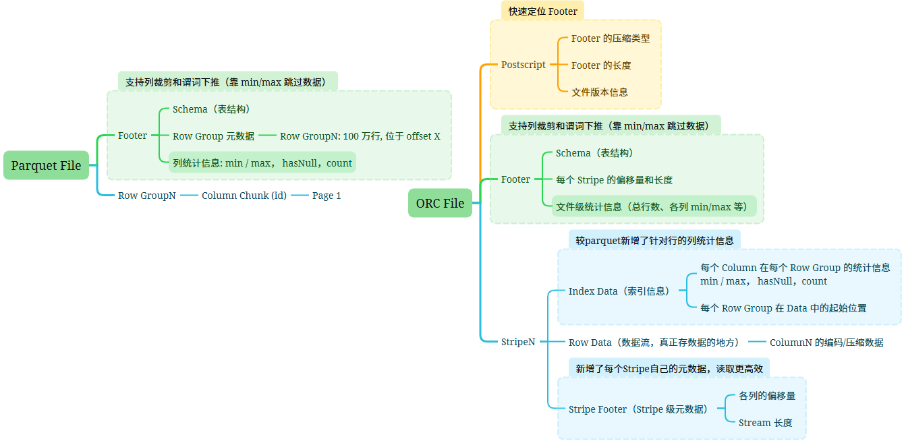

# 1、引入

我们已经学了很多在 Spark 中对已分发的数据执行的操作。到目前为止，所展示的示例都是从本地集合或者普通文件中进行数据读取和保存的。但有时候，数据量可能大到无法放在一台机器中，这时就需要探索别的数据读取和保存的方法了。

Spark 支持很多种输入输出源。一部分原因是 Spark 本身是基于 Hadoop 生态圈而构建，特别是 Spark 可以通过  Hadoop MapReduce 所使用的InputFormat 和 OutputFormat 接口（MapReduce 中用来连接数据源的 Java API）访问数据，而大部分常见的文件格式与存储系统（例如 S3、HDFS、Cassandra、HBase 等）都支持这种接口。

不过，基于这些原始接口构建出的高层 API 会更常用。幸运的是，Spark 及其生态系统提供了很多可选方案。本章会介绍以下三类常见的数据源。

- **文件格式与文件系统**
  对于存储在本地文件系统或分布式文件系统（比如 NFS、HDFS、Amazon S3 等）中的数据，Spark 可以访问很多种不同的文件格式，包括文本文件、JSON、SequenceFile，以及 protocol buffer。我们会展示几种常见格式的用法，以及 Spark 针对不同文件系统的配置和压缩选项。

- **Spark SQL中的结构化数据源**
  第 9 章会介绍 Spark SQL 模块，它针对包括 JSON 和 Apache Hive 在内的结构化数据源，为我们提供了一套更加简洁高效的 API。此处会粗略地介绍一下如何使用 Spark SQL，而大部分细节将留到第 9 章讲解。

- **数据库与键值存储**
  本章还会概述 Spark 自带的库和一些第三方库，它们可以用来连接Cassandra、HBase、Elasticsearch 以及 JDBC 源。这里选择的大多数方法都支持 Spark 所支持的三种编程语言，但是还是有一些库只支持 Java 和 Scala。这种情况我们会专门指出。

# 2、文件格式

在学习 Spark 时，我们经常会接触到 Text、JSON、CSV、Parquet、ORC、SequenceFile 和 ObjectFile 等文件格式。这些文件格式并不是 Spark 独有的，其中一些来自 Hadoop 生态，一些是通用的数据交换格式，还有一些专门针对大数据分析进行了优化

对于初学者，最重要的是理解：

1. **这些文件格式是什么？** 它们在磁盘上如何组织数据？
2. **为什么需要这么多文件格式？** 它们分别解决了什么问题？
3. **各自有什么特点？** 包括 Schema、压缩、并行读取和查询性能。
4. **适用于什么场景？** 为什么有些格式逐渐被淘汰？
5. **Spark 如何读取和写入这些格式？**
6. **目前企业实际使用哪些格式？**

按照文件格式的类型，可以将文件格式划分如下

| 类别                  | 文件格式                         | 核心特点                                | 存储方式              | 是否自带 Schema                   |
| ------------------- | ---------------------------- | ----------------------------------- | ----------------- | ----------------------------- |
| 文本类                 | Text、CSV、JSON                | 数据以文本形式保存，人类可以直接阅读                  | 行存储               | Text/CSV 否<br/>JSON 半结构化（靠推断） |
| 二进制行存储              | SequenceFile、ObjectFile、Avro | 数据以二进制形式保存，主要服务于 Hadoop 和 Spark RDD | 行存储，二进制           | SequenceFile 否，Avro 是         |
| 列存储                 | Parquet、ORC                  | 按列组织数据，针对分析型查询优化                    | 列存储，二进制，带压缩和统计信息  | 是                             |
| 表格式（建立在 Parquet 之上） | Delta Lake、Iceberg、Hudi      |                                     | Parquet 数据文件加事务日志 | 是                             |

## 基础概念

### 区分文件格式、存储系统和计算引擎

假设你有一个包含一亿条用户记录的数据集，需要使用 Spark 进行分析。这个过程中涉及三个不同的概念：

| 概念   | 代表技术                 | 主要职责          |
| ---- | -------------------- | ------------- |
| 计算引擎 | Spark、Flink          | 读取数据并执行计算     |
| 存储系统 | HDFS、ADLS、Amazon S3  | 保存文件，提供文件访问能力 |
| 文件格式 | CSV、JSON、Parquet、ORC | 定义文件内部的数据组织方式 |

例如：

- HDFS 负责将一个 Parquet 文件存储到多个 DataNode 上。
- Parquet 定义这个文件内部的数据结构。
- Spark 负责读取 Parquet 文件并执行 SQL 查询。

**HDFS 并不关心文件是 CSV 还是 Parquet。** 对于 HDFS 而言，它们都是字节数据。而 Spark 需要使用对应的文件读取器，才能正确解析其中的数据。

### 行存储与列存储

假设存在如下数据：

| ID  | Name  | Age | City     |
| --- | ----- | --- | -------- |
| 1   | Tom   | 20  | Beijing  |
| 2   | Jack  | 25  | Shanghai |
| 3   | Alice | 30  | Chengdu  |

行式存储：数据按照**行**组织，一条记录的各个字段通常存储在一起

```plain
1、Tom、20、Beijing
2、Jack、25、Shanghai
3、Alice、30、Chengdu
```

列式存储：数据按照**列**组织，一列字段的各个行通常存储在一起

```plain
ID：1、2、3
Name：Tom、Jack、Alice
Age：20、25、30
City：Beijing、Shanghai、Chengdu
```

行式存储适合：读取完整记录、以记录为单位进行处理、数据交换和日志存储

列式存储适合：数据分析、数据仓库、聚合计算、OLAP 查询

---

## 2.0 配套代码说明

配套示例项目：`BigDataLearningNotes\Spark\ScalaApplicaton\spark-data-io`。所有格式都从 `input` 读取，保存到 `output` 下同名的格式子目录。主入口只演示简单的读取和保存，不重新读取输出，也不验证结果。

项目提供三种输入txt、json、csv（可直接编辑）

- `input\text\messages.txt`
  
  ```plain
  Hello Spark
  你好，Spark
  Hello Spark
  ```

- `input\json\students.json` ：每行一个对象
  
  ```json
  {"id":1,"name":"Alice","score":90}
  {"id":2,"name":"Bob, Jr.","score":85}
  {"id":3,"name":"李 \"雷\"","score":95}
  ```

- `input\csv\students.csv`：有表头，使用默认的反斜杠转义字段中的引号。
  
  ```plain
  id,name,score
  1,Alice,90
  2,"Bob, Jr.",85
  3,"李 \"雷\"",95
  ```

首次使用，在项目目录先运行独立初始化入口，目的是构建text-gzip、parquet、orc、sequence、object类型的输入：

```powershell
sbt "runMain com.example.PrepareFileInputsApp"
```

从文本样例生成 `input\text-gzip`，从 JSON 样例生成 `input\parquet`、`input\orc`、`input\sequence` 和 `input\object`（这些是压缩或二进制文件，不适合手写）

> 初始化入口只接收输入目录，例如 `sbt "runMain com.example.PrepareFileInputsApp D:\spark-input"`，其中须先放好上述文本、JSON、CSV 样例。

随后运行主入口（之后通常只需运行这一条）：

```powershell
sbt "runMain com.example.FileFormatsApp"
```

主入口分别演示文本（含 gzip）、JSON、CSV、Parquet、ORC、SequenceFile 和 ObjectFile 的读取与写入，不会自动初始化输入。请先准备好所有输入文件。`wholeTextFiles` 额外演示将每个文本文件整体读为一条记录。每种格式占用一个子目录：`text`、`text-gzip`、`json`、`csv`、`parquet`、`orc`、`sequence`、`object`。Spark 保存的是包含 `part-*` 文件的目录，而非单个文件。

下面各小标题中的代码与主入口对应，默认已有 `spark` 和 `sc = spark.sparkContext`。代码只做读取和保存，不包含结果验证。输出目录已存在时会报错；再次运行前请自行移走旧输出，或改用新的输出路径。本项目使用 Spark 3.5.9，建议使用 JDK 8 或 11 运行；JDK 21 不在其官方支持范围内。 

---

## 2.1 文本类文件格式

文件内容主要由字符构成，可以使用文本编辑器直接查看。它们通常具有较好的通用性，但在大规模分析场景下，存储和计算效率不如专门设计的列式格式。

### 2.1.1 文本文件（Text File）

Text File 是最简单的数据存储形式，Text File 本身没有规定每行应该包含什么字段，Spark 通常将每一行视为一条记录

所以下面这几种都是合法的输入

```plain
Tom
Jack
Alice
Bob
```

```plain
1,Tom,20
2,Jack,25
3,Alice,30
```

```plain
2026-11-25 10:00:00 INFO Application started
2026-11-25 10:00:01 ERROR Connection failed
```

**优点：**

1. 格式简单，不需要复杂的解析工具。
2. 可读性强，可以直接查看文件内容。
3. 兼容性好，几乎所有编程语言都支持。
4. 适合保存日志、文本和原始数据。
5. 普通未压缩文本文件通常支持并行读取。

**缺点：**

1. 没有 Schema。
2. 不保存字段的数据类型。
3. 通常需要开发人员自行解析。
4. 无法利用 Parquet 那样的列统计信息跳过数据。
5. 对大规模结构化数据分析不够高效。

**应用场景**

- 应用程序/Web 服务器日志
- 原始文本数据
- WordCount 等文本处理任务
- 简单的数据导入和导出

```scala
// RDD API读取
val input = sc.textFile("input/text/messages.txt")
// DataFrame API读取
val df = spark.read.text("/data/users.txt")

val outputFile = "output/text"
// RDD 写入
input.saveAsTextFile(outputFile)
// DataFrame 写入
df.write
  .mode("overwrite")
  .text("/output/users")
```

### 2.1.2 JSON

JSON 全称：JavaScript Object Notation，是一种轻量级的数据交换格式。与普通 Text 不同，JSON 具有明确的语法结构：

```json
{
  "id": 1,
  "name": "Tom",
  "age": 20,
  "address": {
    "city": "Beijing",
    "country": "China"
  }
}
```

JSON支持 字符串、数字、布尔值、null、数组、对象，因此它能够表达比 CSV 更复杂的数据结构

**优点：**

1. 结构清晰。
2. 支持嵌套对象。
3. 支持数组。
4. 字段名具有自描述能力。
5. 广泛用于 API 和系统间的数据交换。
6. Spark 可以推断 Schema。

**缺点：**

1. 字段名反复出现，增加文件大小。
2. 文本解析成本较高。
3. 数据类型可能不一致。
4. Schema 推断需要额外计算。
5. 不适合高性能的大规模分析查询。

**应用场景**

- REST API
- Web 应用数据交换
- 事件日志
- 用户行为埋点
- Kafka 消息
- 半结构化数据存储

Spark 默认使用的 JSON 文件读取方式，通常要求每行是一条完整的 JSON 记录，这种形式通常称为**JSON Lines 或 NDJSON**

```json
{"id":1,"name":"Tom","age":20}
{"id":2,"name":"Jack","age":25}
{"id":3,"name":"Alice","age":30}
```

这样如果每一行都是独立记录，Spark 就可以根据文件切分情况，让多个 Task 并行处理不同的数据范围；

但是，如果整个文件是一个巨大的 JSON 对象就无法被拆分为多个独立输入分片，大文件的并行读取能力会受到限制。如果有跨多行的单个 JSON，需要在读取时设置 `multiLine=true`。

```scala
// 每行一个 JSON 对象，Spark 自动推断字段名和类型。
val json = spark.read.json("input/json/students.json")

//生产环境通常更推荐显式指定 Schema
val json2 = spark.read
  .schema("id LONG, name STRING, score DOUBLE")
  .json("input/json/students.json")

// 保存为 JSON 文件目录。
json.write.json("output/json")
```

### 2.1.3 CSV/TSV

CSV 文件和 TSV 文件有时支持的标准并不一致，主要是在处理换行符、转义字符、非 ASCII 字符、非整数值等方面。CSV 原生并不支持嵌套字段，所以需要手动组合和分解特定的字段

| 格式  | 英文全称                   | 中文全称   | 分隔符      |                |
| --- | ---------------------- | ------ | -------- | -------------- |
| CSV | Comma-Separated Values | 逗号分隔值  | 逗号 `,`   | 1,Tom,20       |
| TSV | Tab-Separated Values   | 制表符分隔值 | Tab `\t` | 1    Tom    20 |

与 JSON 中的字段不一样的是，这里的每条记录都没有相关联的字段名，只能得到对应的序号。常规做法是使用第一行中每列的值作为字段名。

**优点：**

1. 格式简单。
2. 人类容易阅读。
3. Excel 等工具支持良好。
4. 非常适合二维表格数据。
5. 便于跨系统交换。

**缺点：**

1. 不保存字段类型。
2. 不支持原生嵌套结构。
3. 字段分隔符可能与数据内容冲突。
4. Schema 通常需要推断或显式指定。
5. 大规模分析性能通常不如 Parquet。

**应用场景**

- Excel 数据导入
- 数据库导出
- 报表交换
- 第三方数据接入
- 小型数据集处理

```scala
// 第一行作为列名，inferSchema 根据内容推断数字等字段类型。
val csv = spark.read
  .option("header", "true")
  .option("inferSchema", "true")
  .csv("input/csv/students.csv")
// 保存时也写入表头。
csv.write.option("header", "true").csv("output/csv")
```

## 2.2、二进制行式存储

这一类文件与 Text、JSON、CSV 最大的区别是：**数据不再主要以人类可直接阅读的字符形式保存，而是采用二进制编码。** 但二进制存储并不意味着一定比文本格式快。实际性能还取决于：

- 编码方式

- 压缩算法

- 数据结构

- 读取模式

- 查询引擎的优化能力

### 2.2.1 SequenceFile

SequenceFile 是 Hadoop 提供的一种二进制文件格式，它主要用于保存 Key-Value 类型的数据。

SequenceFile 通常包含：Header + Records，因此，Records之间有同步标记，意味着Spark 可以从任意路标开始读，所以它能够支持文件切分和并行读取

```plain
SequenceFile
 │
 ├── Header(说明：里面存的是什么类型数据)
 │     ├── key 类型
 │     └── value 类型
 │
 └── 数据块Records（按同步标记 Sync Marker 切分，用于定位）
       ├── Sync Marker1 （标记从这里开始读是安全的）
       ├── Record 1 (id, name) （真正的数据）
       ├── Record 2 (id, name)
       │
       ├── Sync Marker2
       ├── Record 3 (id, name)
       ├── Record 4 (id, name)
       │
       ├── Sync Marker3
       ├── Record 5 (id, name)
       └── ...
```

**优点：**

2. 使用二进制编码。
3. 支持 Key-Value 数据。
4. 支持压缩。
5. 支持文件切分。
6. 与 Hadoop MapReduce 兼容性好。

**缺点：**

2. 不方便人工查看。
3. 与 Hadoop Writable 类型体系绑定较深。
4. 不具备 Parquet 那样的列式查询优化能力。
5. 在现代 Spark 数据分析中使用较少。

**应用场景**

- 传统 Hadoop MapReduce
- Hadoop 中间结果存储
- 旧系统数据交换
- 某些小文件合并方案

HDFS 中存在大量小文件时，可以将文件名作为 Key、文件内容作为 Value，保存到 SequenceFile 中。这样能够减少独立 HDFS 文件的数量。

不过，现代系统也有其他解决小文件问题的方法，例如合并 Parquet 文件

```scala
import org.apache.hadoop.io.{IntWritable, Text}

// 读取 Hadoop 键值文件，键是整数，值是文本。
val sequence = sc.sequenceFile[IntWritable, Text]("input/sequence")

// 将 Hadoop 类型转成 Scala 的 (Int, String)。
val pairs = sequence.map { case (id, name) => (id.get(), name.toString) }
// 保存为 SequenceFile 键值文件。
pairs.saveAsSequenceFile("output/sequence")
```

### 2.2.2、ObjectFile

ObjectFile 是 Spark RDD API 提供的一种对象持久化文件形式，它允许开发人员将 RDD 中的对象序列化并保存到文件系统。例如：

```scala
case class User(
  id: Int,
  name: String,
  age: Int
)
```

对应 RDD 中包含：

```scala
User(1, "Tom", 20)
User(2, "Jack", 25)
```

ObjectFile 可以JVM 对象序列化并保存到磁盘，读取时再反序列化成对象。这种特性使得ObjectFile能够为“Spark的作业内部 / 中间结果”提供的一种轻量级对象存储格式

```plain
ObjectFile
 │
 ├── part-00000
 │     ├── 序列化后的对象 1
 │     ├── 序列化后的对象 2
 │     └── ...
 │
 ├── part-00001
 │     ├── 序列化后的对象 3
 │     └── ...
 │
 └── _SUCCESS
```

这里有一个重要知识点：**Spark 的 ObjectFile 底层使用 SequenceFile 作为存储容器**，所以ObjectFile可以理解为是Spark 基于 SequenceFile 提供的一套**对象序列化读写机制**，ObjectFile的底层可以理解为：

- Spark 将 RDD 中的对象分批序列化。

- 得到二进制字节数组。

- 将字节数组保存到 SequenceFile。

- 读取时再反序列化。

**优点：**

2. 可以直接保存对象。
3. 使用方便。
4. 不需要手动设计文本编码格式。
5. 适合部分 RDD 中间结果持久化场景。

**缺点：**

2. 依赖 Java 序列化。
3. 序列化和反序列化存在开销。
4. 跨语言兼容性较差。
5. 对对象类定义的变化比较敏感。
6. 不支持 Parquet 那样的列裁剪。
7. 不适合现代数据湖的长期数据存储。

**应用场景**

- Spark RDD 临时数据保存
- 旧 Spark 应用
- 特定对象类型的中间结果持久化

```scala
// 使用准备文件入口中的同一个 Student 类，不要重新定义另一个类。
import com.example.FileFormatsApp.Student

// 按准备文件时使用的 Student 类型读取，只读取可信文件。
val students = sc.objectFile[Student]("input/object")
// 将学生对象保存为 ObjectFile。
students.saveAsObjectFile("output/object")
```

> 注意：ObjectFile 并不适合跨语言的数据交换。
> 
> 例如，Python 程序通常不能像读取 Parquet 一样，直接通用地解析 Spark Scala RDD 的 ObjectFile。

## 2.3、列存储

这是现代 Spark 数据分析中非常重要的一类文件格式，主要包括 Parquet、ORC

### 2.3.1 Parquet

Apache Parquet 是一种**面向分析型**工作负载设计的列式存储文件格式，它**按照列组织数据**，但不是简单按照列区域划分，其内部是由多个 Row Group + 一个 Footer组成的，如下：

- Row Group（行块）是按“行”切分出来的数据块，一个 Row Group = 一批行大小，一般建议 128 MB 左右（和 HDFS Block 对齐）。Spark 读 Parquet 时，一个 Row Group 通常对应一个 Task。
  
  - Column Chunk（列块），在每个 Row Group 中又会按照列将数据集中存放到一起，称之为列块。
    
    - Page（页），Column Chunk 内部更小的读写单位，每个 Page 通常 几十 KB ~ 几 MB。**Page 是真正“读 / 解压”的最小单位**，所以同一个Column Chunk里的不同Page可能有不同的编码和压缩方式。

- **Footer（文件尾），包含Schema、Row Group 元数据、列统计信息**，Spark利用他们在执行查询前**列裁剪、谓词下推、压缩等**就可以跳过不需要的数据，优化读取过程。

```plain
Parquet File
 │
 ├── Row Group 1
 │     │
 │     ├── Column Chunk (id)
 │     │     ├── Page 1
 │     │     ├── Page 2
 │     │     └── ...
 │     │
 │     ├── Column Chunk (name)
 │     │     ├── Page 1
 │     │     └── ...
 │     │
 │     └── Column Chunk (score)
 │           ├── Page 1
 │           └── ...
 │
 ├── Row Group 2
 │     ├── Column Chunk (id)
 │     ├── Column Chunk (name)
 │     └── Column Chunk (score)
 │
 ├── Row Group 3
 │     └── ...
 │
 └── Footer（文件尾部，只有 1 个）
       ├── Schema（表结构）
       │      ├── id: INT
       │      ├── name: STRING
       │      └── score: INT
       ├── Row Group 元数据
       │     ├── 每个 Row Group 有多少行
       │     ├── 每个 Column Chunk 的字节数
       │     └── 每个 Column Chunk 的起始位置
       │
       └── 各列统计信息（min / max / null count 等）
```

**优点：**

2. 列式存储。
3. 支持 Schema。
4. 支持嵌套结构。
5. 支持列裁剪。
6. 支持谓词下推。
7. 压缩效率通常较高。
8. 支持并行读取。
9. 广泛兼容现代大数据计算引擎。

**缺点：**

2. 不方便人工查看。
3. 不适合频繁修改单条记录。
4. 小文件过多会影响性能。
5. 写入和编码比简单文本更复杂。
6. 原生 Parquet 文件本身不提供完整的数据库事务管理能力。

**应用场景**

- 数据仓库
- 数据湖
- ETL 中间结果
- 用户行为分析
- 日志分析
- 大规模报表计算
- Spark SQL 查询

```scala
// Parquet 文件中已保存字段类型，直接读取和保存即可。
val parquet = spark.read.parquet("input/parquet")
val df = spark.read
  .format("parquet")
  .load("input/parquet")

parquet.write.parquet("output/parquet")
df.write
  .mode("overwrite")
  .option("compression", "snappy") //指定压缩
  .partitionBy("date") //按照日期分区
  .parquet("output/parquet")
```

### 2.3.2 ORC

ORC 全称：Optimized Row Columnar 优化行列混合存储，和Parquet一样是一种面向大数据分析的列式存储格式。它最初主要服务于 Hive 生态。ORC 与 Parquet 非常相似，两者都支持：列式存储、压缩、Schema、列裁剪、统计信息、数据块跳过。

其内部是由多个 Stripe + 一个Postscript + 一个Footer组成的，如下：

- Stripe（行块）是按“行”切分出来的数据块，一个 Row Group = 一批行大小，默认约 **64 MB**（可配置），Spark 读 ORC 时一个 Stripe 通常对应一个 Task。
  
  - Index Data​：每个 Stripe 内按 **Row Group**（默认 1 万行）存每个 Row Group 在 Data 中的偏移，实现**真正按偏移量随机读**，记录每列的统计信息，帮助跳过无关数据
  
  - Row Data：真正存数据的地方，按列编码 + 压缩（如 Zlib、Snappy）
  
  - Stripe Footer：每个 Stripe 自己的元数据（各列偏移量、Stream 长度），让 Stripe 内部读取更独立高效。

- Postscript：文件最尾端，存 Footer 压缩类型、长度、版本。读取时先读它，快速定位 Footer（Parquet 也有类似但不单独命名此层）。

- **Footer（文件尾），包含Schema、每个 Stripe 的偏移量和长度、文件级统计信息（总行数、各列 min/max 等）**，Spark利用他们在执行查询前**列裁剪、谓词下推、压缩等**就可以跳过不需要的数据，优化读取过程。

```plain
ORC File
 │
 ├── Postscript（文件末尾几个字节，只有 1 个）
 │     ├── Footer 的压缩类型
 │     ├── Footer 的长度
 │     └── 文件版本信息
 │
 ├── Footer（文件级元数据，只有 1 个）
 │     ├── Schema（表结构）
 │     ├── 文件级统计信息（总行数、各列 min/max 等）
 │     └── 每个 Stripe 的偏移量和长度
 │
 ├── Stripe 1
 │     │
 │     ├── Index Data（索引信息）
 │     │     ├── 每个 Column 在每个 Row Group 的统计信息
 │     │     │     ├── min / max
 │     │     │     ├── hasNull
 │     │     │     └── count
 │     │     └── 每个 Row Group 在 Data 中的起始位置
 │     │
 │     ├── Row Data（数据流，真正存数据的地方）
 │     │     ├── Column 1 的编码/压缩数据
 │     │     ├── Column 2 的编码/压缩数据
 │     │     └── Column 3 的编码/压缩数据
 │     │
 │     └── Stripe Footer（Stripe 级元数据）
 │           ├── 各列的偏移量
 │           └── Stream 长度
 │
 ├── Stripe 2
 │     ├── Index Data
 │     ├── Row Data
 │     └── Stripe Footer
 │
 └── Stripe 3
       ├── Index Data
       ├── Row Data
       └── Stripe Footer
```

两者都是**列式存储**，读写优化逻辑相通：

- **行切分**：Parquet 的 `Row Group` ≈ ORC 的 `Stripe`（都是按行批量切分，作为读取/Task 的大单位）。
- **列存储**：Parquet 的 `Column Chunk` ≈ ORC `Row Data` 中的各列流（只读取需要的列）。
- **元数据优化**：都有 `Footer + 统计信息`，都支持**列裁剪**和**谓词下推**（靠 min/max 跳过数据）

为了方便理解，我画上了Parquet和ORC在结构上的组成，方便观察区别。



ORC增加了：

- **Postscript**：文件最尾端，存 Footer 压缩类型、长度、版本。读取时先读它，快速定位 Footer（Parquet 也有类似但不单独命名此层）。

- **Stripe Footer**：每个 Stripe 自己的元数据（各列偏移量、Stream 长度），让 Stripe 内部读取更独立高效。

- **Stripe 内部的 Index Data**：划分行之后的行统计信息（记录每个 Row Group 每列的 min/max, hasNull, count），还存每个 Row Group 在 Data 中的偏移，实现**真正按偏移量随机读**

**实际 ORC 还常配布隆过滤器（图中未画），对等值查询（如 id=123）跳过能力更强**

**优点：**

2. 列式存储。
3. 压缩效率高。
4. 支持列裁剪。
5. 支持统计信息。
6. 支持索引机制。
7. 与 Hive 生态集成良好。

**缺点：**

2. 不方便人工查看。
3. 对单条记录频繁修改不友好。
4. 在部分跨平台场景中，Parquet 的生态兼容性更广。

**应用场景**

- Hive 数据仓库
- Hadoop 数据分析
- 大规模 OLAP 查询
- 基于 Hive 的 ETL 系统

```scala
// ORC 同样自带字段类型，换成 orc 方法即可。
val orc = spark.read.orc("input/orc")
orc.write.orc("output/orc")
```

## 2.4 总结

| 文件格式         | 数据组织          | Schema          | 可读性 | 主要 API          | 典型应用           |
| ------------ | ------------- | --------------- | --- | --------------- | -------------- |
| Text         | 文本记录          | 无               | 高   | RDD / DataFrame | 日志、文本处理        |
| JSON         | 文本记录          | 可推断             | 高   | DataFrame       | API、事件数据       |
| CSV/TSV      | 文本表格          | 可推断             | 高   | DataFrame       | 数据交换、报表        |
| SequenceFile | 二进制 Key-Value | Key/Value 类型元数据 | 低   | RDD             | 传统 Hadoop      |
| ObjectFile   | 序列化对象         | 依赖对象类型          | 低   | RDD             | 旧 Spark RDD 应用 |
| Parquet      | 二进制列式         | 有               | 低   | DataFrame       | 数据湖、数仓         |
| ORC          | 二进制列式         | 有               | 低   | DataFrame       | Hive 数仓        |

## 2.5 市面上的常见用法

现代企业通常不会只使用一种文件格式，而是根据数据处理阶段选择不同格式。

### 2.5.1 数据采集阶段

常见格式：JSON、CSV、Text、Avro。例如：

- Web 应用产生用户行为日志。日志可以先以 JSON 形式进入 Kafka，再写入数据湖。

- CSV 则经常用于接收第三方提供的批量数据。

### 2.5.2 数据清洗和 ETL 阶段

常见格式：Parquet、ORC。例如：

- Spark 读取 JSON 日志：
  
  ```scala
  val raw = spark.read.json("/raw/events")
  ```

- 清洗数据：
  
  ```scala
  val cleaned = raw
  .filter("userId IS NOT NULL")
  .dropDuplicates()
  
  //写成 Parquet
  cleaned.write
  .mode("overwrite")
  .parquet("/processed/events")
  ```

这样后续分析任务就不需要反复解析原始 JSON

### 2.5.3 数据仓库阶段

常见格式：Parquet、ORC

Spark 数据仓库和现代数据湖中，Parquet 非常普遍。传统 Hive 数据仓库则使用ORC 。

### 2.5.4 数据湖与 Lakehouse

目前现代数据平台中，除了 Parquet、ORC，还经常出现：

- Delta Lake
- Apache Iceberg
- Apache Hudi

这里需要特别区分：**Parquet 是文件格式，而 Delta Lake、Iceberg、Hudi 主要提供表管理能力。**

它们通常使用 Parquet 保存实际数据，同时增加元数据和事务管理机制。

例如：普通 Parquet 数据集可以支持分析查询。但是如果希望实现：

- UPDATE
- DELETE
- MERGE
- ACID 事务
- 时间旅行
- 表级 Schema 演进

就可以考虑 Delta Lake、Iceberg 或 Hudi，这些技术能够在数据湖存储之上提供更接近数据库表的能力。

### 2.5.5 SequenceFile 和 ObjectFile 的现状

SequenceFile 主要出现在传统 Hadoop 系统和遗留作业中；ObjectFile 则主要与旧 Spark RDD 应用有关。

对于现代 Spark 开发，如果数据可以表达为结构化表，通常优先考虑：**DataFrame + Parquet**

而不是：**RDD + ObjectFile**

因为 DataFrame 能够利用 Spark SQL 的优化能力，而 ObjectFile 主要保存序列化对象，不具备同等级别的结构化查询优化能力。


# 3、文件系统

**文件系统是一套组织、查找和管理文件与目录的机制**，它规定了文件怎么命名、存放和查找，以及如何处理读写、权限等操作。

比如在Windows、Linux系统中用户可以通过可视化界面或命令行来管理文件：

- 利用可视化的文件资源管理器，用鼠标点点就可以新建、修改、删除文件；

- 打开cmd使用命令行批量删除以 xx 开头的文件。

其背后都是操作系统中的**本地文件系统**执行了相应的程序来处理这些请求，**其特点就是每台自己管自己的磁盘**。在Windows 中，主流的是文件系统 NTFS；在 Linux 中则是 ext4（通用默认）和 XFS（擅长大文件、大容量场景）

随着存储和管理的需求不断增加，单机使用的本地文件系统无法完成存储和管理，出现了**跨机器存储文件的分布式文件系统**，它可以通过网络传输使得多台机器的磁盘被统一管理，对上层看起来像一个文件系统。

如：HDFS 全称 Hadoop Distributed File System（直译就是 Hadoop 分布式文件系统）。只要在**多台电脑上部署并组建 HDFS 集群**，这些机器上被分配给 HDFS 的存储空间就会被统一管理，对外看起来像一块巨大的硬盘。

分布式存储好后就可以通过计算框架（如 MapReduce、Spark）**就近**（先本地再网络）读取各机器上的数据块并行处理，从而把多台机器的存储和计算能力利用起来。

**分布式存储**主要扩展存储容量、可靠性和读写吞吐量；只有配合 Spark、MapReduce 等**分布式计算框架**，才会扩展计算能力，**分布式存储和分布式计算二者是相辅相成的。**，HDFS 可以利用**数据本地性**；而 S3、Azure Blob Storage 通常采用**计算与存储分离，通过网络提供数据**。

> 我的推测：由于**分布式存储和分布式计算二者是相辅相成的**，所以初代的计算框架Hadoop 1.x 直接把存储HDFS和计算MapReduce打包到一起了，直到 Hadoop 2.x 开始，两者才开始进一步解耦

---

不同的文件系统会有不同的**数据存储、程序访问方式、操作权限等**。但对于Spark而言，它可以用**相似**的代码**读写不同的文件系统**。

- Spark 的文件数据源负责按指定格式读写数据，例如把 Parquet 文件解析成表中的行和列。
- HDFS 根据路径的 URI 和配置选择对应的访问实现，例如通过 S3A 访问 Amazon

> 这是因为 DataSource API 内部通过统一的读写接口封装了**不同的数据源**，而**文件系统的差异**由更底层的 Hadoop FileSystem 通过工厂/SPI 机制处理。

## 3.1 区分路径、文件格式、表格式

如果搞不清楚路径、文件格式、表格式这几个概念可以看一下：以 `spark.read.parquet("abfss://lake@demo.dfs.core.windows.net/events/")` 为例：

| 层次            | 回答什么问题               | 文件路径案例                                                                                                                       |
| ------------- | -------------------- | ---------------------------------------------------------------------------------------------------------------------------- |
| **存储路径与访问方式** | 数据放在哪，Spark 怎么连过去？   | `file:///` 按当前进程可见的文件系统路径访问，也可能指向共享挂载目录；<br/>`hdfs://` 访问 HDFS，<br/>`s3a://` 通过 S3A 访问 S3<br/>`abfss://` 通过 ABFS 访问 Azure 存储 |
| **文件格式**      | 拿到字节后，怎么解析成数据？       | Text、CSV、JSON、Parquet<br/>同一份 Parquet 文件可以放在不同存储上                                                                            |
| **表格式**       | 哪些文件组成当前版本的表，怎么管理更新？ | Delta Lake、Iceberg<br/>它们不是文件系统，不负责替代底层存储，而是在底层存储之上管理表的元数据和版本                                                                |

所以，**同一份 Parquet 数据可以存在 HDFS、S3 或 ADLS Gen2 上**。
存储位置和文件格式是两个独立事件：换存储位置不一定要换文件格式；反过来，换文件格式（从 CSV 换成 Parquet），也不一定要搬存储。

## 3.2 本地文件系统：操作系统如何组织本地存储

**本地文件系统**是操作系统**在本地存储上组织和管理文件**的方式。Linux 常见的有 ext4、XFS，Windows 常见的有 NTFS。一台机器可以挂载多个本地文件系统。例如，在 Linux 上，根目录 / 可以使用 ext4，/data 可以挂载另一块使用 XFS 的盘。虽然用户看到的是同一棵目录树，底下却可以有多个文件系统。

**底层逻辑**： 本地文件系统由操作系统管理一块磁盘，操作系统根据文件路径逐级查找目录项，找到文件的元数据（权限、大小和数据块的位置等），再定位磁盘上的数据块。

可以用**Spark的本地模式**模拟本地读取：此时只有一个同一个机器，一个 JVM，一个调度Task的Driver 和 多个执行Task的Executor，读取文件时就不会有网络传输。

```scala
val rdd = sc.textFile("file:///home/holden/happypandas.gz")
```

**优缺点与场景**： 访问本机磁盘不必经过网络，简单，适合本地开发、单机应用和临时文件。缺点是机器之间不会自动共享数据。两台机器都有 /data，不代表它们看到的是同一份文件。

> 此时我有冒出来以一个疑问：在**集群模式**下，如果存储不是分布式的，那么执行计算时还能利用上集群的分布式计算特性吗？
> 
> 答：可以的，数据怎么存、任务怎么读、计算怎么分，是三件事
> 
> Spark可以通过 `parallelize` 把数据分发给各个 Executor 做并行处理。这种方式需要把整个文件从 Driver 经网络传给 Executor，效率较低，只适合小文件或本地测试。

## 3.3 HDFS

HDFS 是 Apache Hadoop 项目中的**开源分布式文件系统**。Spark 可以在 HDFS 已有 API（Hadoop FileSystem、InputFormat 和 OutputFormat 等接口）之上提供HDFS数据读取、转换和计算能力。

> 关于HDFS读写底层的实现过程感兴趣，请详见：[【Hadoop01】HDFS 读写过程：从副本放置到 Pipeline 与数据校验](https://eleanora-lyh.github.io/MyLearningNotes/posts/hadoop/hdfs%E8%AF%BB%E5%86%99%E8%BF%87%E7%A8%8B/)

**最佳实践**

**Spark 和 HDFS 可以部署在同一批机器上**，这样 Spark 可以利用数据分布来尽量避免一些网络开销。在 Spark 中使用 HDFS 只需要将输入输出路径指定为 `hdfs://master:port/path`

## 3.4 云对象存储 Amazon S3

S3 全称 **Amazon Simple Storage Service**，它是全球规模的**分布式对象存储。**

> Amazon S3和Azure Blob Storage 的分布式云存储服务都是**闭源**的，所以我们无法知道其内部的存储是如何实现的。

这句话已经可以看出端倪了，他也实现了分布式存储，但对外暴露的是**对象模型**（HDFS 对外暴露的是**文件系统模型**），打个比方如下：

- **HDFS 像一个分布式硬盘**：用户看到文件和目录，文件内部被切成 Block 存在 DataNode 上。并通过 Hadoop FileSystem API 提供创建、打开、追加、重命名、删除和列举等文件操作。
- **S3 像一个超大规模对象仓库**：用户把一整个对象Object保存进去，再通过 Bucket 和 Key 访问数据。提供 PUT、GET、DELETE、LIST 等 API 操作对象。

虽然都是分布式存储，但 **对象存储 ≠ 文件系统**。关键差异如下：

| 维度         | S3（对象存储）                                      | HDFS（分布式文件系统）                          |
| ---------- | --------------------------------------------- | -------------------------------------- |
| **数据模型**​  | Bucket/Container、Object/Blob、Key/Name         | 文件（File）、目录树、Block                     |
| **元数据管理**  | 云存储服务内部管理，对用户隐藏                               | NameNode 管文件目录和 Block 位置               |
| **数据节点**   | 云厂商内部存储节点，对用户隐藏                               | DataNode，可由用户部署和运维                     |
| **访问接口**​  | REST API（HTTP PUT/GET/DELETE）                 | 文件系统 API（POSIX 风格、Java FileSystem API） |
| **目录语义**​  | 无真正目录，仅通过 Key 前缀模拟逻辑目录（如 `logs/2024/01/file`） | 有真正的层级目录，支持 `mkdir`、`rename`           |
| **文件修改**​  | 适合顺序写入，**不支持追加或随机写**，只能整体替换（PUT 新对象）          | 支持追加写（某些版本）、随机写                        |
| **原子重命名**​ | 无原子重命名，实际是 Copy + Delete，代价高                  | 元数据操作，原子且快速                            |
| **一致性**​   | 强一致性（自 2020 年起对 PUT、DELETE、GET 均强一致）          | 最终一致性（HDFS 自身是强一致，但依赖 NameNode）        |
| **典型场景**​  | 海量非结构化数据、数据湖、备份归档                             | 大数据批处理、高性能计算                           |

对象存储的模型很简单

```plain
Bucket（存储桶）
└── Object（对象）
    ├── Key：对象名称
    ├── Data：对象内容
    └── Metadata：对象的元数据
```

他的Key一般是如下样式（其中的 / 主要用于按照前缀组织和展示对象）

```plain text
sales/year=2026/month=11/a.parquet
sales/year=2026/month=11/b.parquet
sales/year=2026/month=12/c.parquet
```

控制台可以把它们显示成

```plain text
sales/
└── year=2026/
    ├── month=11/
    │   ├── a.parquet
    │   └── b.parquet
    └── month=12/
        └── c.parquet
```

这种逻辑上的结构对 Spark 很有用，因为 Spark 可以进行分区裁剪：缩小需要列举和读取的对象范围。

当把 `s3n://bucket/path-within-bucket` 传给 Spark 读取时，其内部实际是通过 S3A 连接器（最常用的是 S3AFileSystem即 s3a:// 协议）**把类似文件系统的操作转换为 S3 对象 API 请求**。（也就是前文提到的**Hadoop FileSystem 抽象**​ 在起作用）

```plain text
FileSystem (抽象接口)
└── S3AFileSystem
    ├── 调用 S3 REST API
    └── 将对象存储语义“翻译”成文件系统语义
```

但底层仍有差异：

| 文件系统操作             | S3A 的实现方式                   | 代价           |
| ------------------ | --------------------------- | ------------ |
| `listStatus`（列出目录） | 调用 S3 `ListObjects` API     | 延迟较高，尤其是对象多时 |
| `rename`（重命名）      | Copy 对象 + Delete 原对象        | 非常昂贵，非原子     |
| `create`（写文件）      | 先写本地临时文件，再 Multipart Upload | 需要磁盘空间       |
| `append`（追加写）      | **不支持**​                    | 直接报错         |

**因此，Spark 在 S3 上的最佳实践**

- 写数据时**避免重命名**（如 Spark 的 `_temporary` 目录方案会有性能问题）
- 使用 **S3-optimized committers**（如 EMR 的 `S3ACommitter`）
- 读数据时尽量用 **列式格式（Parquet/ORC）**，减少小文件

# 4、SparkSQL中的结构化数据

## Apache Hive

## JSON

# 5、数据库

## Java数据库连接

## Cassandra

## HBase

## Elasticsearch
