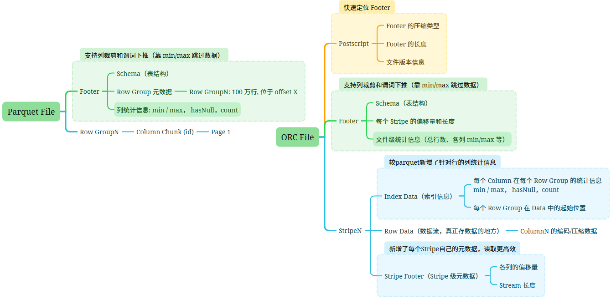

# 1、引入

我们已经学了很多在 Spark 中对已分发的数据执行的操作。到目前为止，所展示的示例都是从本地集合或者普通文件中进行数据读取和保存的。但有时候，数据量可能大到无法放在一台机器中，这时就需要探索别的数据读取和保存的方法了。

Spark 支持很多种输入输出源。一部分原因是 Spark 本身是基于 Hadoop 生态圈而构建，特别是 Spark 可以通过  Hadoop MapReduce 所使用的InputFormat 和 OutputFormat 接口（MapReduce 中用来连接数据源的 Java API）访问数据，而大部分常见的文件格式与存储系统（例如 S3、HDFS、Cassandra、HBase 等）都支持这种接口。

不过，基于这些原始接口构建出的高层 API 会更常用。幸运的是，Spark 及其生态系统提供了很多可选方案。本章会介绍以下三类常见的数据源。

- **文件格式与文件系统**
  对于存储在本地文件系统或分布式文件系统（比如 NFS、HDFS、Amazon S3 等）中的数据，Spark 可以访问很多种不同的文件格式，包括文本文件、JSON、SequenceFile，以及 protocol buffer。我们会展示几种常见格式的用法，以及 Spark 针对不同文件系统的配置和压缩选项。

- **Spark SQL中的结构化数据源**
  第 9 章会介绍 Spark SQL 模块，它针对包括 JSON 和 Apache Hive 在内的结构化数据源，为我们提供了一套更加简洁高效的 API。此处会粗略地介绍一下如何使用 Spark SQL，而大部分细节将留到第 9 章讲解。

- **数据库与键值存储（暂时搁置）**
  本章还会概述 Spark 自带的库和一些第三方库，它们可以用来连接Cassandra、HBase、Elasticsearch 以及 JDBC 源。这里选择的大多数方法都支持 Spark 所支持的三种编程语言，但是还是有一些库只支持 Java 和 Scala。这种情况我们会专门指出。

# 2、文件格式

在学习 Spark 时，我们经常会接触到 Text、JSON、CSV、Parquet、ORC、SequenceFile 和 ObjectFile 等文件格式。这些文件格式并不是 Spark 独有的，其中一些来自 Hadoop 生态，一些是通用的数据交换格式，还有一些专门针对大数据分析进行了优化

对于初学者，最重要的是理解：

1. **这些文件格式是什么？** 它们在磁盘上如何组织数据？
2. **为什么需要这么多文件格式？** 它们分别解决了什么问题？
3. **各自有什么特点？** 包括 Schema、压缩、并行读取和查询性能。
4. **适用于什么场景？** 为什么有些格式逐渐被淘汰？
5. **Spark 如何读取和写入这些格式？**
6. **目前企业实际使用哪些格式？**

按照文件格式的类型，可以将文件格式划分如下

| 类别                  | 文件格式                         | 核心特点                                | 存储方式              | 是否自带 Schema                   |
| ------------------- | ---------------------------- | ----------------------------------- | ----------------- | ----------------------------- |
| 文本类                 | Text、CSV、JSON                | 数据以文本形式保存，人类可以直接阅读                  | 行存储               | Text/CSV 否<br/>JSON 半结构化（靠推断） |
| 二进制行存储              | SequenceFile、ObjectFile、Avro | 数据以二进制形式保存，主要服务于 Hadoop 和 Spark RDD | 行存储，二进制           | SequenceFile 否，Avro 是         |
| 列存储                 | Parquet、ORC                  | 按列组织数据，针对分析型查询优化                    | 列存储，二进制，带压缩和统计信息  | 是                             |
| 表格式（建立在 Parquet 之上） | Delta Lake、Iceberg、Hudi      |                                     | Parquet 数据文件加事务日志 | 是                             |

## 基础概念

### 区分文件格式、存储系统和计算引擎

假设你有一个包含一亿条用户记录的数据集，需要使用 Spark 进行分析。这个过程中涉及三个不同的概念：

| 概念   | 代表技术                 | 主要职责          |
| ---- | -------------------- | ------------- |
| 计算引擎 | Spark、Flink          | 读取数据并执行计算     |
| 存储系统 | HDFS、ADLS、Amazon S3  | 保存文件，提供文件访问能力 |
| 文件格式 | CSV、JSON、Parquet、ORC | 定义文件内部的数据组织方式 |

例如：

- HDFS 负责将一个 Parquet 文件存储到多个 DataNode 上。
- Parquet 定义这个文件内部的数据结构。
- Spark 负责读取 Parquet 文件并执行 SQL 查询。

**HDFS 并不关心文件是 CSV 还是 Parquet。** 对于 HDFS 而言，它们都是字节数据。而 Spark 需要使用对应的文件读取器，才能正确解析其中的数据。

### 行存储与列存储

假设存在如下数据：

| ID  | Name  | Age | City     |
| --- | ----- | --- | -------- |
| 1   | Tom   | 20  | Beijing  |
| 2   | Jack  | 25  | Shanghai |
| 3   | Alice | 30  | Chengdu  |

行式存储：数据按照**行**组织，一条记录的各个字段通常存储在一起

```plain
1、Tom、20、Beijing
2、Jack、25、Shanghai
3、Alice、30、Chengdu
```

列式存储：数据按照**列**组织，一列字段的各个行通常存储在一起

```plain
ID：1、2、3
Name：Tom、Jack、Alice
Age：20、25、30
City：Beijing、Shanghai、Chengdu
```

行式存储适合：读取完整记录、以记录为单位进行处理、数据交换和日志存储

列式存储适合：数据分析、数据仓库、聚合计算、OLAP 查询

---

## 2.0 配套代码说明

配套示例项目：`BigDataLearningNotes\Spark\ScalaApplicaton\spark-data-io`。所有格式都从 `input` 读取，保存到 `output` 下同名的格式子目录。主入口只演示简单的读取和保存，不重新读取输出，也不验证结果。

项目提供三种输入txt、json、csv（可直接编辑）

- `input\text\messages.txt`
  
  ```plain
  Hello Spark
  你好，Spark
  Hello Spark
  ```

- `input\json\students.json` ：每行一个对象
  
  ```json
  {"id":1,"name":"Alice","score":90}
  {"id":2,"name":"Bob, Jr.","score":85}
  {"id":3,"name":"李 \"雷\"","score":95}
  ```

- `input\csv\students.csv`：有表头，使用默认的反斜杠转义字段中的引号。
  
  ```plain
  id,name,score
  1,Alice,90
  2,"Bob, Jr.",85
  3,"李 \"雷\"",95
  ```

首次使用，在项目目录先运行独立初始化入口，目的是构建text-gzip、parquet、orc、sequence、object类型的输入：

```powershell
sbt "runMain com.example.PrepareFileInputsApp"
```

从文本样例生成 `input\text-gzip`，从 JSON 样例生成 `input\parquet`、`input\orc`、`input\sequence` 和 `input\object`（这些是压缩或二进制文件，不适合手写）

> 初始化入口只接收输入目录，例如 `sbt "runMain com.example.PrepareFileInputsApp D:\spark-input"`，其中须先放好上述文本、JSON、CSV 样例。

随后运行主入口（之后通常只需运行这一条）：

```powershell
sbt "runMain com.example.FileFormatsApp"
```

主入口分别演示文本（含 gzip）、JSON、CSV、Parquet、ORC、SequenceFile 和 ObjectFile 的读取与写入，不会自动初始化输入。请先准备好所有输入文件。`wholeTextFiles` 额外演示将每个文本文件整体读为一条记录。每种格式占用一个子目录：`text`、`text-gzip`、`json`、`csv`、`parquet`、`orc`、`sequence`、`object`。Spark 保存的是包含 `part-*` 文件的目录，而非单个文件。

下面各小标题中的代码与主入口对应，默认已有 `spark` 和 `sc = spark.sparkContext`。代码只做读取和保存，不包含结果验证。输出目录已存在时会报错；再次运行前请自行移走旧输出，或改用新的输出路径。本项目使用 Spark 3.5.9，建议使用 JDK 8 或 11 运行；JDK 21 不在其官方支持范围内。 

---

## 2.1 文本类文件格式

文件内容主要由字符构成，可以使用文本编辑器直接查看。它们通常具有较好的通用性，但在大规模分析场景下，存储和计算效率不如专门设计的列式格式。

### 2.1.1 文本文件（Text File）

Text File 是最简单的数据存储形式，Text File 本身没有规定每行应该包含什么字段，Spark 通常将每一行视为一条记录

所以下面这几种都是合法的输入

```plain
Tom
Jack
Alice
Bob
```

```plain
1,Tom,20
2,Jack,25
3,Alice,30
```

```plain
2026-11-25 10:00:00 INFO Application started
2026-11-25 10:00:01 ERROR Connection failed
```

**优点：**

1. 格式简单，不需要复杂的解析工具。
2. 可读性强，可以直接查看文件内容。
3. 兼容性好，几乎所有编程语言都支持。
4. 适合保存日志、文本和原始数据。
5. 普通未压缩文本文件通常支持并行读取。

**缺点：**

1. 没有 Schema。
2. 不保存字段的数据类型。
3. 通常需要开发人员自行解析。
4. 无法利用 Parquet 那样的列统计信息跳过数据。
5. 对大规模结构化数据分析不够高效。

**应用场景**

- 应用程序/Web 服务器日志
- 原始文本数据
- WordCount 等文本处理任务
- 简单的数据导入和导出

```scala
// RDD API读取
val input = sc.textFile("input/text/messages.txt")
// DataFrame API读取
val df = spark.read.text("/data/users.txt")

val outputFile = "output/text"
// RDD 写入
input.saveAsTextFile(outputFile)
// DataFrame 写入
df.write
  .mode("overwrite")
  .text("/output/users")
```

### 2.1.2 JSON

JSON 全称：JavaScript Object Notation，是一种**半结构化**的文本数据格式（轻量级）。JSON 用明确的语法结构：“字段名 + 字段值” 的方式描述一条记录，比普通 Text 文件更容易表达复杂的数据结构。

例如，下面的 JSON 数据包含两条用户消息记录：

```json
{"user":{"name":"Holden","location":"San Francisco"},"text":"Nice day out today"}

{"user":{"name":"Matei","location":"Berkeley"},"text":"Even nicer here :)"}
```

其逻辑结构可以表示为：

```text
root
 |-- user（顶层字段）
 |    |-- name（嵌套字段）
 |    |-- location（嵌套字段）
 |
 |-- text（顶层字段）
```

每一条记录都包含两个顶层字段：`user`和`text`，其中的 `user.name` 和 `user.location` 属于嵌套字段。

JSON支持 字符串、数字、布尔值、null、数组、对象，因此它能够表达比 CSV 更复杂的数据结构

**优点：**

1. 结构清晰。
2. 支持嵌套对象。
3. 支持数组。
4. 字段名具有自描述能力。
5. 广泛用于 API 和系统间的数据交换。
6. Spark 可以推断 Schema。

**缺点：**

1. 字段名反复出现，增加文件大小。
2. 文本解析成本较高。
3. 数据类型可能不一致。
4. Schema 推断需要额外计算。
5. 不适合高性能的大规模分析查询。

**应用场景**

- REST API
- Web 应用数据交换
- 事件日志
- 用户行为埋点
- Kafka 消息
- 半结构化数据存储

Spark 默认使用的 JSON 文件读取方式，通常要求每行是一条完整的 JSON 记录，这种形式通常称为**JSON Lines 或 NDJSON**

```json
{"id":1,"name":"Tom","age":20}
{"id":2,"name":"Jack","age":25}
{"id":3,"name":"Alice","age":30}
```

这样如果每一行都是独立记录，Spark 就可以根据文件切分情况，让多个 Task 并行处理不同的数据范围；

但是，如果整个文件是一个巨大的 JSON 对象就无法被拆分为多个独立输入分片，大文件的并行读取能力会受到限制。如果有跨多行的单个 JSON，需要在读取时设置 `multiLine=true`。

```scala
// 每行一个 JSON 对象，Spark 自动推断字段名和类型。
val json = spark.read.json("input/json/students.json")

//生产环境通常更推荐显式指定 Schema
val json2 = spark.read
  .schema("id LONG, name STRING, score DOUBLE")
  .json("input/json/students.json")

// 保存为 JSON 文件目录。
json.write.json("output/json")
```

### 2.1.3 CSV/TSV

CSV 文件和 TSV 文件有时支持的标准并不一致，主要是在处理换行符、转义字符、非 ASCII 字符、非整数值等方面。CSV 原生并不支持嵌套字段，所以需要手动组合和分解特定的字段

| 格式  | 英文全称                   | 中文全称   | 分隔符      |                |
| --- | ---------------------- | ------ | -------- | -------------- |
| CSV | Comma-Separated Values | 逗号分隔值  | 逗号 `,`   | 1,Tom,20       |
| TSV | Tab-Separated Values   | 制表符分隔值 | Tab `\t` | 1    Tom    20 |

与 JSON 中的字段不一样的是，这里的每条记录都没有相关联的字段名，只能得到对应的序号。常规做法是使用第一行中每列的值作为字段名。

**优点：**

1. 格式简单。
2. 人类容易阅读。
3. Excel 等工具支持良好。
4. 非常适合二维表格数据。
5. 便于跨系统交换。

**缺点：**

1. 不保存字段类型。
2. 不支持原生嵌套结构。
3. 字段分隔符可能与数据内容冲突。
4. Schema 通常需要推断或显式指定。
5. 大规模分析性能通常不如 Parquet。

**应用场景**

- Excel 数据导入
- 数据库导出
- 报表交换
- 第三方数据接入
- 小型数据集处理

```scala
// 第一行作为列名，inferSchema 根据内容推断数字等字段类型。
val csv = spark.read
  .option("header", "true")
  .option("inferSchema", "true")
  .csv("input/csv/students.csv")
// 保存时也写入表头。
csv.write.option("header", "true").csv("output/csv")
```

## 2.2、二进制行式存储

这一类文件与 Text、JSON、CSV 最大的区别是：**数据不再主要以人类可直接阅读的字符形式保存，而是采用二进制编码。** 但二进制存储并不意味着一定比文本格式快。实际性能还取决于：

- 编码方式

- 压缩算法

- 数据结构

- 读取模式

- 查询引擎的优化能力

### 2.2.1 SequenceFile

SequenceFile 是 Hadoop 提供的一种二进制文件格式，它主要用于保存 Key-Value 类型的数据。

SequenceFile 通常包含：Header + Records，因此，Records之间有同步标记，意味着Spark 可以从任意路标开始读，所以它能够支持文件切分和并行读取

```plain
SequenceFile
 │
 ├── Header(说明：里面存的是什么类型数据)
 │     ├── key 类型
 │     └── value 类型
 │
 └── 数据块Records（按同步标记 Sync Marker 切分，用于定位）
       ├── Sync Marker1 （标记从这里开始读是安全的）
       ├── Record 1 (id, name) （真正的数据）
       ├── Record 2 (id, name)
       │
       ├── Sync Marker2
       ├── Record 3 (id, name)
       ├── Record 4 (id, name)
       │
       ├── Sync Marker3
       ├── Record 5 (id, name)
       └── ...
```

**优点：**

2. 使用二进制编码。
3. 支持 Key-Value 数据。
4. 支持压缩。
5. 支持文件切分。
6. 与 Hadoop MapReduce 兼容性好。

**缺点：**

2. 不方便人工查看。
3. 与 Hadoop Writable 类型体系绑定较深。
4. 不具备 Parquet 那样的列式查询优化能力。
5. 在现代 Spark 数据分析中使用较少。

**应用场景**

- 传统 Hadoop MapReduce
- Hadoop 中间结果存储
- 旧系统数据交换
- 某些小文件合并方案

HDFS 中存在大量小文件时，可以将文件名作为 Key、文件内容作为 Value，保存到 SequenceFile 中。这样能够减少独立 HDFS 文件的数量。

不过，现代系统也有其他解决小文件问题的方法，例如合并 Parquet 文件

```scala
import org.apache.hadoop.io.{IntWritable, Text}

// 读取 Hadoop 键值文件，键是整数，值是文本。
val sequence = sc.sequenceFile[IntWritable, Text]("input/sequence")

// 将 Hadoop 类型转成 Scala 的 (Int, String)。
val pairs = sequence.map { case (id, name) => (id.get(), name.toString) }
// 保存为 SequenceFile 键值文件。
pairs.saveAsSequenceFile("output/sequence")
```

### 2.2.2、ObjectFile

ObjectFile 是 Spark RDD API 提供的一种对象持久化文件形式，它允许开发人员将 RDD 中的对象序列化并保存到文件系统。例如：

```scala
case class User(
  id: Int,
  name: String,
  age: Int
)
```

对应 RDD 中包含：

```scala
User(1, "Tom", 20)
User(2, "Jack", 25)
```

ObjectFile 可以JVM 对象序列化并保存到磁盘，读取时再反序列化成对象。这种特性使得ObjectFile能够为“Spark的作业内部 / 中间结果”提供的一种轻量级对象存储格式

```plain
ObjectFile
 │
 ├── part-00000
 │     ├── 序列化后的对象 1
 │     ├── 序列化后的对象 2
 │     └── ...
 │
 ├── part-00001
 │     ├── 序列化后的对象 3
 │     └── ...
 │
 └── _SUCCESS
```

这里有一个重要知识点：**Spark 的 ObjectFile 底层使用 SequenceFile 作为存储容器**，所以ObjectFile可以理解为是Spark 基于 SequenceFile 提供的一套**对象序列化读写机制**，ObjectFile的底层可以理解为：

- Spark 将 RDD 中的对象分批序列化。

- 得到二进制字节数组。

- 将字节数组保存到 SequenceFile。

- 读取时再反序列化。

**优点：**

2. 可以直接保存对象。
3. 使用方便。
4. 不需要手动设计文本编码格式。
5. 适合部分 RDD 中间结果持久化场景。

**缺点：**

2. 依赖 Java 序列化。
3. 序列化和反序列化存在开销。
4. 跨语言兼容性较差。
5. 对对象类定义的变化比较敏感。
6. 不支持 Parquet 那样的列裁剪。
7. 不适合现代数据湖的长期数据存储。

**应用场景**

- Spark RDD 临时数据保存
- 旧 Spark 应用
- 特定对象类型的中间结果持久化

```scala
// 使用准备文件入口中的同一个 Student 类，不要重新定义另一个类。
import com.example.FileFormatsApp.Student

// 按准备文件时使用的 Student 类型读取，只读取可信文件。
val students = sc.objectFile[Student]("input/object")
// 将学生对象保存为 ObjectFile。
students.saveAsObjectFile("output/object")
```

> 注意：ObjectFile 并不适合跨语言的数据交换。
> 
> 例如，Python 程序通常不能像读取 Parquet 一样，直接通用地解析 Spark Scala RDD 的 ObjectFile。

## 2.3、列存储

这是现代 Spark 数据分析中非常重要的一类文件格式，主要包括 Parquet、ORC

### 2.3.1 Parquet

Apache Parquet 是一种**面向分析型**工作负载设计的列式存储文件格式，它**按照列组织数据**，但不是简单按照列区域划分，其内部是由多个 Row Group + 一个 Footer组成的，如下：

- Row Group（行块）是按“行”切分出来的数据块，一个 Row Group = 一批行大小，一般建议 128 MB 左右（和 HDFS Block 对齐）。Spark 读 Parquet 时，一个 Row Group 通常对应一个 Task。
  
  - Column Chunk（列块），在每个 Row Group 中又会按照列将数据集中存放到一起，称之为列块。
    
    - Page（页），Column Chunk 内部更小的读写单位，每个 Page 通常 几十 KB ~ 几 MB。**Page 是真正“读 / 解压”的最小单位**，所以同一个Column Chunk里的不同Page可能有不同的编码和压缩方式。

- **Footer（文件尾），包含Schema、Row Group 元数据、列统计信息**，Spark利用他们在执行查询前**列裁剪、谓词下推、压缩等**就可以跳过不需要的数据，优化读取过程。

```plain
Parquet File
 │
 ├── Row Group 1
 │     │
 │     ├── Column Chunk (id)
 │     │     ├── Page 1
 │     │     ├── Page 2
 │     │     └── ...
 │     │
 │     ├── Column Chunk (name)
 │     │     ├── Page 1
 │     │     └── ...
 │     │
 │     └── Column Chunk (score)
 │           ├── Page 1
 │           └── ...
 │
 ├── Row Group 2
 │     ├── Column Chunk (id)
 │     ├── Column Chunk (name)
 │     └── Column Chunk (score)
 │
 ├── Row Group 3
 │     └── ...
 │
 └── Footer（文件尾部，只有 1 个）
       ├── Schema（表结构）
       │      ├── id: INT
       │      ├── name: STRING
       │      └── score: INT
       ├── Row Group 元数据
       │     ├── 每个 Row Group 有多少行
       │     ├── 每个 Column Chunk 的字节数
       │     └── 每个 Column Chunk 的起始位置
       │
       └── 各列统计信息（min / max / null count 等）
```

**优点：**

2. 列式存储。
3. 支持 Schema。
4. 支持嵌套结构。
5. 支持列裁剪。
6. 支持谓词下推。
7. 压缩效率通常较高。
8. 支持并行读取。
9. 广泛兼容现代大数据计算引擎。

**缺点：**

2. 不方便人工查看。
3. 不适合频繁修改单条记录。
4. 小文件过多会影响性能。
5. 写入和编码比简单文本更复杂。
6. 原生 Parquet 文件本身不提供完整的数据库事务管理能力。

**应用场景**

- 数据仓库
- 数据湖
- ETL 中间结果
- 用户行为分析
- 日志分析
- 大规模报表计算
- Spark SQL 查询

```scala
// Parquet 文件中已保存字段类型，直接读取和保存即可。
val parquet = spark.read.parquet("input/parquet")
val df = spark.read
  .format("parquet")
  .load("input/parquet")

parquet.write.parquet("output/parquet")
df.write
  .mode("overwrite")
  .option("compression", "snappy") //指定压缩
  .partitionBy("date") //按照日期分区
  .parquet("output/parquet")
```

### 2.3.2 ORC

ORC 全称：Optimized Row Columnar 优化行列混合存储，和Parquet一样是一种面向大数据分析的列式存储格式。它最初主要服务于 Hive 生态。ORC 与 Parquet 非常相似，两者都支持：列式存储、压缩、Schema、列裁剪、统计信息、数据块跳过。

其内部是由多个 Stripe + 一个Postscript + 一个Footer组成的，如下：

- Stripe（行块）是按“行”切分出来的数据块，一个 Row Group = 一批行大小，默认约 **64 MB**（可配置），Spark 读 ORC 时一个 Stripe 通常对应一个 Task。
  
  - Index Data​：每个 Stripe 内按 **Row Group**（默认 1 万行）存每个 Row Group 在 Data 中的偏移，实现**真正按偏移量随机读**，记录每列的统计信息，帮助跳过无关数据
  
  - Row Data：真正存数据的地方，按列编码 + 压缩（如 Zlib、Snappy）
  
  - Stripe Footer：每个 Stripe 自己的元数据（各列偏移量、Stream 长度），让 Stripe 内部读取更独立高效。

- Postscript：文件最尾端，存 Footer 压缩类型、长度、版本。读取时先读它，快速定位 Footer（Parquet 也有类似但不单独命名此层）。

- **Footer（文件尾），包含Schema、每个 Stripe 的偏移量和长度、文件级统计信息（总行数、各列 min/max 等）**，Spark利用他们在执行查询前**列裁剪、谓词下推、压缩等**就可以跳过不需要的数据，优化读取过程。

```plain
ORC File
 │
 ├── Postscript（文件末尾几个字节，只有 1 个）
 │     ├── Footer 的压缩类型
 │     ├── Footer 的长度
 │     └── 文件版本信息
 │
 ├── Footer（文件级元数据，只有 1 个）
 │     ├── Schema（表结构）
 │     ├── 文件级统计信息（总行数、各列 min/max 等）
 │     └── 每个 Stripe 的偏移量和长度
 │
 ├── Stripe 1
 │     │
 │     ├── Index Data（索引信息）
 │     │     ├── 每个 Column 在每个 Row Group 的统计信息
 │     │     │     ├── min / max
 │     │     │     ├── hasNull
 │     │     │     └── count
 │     │     └── 每个 Row Group 在 Data 中的起始位置
 │     │
 │     ├── Row Data（数据流，真正存数据的地方）
 │     │     ├── Column 1 的编码/压缩数据
 │     │     ├── Column 2 的编码/压缩数据
 │     │     └── Column 3 的编码/压缩数据
 │     │
 │     └── Stripe Footer（Stripe 级元数据）
 │           ├── 各列的偏移量
 │           └── Stream 长度
 │
 ├── Stripe 2
 │     ├── Index Data
 │     ├── Row Data
 │     └── Stripe Footer
 │
 └── Stripe 3
       ├── Index Data
       ├── Row Data
       └── Stripe Footer
```

两者都是**列式存储**，读写优化逻辑相通：

- **行切分**：Parquet 的 `Row Group` ≈ ORC 的 `Stripe`（都是按行批量切分，作为读取/Task 的大单位）。
- **列存储**：Parquet 的 `Column Chunk` ≈ ORC `Row Data` 中的各列流（只读取需要的列）。
- **元数据优化**：都有 `Footer + 统计信息`，都支持**列裁剪**和**谓词下推**（靠 min/max 跳过数据）

为了方便理解，我画上了Parquet和ORC在结构上的组成，方便观察区别。



ORC增加了：

- **Postscript**：文件最尾端，存 Footer 压缩类型、长度、版本。读取时先读它，快速定位 Footer（Parquet 也有类似但不单独命名此层）。

- **Stripe Footer**：每个 Stripe 自己的元数据（各列偏移量、Stream 长度），让 Stripe 内部读取更独立高效。

- **Stripe 内部的 Index Data**：划分行之后的行统计信息（记录每个 Row Group 每列的 min/max, hasNull, count），还存每个 Row Group 在 Data 中的偏移，实现**真正按偏移量随机读**

**实际 ORC 还常配布隆过滤器（图中未画），对等值查询（如 id=123）跳过能力更强**

**优点：**

2. 列式存储。
3. 压缩效率高。
4. 支持列裁剪。
5. 支持统计信息。
6. 支持索引机制。
7. 与 Hive 生态集成良好。

**缺点：**

2. 不方便人工查看。
3. 对单条记录频繁修改不友好。
4. 在部分跨平台场景中，Parquet 的生态兼容性更广。

**应用场景**

- Hive 数据仓库
- Hadoop 数据分析
- 大规模 OLAP 查询
- 基于 Hive 的 ETL 系统

```scala
// ORC 同样自带字段类型，换成 orc 方法即可。
val orc = spark.read.orc("input/orc")
orc.write.orc("output/orc")
```

## 2.4 总结

| 文件格式         | 数据组织          | Schema          | 可读性 | 主要 API          | 典型应用           |
| ------------ | ------------- | --------------- | --- | --------------- | -------------- |
| Text         | 文本记录          | 无               | 高   | RDD / DataFrame | 日志、文本处理        |
| JSON         | 文本记录          | 可推断             | 高   | DataFrame       | API、事件数据       |
| CSV/TSV      | 文本表格          | 可推断             | 高   | DataFrame       | 数据交换、报表        |
| SequenceFile | 二进制 Key-Value | Key/Value 类型元数据 | 低   | RDD             | 传统 Hadoop      |
| ObjectFile   | 序列化对象         | 依赖对象类型          | 低   | RDD             | 旧 Spark RDD 应用 |
| Parquet      | 二进制列式         | 有               | 低   | DataFrame       | 数据湖、数仓         |
| ORC          | 二进制列式         | 有               | 低   | DataFrame       | Hive 数仓        |

## 2.5 市面上的常见用法

现代企业通常不会只使用一种文件格式，而是根据数据处理阶段选择不同格式。

### 2.5.1 数据采集阶段

常见格式：JSON、CSV、Text、Avro。例如：

- Web 应用产生用户行为日志。日志可以先以 JSON 形式进入 Kafka，再写入数据湖。

- CSV 则经常用于接收第三方提供的批量数据。

### 2.5.2 数据清洗和 ETL 阶段

常见格式：Parquet、ORC。例如：

- Spark 读取 JSON 日志：
  
  ```scala
  val raw = spark.read.json("/raw/events")
  ```

- 清洗数据：
  
  ```scala
  val cleaned = raw
  .filter("userId IS NOT NULL")
  .dropDuplicates()
  
  //写成 Parquet
  cleaned.write
  .mode("overwrite")
  .parquet("/processed/events")
  ```

这样后续分析任务就不需要反复解析原始 JSON

### 2.5.3 数据仓库阶段

常见格式：Parquet、ORC

Spark 数据仓库和现代数据湖中，Parquet 非常普遍。传统 Hive 数据仓库则使用ORC 。

### 2.5.4 数据湖与 Lakehouse

目前现代数据平台中，除了 Parquet、ORC，还经常出现：

- Delta Lake
- Apache Iceberg
- Apache Hudi

这里需要特别区分：**Parquet 是文件格式，而 Delta Lake、Iceberg、Hudi 主要提供表管理能力。**

它们通常使用 Parquet 保存实际数据，同时增加元数据和事务管理机制。

例如：普通 Parquet 数据集可以支持分析查询。但是如果希望实现：

- UPDATE
- DELETE
- MERGE
- ACID 事务
- 时间旅行
- 表级 Schema 演进

就可以考虑 Delta Lake、Iceberg 或 Hudi，这些技术能够在数据湖存储之上提供更接近数据库表的能力。

### 2.5.5 SequenceFile 和 ObjectFile 的现状

SequenceFile 主要出现在传统 Hadoop 系统和遗留作业中；ObjectFile 则主要与旧 Spark RDD 应用有关。

对于现代 Spark 开发，如果数据可以表达为结构化表，通常优先考虑：**DataFrame + Parquet**

而不是：**RDD + ObjectFile**

因为 DataFrame 能够利用 Spark SQL 的优化能力，而 ObjectFile 主要保存序列化对象，不具备同等级别的结构化查询优化能力。

# 3、文件系统

**文件系统是一套组织、查找和管理文件与目录的机制**，它规定了文件怎么命名、存放和查找，以及如何处理读写、权限等操作。

比如在Windows、Linux系统中用户可以通过可视化界面或命令行来管理文件：

- 利用可视化的文件资源管理器，用鼠标点点就可以新建、修改、删除文件；

- 打开cmd使用命令行批量删除以 xx 开头的文件。

其背后都是操作系统中的**本地文件系统**执行了相应的程序来处理这些请求，**其特点就是每台自己管自己的磁盘**。在Windows 中，主流的是文件系统 NTFS；在 Linux 中则是 ext4（通用默认）和 XFS（擅长大文件、大容量场景）

随着存储和管理的需求不断增加，单机使用的本地文件系统无法完成存储和管理，出现了**跨机器存储文件的分布式文件系统**，它可以通过网络传输使得多台机器的磁盘被统一管理，对上层看起来像一个文件系统。

如：HDFS 全称 Hadoop Distributed File System（直译就是 Hadoop 分布式文件系统）。只要在**多台电脑上部署并组建 HDFS 集群**，这些机器上被分配给 HDFS 的存储空间就会被统一管理，对外看起来像一块巨大的硬盘。

分布式存储好后就可以通过计算框架（如 MapReduce、Spark）**就近**（先本地再网络）读取各机器上的数据块并行处理，从而把多台机器的存储和计算能力利用起来。

**分布式存储**主要扩展存储容量、可靠性和读写吞吐量；只有配合 Spark、MapReduce 等**分布式计算框架**，才会扩展计算能力，**分布式存储和分布式计算二者是相辅相成的。**，HDFS 可以利用**数据本地性**；而 S3、Azure Blob Storage 通常采用**计算与存储分离，通过网络提供数据**。

> 我的推测：由于**分布式存储和分布式计算二者是相辅相成的**，所以初代的计算框架Hadoop 1.x 直接把存储HDFS和计算MapReduce打包到一起了，直到 Hadoop 2.x 开始，两者才开始进一步解耦

---

不同的文件系统会有不同的**数据存储、程序访问方式、操作权限等**。但对于Spark而言，它可以用**相似**的代码**读写不同的文件系统**。

> 这是因为 DataSource API 内部通过统一的读写接口封装了**不同的数据源**，而**文件系统的差异**由更底层的 Hadoop FileSystem 通过工厂/SPI 机制处理。

下面我们看一下面对三种不同的存储形式：本地文件系统、自建集群部署的HDFS、云文件存储AmazonS3，Spark都是怎么做的？同时了解一下这三种存储形式的特点。

## 3.1 区分路径、文件格式、表格式

如果搞不清楚路径、文件格式、表格式这几个概念可以看一下：以 `spark.read.parquet("abfss://lake@demo.dfs.core.windows.net/events/")` 为例：

| 层次            | 回答什么问题               | 文件路径案例                                                                                                                       |
| ------------- | -------------------- | ---------------------------------------------------------------------------------------------------------------------------- |
| **存储路径与访问方式** | 数据放在哪，Spark 怎么连过去？   | `file:///` 按当前进程可见的文件系统路径访问，也可能指向共享挂载目录；<br/>`hdfs://` 访问 HDFS，<br/>`s3a://` 通过 S3A 访问 S3<br/>`abfss://` 通过 ABFS 访问 Azure 存储 |
| **文件格式**      | 拿到字节后，怎么解析成数据？       | Text、CSV、JSON、Parquet<br/>同一份 Parquet 文件可以放在不同存储上                                                                            |
| **表格式**       | 哪些文件组成当前版本的表，怎么管理更新？ | Delta Lake、Iceberg<br/>它们不是文件系统，不负责替代底层存储，而是在底层存储之上管理表的元数据和版本                                                                |

所以，**同一份 Parquet 数据可以存在 HDFS、S3 或 ADLS Gen2 上**。
存储位置和文件格式是两个独立事件：换存储位置不一定要换文件格式；反过来，换文件格式（从 CSV 换成 Parquet），也不一定要搬存储。

## 3.2 本地文件系统：操作系统如何组织本地存储

**本地文件系统**是操作系统**在本地存储上组织和管理文件**的方式。Linux 常见的有 ext4、XFS，Windows 常见的有 NTFS。一台机器可以挂载多个本地文件系统。例如，在 Linux 上，根目录 / 可以使用 ext4，/data 可以挂载另一块使用 XFS 的盘。虽然用户看到的是同一棵目录树，底下却可以有多个文件系统。

**底层逻辑**： 本地文件系统由操作系统管理一块磁盘，操作系统根据文件路径逐级查找目录项，找到文件的元数据（权限、大小和数据块的位置等），再定位磁盘上的数据块。

可以用**Spark的本地模式**模拟本地读取：此时只有一个同一个机器，一个 JVM，一个调度Task的Driver 和 多个执行Task的Executor，读取文件时就不会有网络传输。

```scala
val rdd = sc.textFile("file:///home/holden/happypandas.gz")
```

**优缺点与场景**： 访问本机磁盘不必经过网络，简单，适合本地开发、单机应用和临时文件。缺点是机器之间不会自动共享数据。两台机器都有 /data，不代表它们看到的是同一份文件。

> 此时我有冒出来以一个疑问：在**集群模式**下，如果存储不是分布式的，那么执行计算时还能利用上集群的分布式计算特性吗？
> 
> 答：可以的，数据怎么存、任务怎么读、计算怎么分，是三件事
> 
> Spark可以通过 `parallelize` 把数据分发给各个 Executor 做并行处理。这种方式需要把整个文件从 Driver 经网络传给 Executor，效率较低，只适合小文件或本地测试。

## 3.3 HDFS

HDFS 是 Apache Hadoop 项目中的**开源分布式文件系统**。Spark 可以在 HDFS 已有 API（Hadoop FileSystem、InputFormat 和 OutputFormat 等接口）之上提供HDFS数据读取、转换和计算能力。

> 关于HDFS读写底层的实现过程感兴趣，请详见：[【Hadoop01】HDFS 读写过程：从副本放置到 Pipeline 与数据校验](https://eleanora-lyh.github.io/MyLearningNotes/posts/hadoop/hdfs%E8%AF%BB%E5%86%99%E8%BF%87%E7%A8%8B/)

**最佳实践**

**Spark 和 HDFS 可以部署在同一批机器上**，这样 Spark 可以利用数据分布来尽量避免一些网络开销。在 Spark 中使用 HDFS 只需要将输入输出路径指定为 `hdfs://master:port/path`

## 3.4 云对象存储 Amazon S3

S3 全称 **Amazon Simple Storage Service**，它是全球规模的**分布式对象存储。**

> Amazon S3和Azure Blob Storage 的分布式云存储服务都是**闭源**的，所以我们无法知道其内部的存储是如何实现的。

这句话已经可以看出端倪了，他也实现了分布式存储，但对外暴露的是**对象模型**（HDFS 对外暴露的是**文件系统模型**），打个比方如下：

- **HDFS 像一个分布式硬盘**：用户看到文件和目录，文件内部被切成 Block 存在 DataNode 上。并通过 Hadoop FileSystem API 提供创建、打开、追加、重命名、删除和列举等文件操作。
- **S3 像一个超大规模对象仓库**：用户把一整个对象Object保存进去，再通过 Bucket 和 Key 访问数据。提供 PUT、GET、DELETE、LIST 等 API 操作对象。

虽然都是分布式存储，但 **对象存储 ≠ 文件系统**。关键差异如下：

| 维度         | S3（对象存储）                                      | HDFS（分布式文件系统）                          |
| ---------- | --------------------------------------------- | -------------------------------------- |
| **数据模型**​  | Bucket/Container、Object/Blob、Key/Name         | 文件（File）、目录树、Block                     |
| **元数据管理**  | 云存储服务内部管理，对用户隐藏                               | NameNode 管文件目录和 Block 位置               |
| **数据节点**   | 云厂商内部存储节点，对用户隐藏                               | DataNode，可由用户部署和运维                     |
| **访问接口**​  | REST API（HTTP PUT/GET/DELETE）                 | 文件系统 API（POSIX 风格、Java FileSystem API） |
| **目录语义**​  | 无真正目录，仅通过 Key 前缀模拟逻辑目录（如 `logs/2024/01/file`） | 有真正的层级目录，支持 `mkdir`、`rename`           |
| **文件修改**​  | 适合顺序写入，**不支持追加或随机写**，只能整体替换（PUT 新对象）          | 支持追加写（某些版本）、随机写                        |
| **原子重命名**​ | 无原子重命名，实际是 Copy + Delete，代价高                  | 元数据操作，原子且快速                            |
| **一致性**​   | 强一致性（自 2020 年起对 PUT、DELETE、GET 均强一致）          | 最终一致性（HDFS 自身是强一致，但依赖 NameNode）        |
| **典型场景**​  | 海量非结构化数据、数据湖、备份归档                             | 大数据批处理、高性能计算                           |

对象存储的模型很简单

```plain
Bucket（存储桶）
└── Object（对象）
    ├── Key：对象名称
    ├── Data：对象内容
    └── Metadata：对象的元数据
```

他的Key一般是如下样式（其中的 / 主要用于按照前缀组织和展示对象）

```plain
sales/year=2026/month=11/a.parquet
sales/year=2026/month=11/b.parquet
sales/year=2026/month=12/c.parquet
```

控制台可以把它们显示成

```plain
sales/
└── year=2026/
    ├── month=11/
    │   ├── a.parquet
    │   └── b.parquet
    └── month=12/
        └── c.parquet
```

这种逻辑上的结构对 Spark 很有用，因为 Spark 可以进行分区裁剪：缩小需要列举和读取的对象范围。

当把 `s3n://bucket/path-within-bucket` 传给 Spark 读取时，其内部实际是通过 S3A 连接器（最常用的是 S3AFileSystem即 s3a:// 协议）**把类似文件系统的操作转换为 S3 对象 API 请求**。（也就是前文提到的**Hadoop FileSystem 抽象**​ 在起作用）

```plain
FileSystem (抽象接口)
└── S3AFileSystem
    ├── 调用 S3 REST API
    └── 将对象存储语义“翻译”成文件系统语义
```

但底层仍有差异：

| 文件系统操作             | S3A 的实现方式                   | 代价           |
| ------------------ | --------------------------- | ------------ |
| `listStatus`（列出目录） | 调用 S3 `ListObjects` API     | 延迟较高，尤其是对象多时 |
| `rename`（重命名）      | Copy 对象 + Delete 原对象        | 非常昂贵，非原子     |
| `create`（写文件）      | 先写本地临时文件，再 Multipart Upload | 需要磁盘空间       |
| `append`（追加写）      | **不支持**​                    | 直接报错         |

**因此，Spark 在 S3 上的最佳实践**

- 写数据时**避免重命名**（如 Spark 的 `_temporary` 目录方案会有性能问题）
- 使用 **S3-optimized committers**（如 EMR 的 `S3ACommitter`）
- 读数据时尽量用 **列式格式（Parquet/ORC）**，减少小文件

# 4、SparkSQL中的结构化数据

Spark SQL 是在 Spark 1.0 中新加入 Spark 的组件，并快速成为了 Spark 中较受欢迎的操作**结构化和半结构化数据**的方式。

> 结构化数据指的是数据记录都具有一致字段结构的集合
> 
> Schema 可以类比为数据库中的表结构定义

**Spark SQL 使用 Schema 为数据赋予类似数据库表的结构**，包括列名、数据类型以及可空性等信息，从而把原本的一条条记录组织成类似数据库表的结构化数据。

当我们**把一条 SQL 查询给 Spark SQL**，它就对数据源执行查询（选出一些字段或者对字段使用一些函数），然后得到由 Row 对象组成的 RDD，每个 Row 对象表示一条记录。

为什么说为数据赋予类似数据库表的结构？

因为**Spark SQL**和**数据库查询结果**的查询结果，本质上都可以抽象为：

- Schema 描述：列个数、列名、顺序、数据类型、是否可为 null 等信息

- Row 保存：当前记录每一列对应的值。

```plain
Schema
  ├── 第 0 列：Id，Int
  ├── 第 1 列：Name，String
  └── 第 2 列：Age，Int

Rows
  ├── [1, "Alice", 20]
  └── [2, "Bob", 25]
```

- Java/Scala 可以通过下标或者类型化方法读取字段，例如：
  
  - `row.get(0)` 读取第 0 列，返回 Any（或 Object），需要自己转型
  - `row.getString(0)` 读取第 0 列，并当作 String 返回
  - `row.getInt(1)` 读取第 1 列，并当作 Int 返回

- Python 中使用row[column_number] 以及 row.column_name 来访问元素。：
  
  - `row[0]`
  - `row["name"]`
  - `row.name`

## 4.1 和后端之间的联想

看到这里我就突然联想到，后端最底层的数据访问方式。通过下载各个**数据库驱动**+配套的代码就可以**手动连接数据库**，完成表记录列到实体类属性的映射

```plain
数据库
  ↓ 数据库驱动 / 网络协议
ADO.NET Provider
  ↓
SqlConnection、SqlCommand
  ↓
SqlDataReader / DataTable / DataRow
  ↓ 手动映射
User 实体对象
  ↓
业务代码
```

ADO.NET 中使用 `SqlDataReader` 或 `DataRow` 直接读取数据库查询结果。每条记录可以按列序号读取，例如 `reader.GetString(1)` 或 `row[1]`；后端再把这些字段**手动赋值给实体对象**，这属于 ORM 出现之前或绕过 ORM 的底层数据访问与手动映射方式。

真正的 ORM，例如 **Entity Framework** 或 **NHibernate**（内部封装了SQL 生成、对象映射、状态跟踪等），只需要定义一个接收的实体类，就会自动完成数据库列到实体属性的映射：

```csharp
List<User> users = dbContext.Users
    .Where(user => user.Age >= 18)
    .ToList();
```

同时提供两种访问方式：按位置：`row[1]`、按名称：`row["Name"]`

## 4.2 Spark SQL 与 Apache Hive

### 4.2.1 Apache Hive简介

Apache Hive 是构建在 Hadoop 生态之上的数据仓库工具。它通过**表和分区组织底层数据文件**，并通过 Metastore 管理结构信息，允许用户使用类似 SQL 的 HiveQL（HQL）查询存储在 HDFS、对象存储或其他兼容存储系统中的大规模数据。

传统数据库通常同时负责：

- 存储数据；
- 管理表结构；
- 建立索引；
- 执行 SQL；
- 维护事务和约束。

而在 Hive 中职责是分开的：

- **HDFS、Amazon S3、Azure Data Lake Storage 等存储系统**负责保存实际数据；
- **Hive Metastore**负责保存数据库、表、列、分区和数据位置等元数据；
- **Hive 执行引擎或 Spark SQL**负责读取数据并执行查询。

例如，一张 Hive 表可能具有如下信息：

```text
表名：users
列：
  name STRING
  age  INT
数据位置：
  /warehouse/users/
文件格式：
  Parquet
```

其中，表结构、数据位置和文件格式等信息保存在 Hive Metastore 中；用户数据则以 Parquet、ORC、Text、CSV 等格式存储在对应路径下。

---

如果上面所有的总结都能看懂，就请跳过这里即将介绍的**Hive出现的前情提要**：

回到Hadoop诞生之际，彼时Hadoop的三个核心组件分别是

- **HDFS** 负责 **分布式存储**

- **YARN** 负责 **集群资源管理和应用调度**

- **MapReduce** 负责 **分布式计算模型和执行框架**

早期其计算引擎还只有MapReduce，如果要对 HDFS 中的大规模数据执行分布式计算，开发人员通常需要编写 MapReduce 程序。代码量大，开发和维护成本都很高。

此时Hive闪亮登场，Hive 在MapReduce 程序上面提供了一个 SQL 层，具体来说

- **Hive Metastore**保存表结构、数据路径、文件格式和分区等元数据，使 HDFS 或对象存储中的**数据文件**可以通过数据库和**表的方式**被定位与解释。

- **Hive SQL** 用户可以用操作表的形式表达对数据的计算

- **Hive Driver** 负责执行：SQL 解析、语义分析、查询优化、生成物理执行计划，最终把SQL转换成 MapReduce 任务

```plain
Hive 生成MapReduce任务计算任务
        ↓
执行引擎向 YARN 申请资源
        ↓
YARN ResourceManager 选择合适的节点
        ↓
目标节点的 NodeManager 启动 Container
        ↓
MapReduce Task 在 Container 中运行
        ↓
计算进程从本机或远程 DataNode 读取 HDFS Block
```

> 如果对Hive还不了解，可以看下我之前写的[Hive系列的12篇文章](https://eleanora-lyh.github.io/MyLearningNotes/categories/hive/)，挑选感兴趣的部分查看

### 4.2.2 Spark SQL 为什么能够查询 Hive 表

归功于**Hive Metastore**，它可以把HDFS文件抽象成表，记录着以下信息：

1. **数据库和表名称**
2. **表的 Schema**
3. **分区信息**
4. **数据文件所在位置**
5. **底层文件格式**
6. **SerDe 和其他表属性**

此时通过**Hive Metastore**提供文件的元数据信息，使得文件操作可以抽象为表操作，这里对外呈现的表正是Spark SQL期望的结构化数据。

当使用 Spark SQL 查询 Hive 表时，Spark 通常只使用 Hive Metastore 保存的表结构、分区、文件位置、文件格式以及 SerDe 等元数据和兼容信息。**SQL 的解析、优化、物理计划生成与任务执行由 Spark SQL 和 Spark Core 完成，不再由 Hive Driver 将 SQL 转换为 MapReduce 任务。**

### 4.2.3 Hive on Spark

随着Hadoop的发展，其计算引擎`hive.execution.engine`除了`MapReduce`还推出了`spark`和`tez`。此时你可能会有疑问：在 Hive 配置里把执行引擎设为 Spark，即`hive.execution.engine=spark`那么和 Spark SQL有什么区别？

- Hive on Spark 中，SQL 提交给 Hive，**由 Hive Driver 查询 Hive Metastore，完成 SQL 解析、语义分析、查询优化和执行计划生成**，再使用 Spark 作为执行后端运行任务。

- Spark SQL 查询 Hive 表时，SQL 直接提交给 Spark SQL。**Spark SQL 从 Hive Metastore 获取表结构、分区、文件位置和格式等元数据，然后完成 SQL 解析、语义分析、Catalyst 优化、物理计划生成**，最后Spark Core负责Executor 调度。

1、从 Hive 客户端提交 HiveQL，并把执行引擎配置为 Spark

用 `hive` 命令行或 Beeline 连 HiveServer2 执行查询 ，执行链条如下：

```plain
Beeline客户端 / HiveServer2连接
   ↓
HiveQL:SELECT * FROM users
   ↓
Hive Driver 解析和优化【区别在这】
   ↓
Hive Driver 生成物理执行计划
   ↓
选择 Spark 作为执行后端（把物理执行计划翻译为Spark Task）
   ↓
Spark 集群执行任务
```

不过在现代实践中，Hive 查询通常更常见的是 Tez（`hive.execution.engine`的默认值就是tez），而需要 Spark 能力时通常直接使用 Spark SQL，而不是让 Hive 驱动 Spark。

---

2、Spark SQL

用 `spark-sql` 或 Spark 程序里的 `spark.sql()` 执行查询，执行链条如下：

```plain
用户提交 Spark SQL（spark.sql("SELECT * FROM users")）
        ↓
SparkSession 接收 SQL
        ↓
解析 SQL 并生成逻辑计划
        ↓
从 Catalog / Hive Metastore 获取表元数据
        ├── Schema
        ├── 分区信息
        ├── 文件格式
        └── 数据路径
        ↓
Catalyst Optimizer 优化查询计划
        ├── 列裁剪
        ├── 分区裁剪
        └── 过滤下推
        ↓
生成物理执行计划
        ↓
Executor 从 HDFS、S3 或 ADLS 读取数据文件
        ↓
并行执行过滤、投影、聚合等操作
        ↓
生成 DataFrame，也就是 Dataset[Row]
        ↓
需要时转换为 Dataset[实体类型]
```

- Hive 主要提供 Metastore 和表兼容能力；
- 不经过 Hive Driver 的执行计划,Spark 是 SQL 引擎和计算引擎；

### 4.2.4 Spark SQL和Hive之间的连接入口 SparkSession

早期版本的 Spark SQL 使用`SQLContext`、`HiveContext`（在 `SQLContext` 的基础上增加了 HiveQL、Hive Metastore 和 Hive SerDe 等支持）

从 Spark 2.0 开始，`SQLContext` 和 `HiveContext` 的常用功能被统一到 `SparkSession` 中。因此，现代 Spark 应用通常不再直接创建 `HiveContext`，而是创建启用了 Hive 支持的 `SparkSession`：

```scala
import org.apache.spark.sql.SparkSession

val spark = SparkSession.builder()
  .appName("HiveExample")
  .enableHiveSupport()
  .getOrCreate()
```

其中`.enableHiveSupport()`表示为该 `SparkSession` 启用 Hive 相关能力，例如：

- 访问 Hive Metastore；
- 查询已有 Hive 表；
- 使用部分 HiveQL 语法；
- 处理 Hive SerDe 表；
- 使用 Hive UDF 等兼容能力。

Hive Metastore 只告诉 Spark 数据在什么位置，还要确认分区已经正确注册到 Metastore，同时Spark Executor 还必须具有读取相应数据路径的权限。

### 4.2.5 使用 Scala 查询 Hive 表

```scala
import org.apache.spark.sql.SparkSession

val spark = SparkSession.builder()
  .appName("HiveQueryExample")
  .enableHiveSupport()
  .getOrCreate()

val usersDF = spark.sql(
  """
    |SELECT name, age
    |FROM users
    |WHERE age >= 18
  """.stripMargin
)

usersDF.show() // usersDF的类型是：DataFrame
val firstRow = usersDF.first() //查询第一条记录

val name = firstRow.getString(0) //按列位置读取
val age = firstRow.getInt(1)

val name2 = firstRow.getAs"name" //按列名读取
val age2 = firstRow.getAs"age"
```

如果希望像后端 ORM 一样，将查询结果映射成具体类型，可以定义 case class：

```scala
case class User(name: String, age: Int)
```

 DataFrame 转换为 `Dataset[User]`，也就是说 `Row("Alice", 20)`就变成了`User("Alice", 20)`

```scala
import spark.implicits._

val usersDS = spark.sql(
  """
    |SELECT name, age
    |FROM users
    |WHERE age >= 18
  """.stripMargin
).as[User]

val firstUser = usersDS.first()  //查询第一条记录
val name = user.name //按属性读取
val age = user.age
```

可以进行如下类比：

| 数据库后端开发           | Spark SQL                    |
| ----------------- | ---------------------------- |
| 数据库表结构            | Hive 表 Schema                |
| 数据库查询结果集          | DataFrame                    |
| `DataReader` 当前记录 | `Row`                        |
| 按列序号读取            | `row.getString(0)`           |
| 按列名读取             | `row.getAs"name"`            |
| ORM 实体物化          | DataFrame 转换为 `Dataset[T]`   |
| 实体类               | Scala case class 或 Java Bean |

这种类比有助于理解数据映射，但两者的执行方式不同：

- ORM 通常让远程关系型数据库执行 SQL，再将结果映射为单机应用中的实体对象；
- Spark SQL 会生成分布式执行计划，由多个 Executor 并行处理数据；
- Spark DataFrame 通常代表一个尚未执行的分布式计算计划，而不仅仅是一份已经加载到本地内存中的查询结果。

## 4.3 JSON

JSON的定义详见上面的 2.1.2 JSON

我们知道Spark SQL 可以解析**结构化和半结构化数据**，而JSON恰好就是一种**半结构化**的文本数据格式。

---

### 4.3.1 Spark 读取 JSON 的基本原理

Spark 通过数据源 API 将**半结构化**的文本文件，**转换成结构化**的 `Catalyst InternalRow`，最终构建成 `DataFrame`。具体执行过程以下：

```text
用户提交读取请求（spark.read.json("path") 或 spark.read.schema(...).json("path")）
        ↓
DataFrameReader 接收请求并路由至 JSON 数据源
        ↓
确定 Schema 与数据结构
        ├── 显式指定：直接使用用户定义的 StructType，零推断开销
        └── 推断模式：采样 JSON 数据（默认前 100 行），根据字段和值逐字段生成 StructType
        ↓
JsonDataSource 调度文件读取
        ├── 通过 Hadoop FileSystem 发现并列出文件
        └── 根据文件大小切分 InputSplit，分配至各 Executor 并行读取
        ↓
Executor 使用 Jackson 流式 API 解析 JSON 记录
        ↓
将解析结果映射并转换为 Catalyst InternalRow（UnsafeRow）
        ↓
构建 DataFrame（即 Dataset[Row]），并绑定最终 Schema
        ↓
允许用户使用 DataFrame API / Spark SQL 查询字段
```

---

### 4.3.2 使用 Spark 读取 JSON 文件

读取后会将数据转换为 DataFrame，即一个带有字段名称和字段类型的分布式数据集合，同时使用`DataFrame API`能够识别其中的字段。

```scala
val tweets = spark.read.json("tweets.json")
tweets.printSchema() //Schema 描述每个字段的名称、类型以及是否允许null
tweets.show(false)

val tweets2 = spark.read
  .format("json")
  .load("tweets.json")
tweets.firstRow()

// 使用 DataFrame API 查询用户名和消息内容
val get_username_text1 = tweets.select(
  col("user.name").alias("username"),
  col("text")
)

// 使用字符串形式指定列名
val get_username_text1 = tweets.select(
  "user.name",
  "text"
)
```

如果希望使用 SQL 查询，需要先把 DataFrame 注册为临时视图：

```scala
tweets.createOrReplaceTempView("tweets")

val results = spark.sql("""
  SELECT
    user.name AS username,
    text
  FROM tweets
""")

results.show(false)
```

临时视图 `tweets` 只存在于当前 `SparkSession` 中，通常不会被永久保存到 Hive Metastore，它主要是在当前 Spark 会话中，为这个 DataFrame 注册一个可以被 SQL 引用的名称。

因此，整个查询过程是：

```text
读取 JSON
    ↓
生成 DataFrame
    ↓
注册临时视图 tweets
    ↓
执行 Spark SQL
    ↓
返回新的 DataFrame
```

### 4.3.3 Schema的自动推断/显式指定

当使用以下方式读取 JSON 时：

```scala
val tweets = spark.read.json("tweets.json")
tweets.printSchema() // 查看 Spark 推断出的 Schema
```

如果没有显式提供 Schema，**Spark 会根据实际数据推断字段名称和字段类型**。

```plain
root
 |-- text: string (nullable = true)
 |-- user: struct (nullable = true)
 |    |-- location: string (nullable = true)
 |    |-- name: string (nullable = true)
```

Spark 不保证 Schema 中字段的显示顺序一定与 JSON 原文中的字段顺序完全一致。因此，程序通常应该**通过字段名访问数据，而不要依赖字段所在的位置**。

这种方式的优点是：编写代码简单、适合数据探索、不需要提前声明全部字段、可以自动识别嵌套结构。

但是，它也有几个问题：

- 需要额外分析数据：Spark 必须读取和分析 JSON 数据，才能确定字段类型。对于大规模文件，这会增加额外开销。

- 字段类型可能不稳定：比如有些记录中的 `id` 是整数，另一些记录中的 `id` 是字符串。Spark 必须寻找能够兼容这些值的字段类型，这可能导致推断结果与预期不同

- 容易受到脏数据影响：如果少量记录中的字段类型异常，也可能影响整个字段的推断结果。

**因此，在生产环境中，通常更推荐显式定义 Schema**，显式定义时要根据不同的情况选择不同的实现。

1、**简单扁平结构**（如 `students.json`）使用 **字符串 DSL** `.schema("id LONG, name STRING, score DOUBLE")`

```json
{"id":1,"name":"Alice","score":90}
{"id":2,"name":"Bob, Jr.","score":85}
{"id":3,"name":"李 \"雷\"","score":95}
```

声明式（Declarative）​ 的简写方式，本质上是第二种方式的语法糖。

```scala
val json = spark.read.json("input/json/students.json")

//生产环境通常更推荐显式指定 Schema
val json2 = spark.read
  .schema("id LONG, name STRING, score DOUBLE")
  .json("input/json/students.json")

// 保存为 JSON 文件目录。
json.write.json("output/json")
```

2、**复杂嵌套结构**（如 `tweets.json`、埋点日志）使用**StructType API**

```json
{"user":{"name":"Holden","location":"San Francisco"},"text":"Nice day out today"}
{"user":{"name":"Matei","location":"Berkeley"},"text":"Even nicer here :)"}
```

`StructType API` 通过**编程式的定义方式**，可以精细控制每一个细节，比如：nullable 属性、Metadata数据（为字段添加自定义元数据）、复杂类型（轻松定义多层嵌套）

```scala
import org.apache.spark.sql.types._

val tweetSchema = StructType(Seq(
  StructField(
    "user",
    StructType(Seq(
      StructField("name", StringType, nullable = true),
      StructField("location", StringType, nullable = true)
    )),
    nullable = true
  ),
  StructField("text", StringType, nullable = true)
))

val tweets = spark.read
  .schema(tweetSchema)
  .json("tweets.json")
```

字符串 DSL 虽然也能定义简单的 `STRUCT` 和 `ARRAY`，但在表达极度复杂的 Schema 时，不仅写起来痛苦，而且很容易因为拼写错误导致运行时才报错。

```scala
.schema("user STRUCT<name: STRING, location: STRING>, text STRING")
```

3、**超复杂 Schema（如 Hive 表迁移）**，从已有表读取`spark.table("db.table").schema`

```scala
// 获取 Hive 表 Schema
val sourceSchema = spark.table("db.old_hive_table").schema

// 创建新表时直接复用
spark.sql(s"""
  CREATE TABLE db.new_iceberg_table
  USING iceberg
  AS SELECT * FROM db.old_hive_table WHERE 1=0
""") // 上面只是建表结构

// 或者直接通过 DataFrame 写
val emptyDF = spark.createDataFrame(spark.sparkContext.emptyRDD[Row], sourceSchema)
emptyDF.write.saveAsTable("db.new_iceberg_table")
```

---

### 4.3.4 解析模式.Option

当 JSON 文件包含格式错误记录、无法正确解析的记录时，不同的解析模式对这样的记录处理不同。JSON 文件如下：

```text
{"id":1,"name":"Alice"}
this is not json
{"id":3,"name":"Charlie"}
```

Spark 读取 JSON 时常见的解析模式包括：

- 默认模式 PERMISSIVE：Spark 尽可能保留可以解析的数据，并将格式错误的内容放入损坏记录字段中
  
  ```scala
  val data = spark.read
    .option("mode", "PERMISSIVE")
    .json("input.json")
  ```

- 忽略 DROPMALFORMED：静默丢失数据，因此生产环境中需要谨慎使用。
  
  ```scala
  val data = spark.read
    .option("mode", "DROPMALFORMED")
    .json("input.json")
  ```

- 立即失败 FAILFAST：只要发现格式错误的记录，读取任务就立即失败
  
  ```scala
  val data = spark.read
    .option("mode", "FAILFAST")
    .json("input.json")
  ```

如果业务强调数据完整性，并且不允许静默忽略异常数据，可以使用 `FAILFAST`。如果业务需要保留异常记录以便后续排查，则可以使用 `PERMISSIVE`，并将错误记录单独输出到隔离目录。

---

### 4.3.5 JSON 格式的优缺点

**优点**

- **可读性较好**， JSON 是文本格式，开发者可以直接打开文件查看数据内容。

- **支持复杂结构**：JSON 支持对象、数组和嵌套字段，适合表达 API 返回值、事件数据和日志数据。

- **字段具有明确名称**： 与普通 Text 文件相比，JSON 不需要依赖固定的字段位置。

- **语言和平台无关**：Java、Scala、Python、JavaScript、C# 等语言都能方便地处理 JSON。

- **适合数据交换**：JSON 广泛用于 REST API、消息系统、配置文件和事件传输。

**缺点**

- **存储空间较大**： 每条记录通常都会重复保存字段名。如name`和`age` 会在每条记录中重复出现。
  
  ```json
  {"name":"Alice","age":30}
  {"name":"Bob","age":28}
  ```

- **解析开销较高**： JSON 是文本格式。Spark 读取时需要进行文本解析和类型转换。

- **Schema 不够严格**：不同记录可能缺少字段，也可能使用不同的数据类型。

- **查询效率通常低于 Parquet 和 ORC**： JSON 缺少高效的列式存储、列裁剪和统计信息等优化能力。

- **不适合作为大规模分析数据的长期存储格式**：如果数据需要被反复查询和聚合，通常应该将 JSON 转换为 Parquet、ORC 或使用 Delta Lake、Apache Iceberg、Apache Hudi 等表格式进行管理。

---

### 4.3.6 JSON 在 Spark 中的典型使用场景

JSON 比较适合：

- REST API 返回数据；

- Kafka 等消息系统中的事件数据；

- Web 和应用程序日志；

- 半结构化原始数据；

- 系统之间的数据交换；

- 数据湖的 Raw 或 Bronze 层；

- 临时调试和数据检查。

JSON 通常不适合：

- 大规模分析结果的长期存储；

- 需要频繁执行列式查询的数据；

- 对存储空间和扫描速度要求较高的数据；

- 需要严格 Schema 管理的核心业务数据。

一种常见的数据处理方式是：把 JSON 经常作为数据进入系统时的交换格式，而 Parquet、ORC 等列式格式更适合作为分析阶段的存储格式。

```text
JSON 原始数据
    ↓
Spark 读取并解析
    ↓
清洗、校验和结构化
    ↓
转换为 Parquet
或写入 Delta Lake / Iceberg / Hudi 表
    ↓
用于后续分析和聚合
```

# 5、数据库

这部分还没有写完，先搁置，后面遇到再补充上。

第四小节将的都是spark如何与当前集群的分布式存储连接并使用，此外，Spark 还可以连接外部数据库/数据存储系统

| 类型                       | 数据库/系统                             | 主要用途                        | 范围               | Spark 推荐连接方式                                 |
| ------------------------ | ---------------------------------- | --------------------------- | ---------------- | -------------------------------------------- |
| 关系型数据库                   | MySQL、PostgreSQL、SQL Server、Oracle | 传统的表结构数据库，支持 SQL、事务和表关联     | 最常见              | Spark SQL JDBC Data Source                   |
| 分布式宽列NoSQL数据库            | Cassandra                          | 海量数据、高吞吐写入、高可用和跨数据中心部署      | 场景较专门            | Spark Cassandra Connector，以 DataFrame API 为主 |
| 基于 HDFS 的分布式宽列 NoSQL 数据库 | HBase                              | 海量稀疏数据的 RowKey 查询、随机读写和版本管理 | 主要见于传统 Hadoop 平台 | HBase Spark Connector、HBase Client、Bulk Load |
| 分布式搜索与分析引擎               | Elasticsearch                      | 全文搜索、日志检索、倒排索引和聚合分析         | 非事务型数据库          | Elasticsearch-Hadoop Connector               |

## 5.1 关系型数据库

Spark 可以通过对应的 JDBC Driver 连接关系型数据库：MySQL、PostgreSQL、Microsoft SQL Server、Oracle、DB2、Teradata

适合的场景包括：

- 从业务数据库批量抽取数据

- 将数据库数据导入 Data Lake

- Spark 清洗、聚合后将结果写回数据库

- 将数据库表和 Parquet、Delta 等数据进行关联

```scala
val df = spark.read
  .format("jdbc")
  .option("url", "jdbc:mysql://server:3306/test")
  .option("dbtable", "orders")
  .option("user", "username")
  .option("password", "password")
  .option("driver", "com.mysql.cj.jdbc.Driver")
  .load()
```

## 5.2 分布式宽列数据库 Cassandra

Cassandra 是一种去中心化的分布式 NoSQL 数据库，擅长：

- 高并发写入
- 水平扩展
- 多节点高可用
- 跨数据中心部署
- 根据预先设计的 Key 和查询模式访问数据

它不擅长像关系型数据库那样随意执行复杂 Join、外键约束和多表事务。因此，Cassandra 通常需要根据查询方式提前设计表结构。

Spark 通过 **Spark Cassandra Connector** 读取和写入 Cassandra。现代连接器支持 RDD、DataFrame 和 Dataset；

适合的场景包括：

- IoT 数据
- 用户事件
- 时序记录
- 大规模写入
- 跨区域高可用服务

## 5.2 HBase

HBase 是构建在 HDFS 上的分布式宽列数据库。

可以简单理解为：

- **HDFS** 负责保存底层文件和数据块
- **HBase** 在 HDFS 之上提供按 RowKey 查询和随机读写能力

HBase 适合：

- 海量稀疏数据
- 根据 RowKey 快速查询
- 用户画像
- 时序数据
- 事件和计数器
- 需要随机读写的 Hadoop 数据

## 5.3 Elasticsearch

Elasticsearch 严格来说不是传统关系型数据库，而是一个分布式的搜索与分析引擎。

它主要擅长：

- 全文搜索
- 模糊匹配
- 日志检索
- 多条件过滤
- 聚合统计
- 近实时查询

例如，MySQL 更适合根据确定的主键查询一条订单记录；Elasticsearch 更适合搜索“标题或正文中包含 Spark 的文档”，再根据相关性、时间和分类进行排序与聚合。

Spark 通常通过 **Elasticsearch-Hadoop Connector** 将 DataFrame 或 RDD 读写到 Elasticsearch。该连接器目前仍提供专门的 Spark 集成支持。

常见流程是：

```Plain
日志或业务数据
    ↓
Spark 清洗、转换、聚合
    ↓
Elasticsearch 建立索引
    ↓
Kibana 或搜索接口进行查询
```
