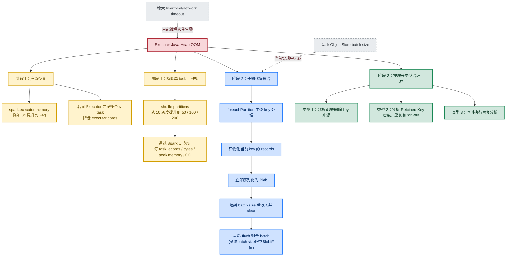

# 1、文档目的

本文整理 2026-08-01 Spark ingestion 发生 Java Heap OOM 的完整调查过程，覆盖以下方面：

- Spark 报错与 JVM 指标解读。

- 问题类型判断：数据倾斜、总量增长还是代码内存模型问题。

- 相关 Spark 参数的真实作用及常见误区。

- 当前临时处理、短期稳态处理和长期根治方案。

# 2、日志分析

打开spark的日志（敏感部分已打码）从第一句话就可以看到 log 显示：`java.lang.OutOfMemoryError: Java heap space`**当前 JVM 的 Java Heap 无法继续分配内存**

说明：

1. 错误发生在 Spark Executor 的 task worker，而不是 Driver。
2. 失败资源是 Executor JVM 的 Java Heap，不是磁盘空间，也不是单纯的 YARN memory overhead。

```log
26/08/01 18:16:00 ERROR Executor [Executor task launch worker for task 3.2 in stage 11.0 (TID 180)]: Exception in task 3.2 in stage 11.0 (TID 180)
java.lang.OutOfMemoryError: Java heap space
  at java.util.Arrays.copyOf(Arrays.java:3181) ~[?:1.8.0_492]
  at java.util.ArrayList.grow(ArrayList.java:267) ~[?:1.8.0_492]
  at java.util.ArrayList.ensureExplicitCapacity(ArrayList.java:241) ~[?:1.8.0_492]
  at java.util.ArrayList.ensureCapacityInternal(ArrayList.java:233) ~[?:1.8.0_492]
  at java.util.ArrayList.add(ArrayList.java:464) ~[?:1.8.0_492]
 ....
26/08/01 18:16:00 INFO metrics [shutdown-hook-0]: type=GAUGE, name=application_1783999226249_22616.8.jvm.heap.init, value=1054867456
26/08/01 18:16:00 INFO metrics [shutdown-hook-0]: type=GAUGE, name=application_1783999226249_22616.8.jvm.heap.max, value=11453595648
26/08/01 18:16:00 INFO metrics [shutdown-hook-0]: type=GAUGE, name=application_1783999226249_22616.8.jvm.heap.usage, value=0.716910699866886
26/08/01 18:16:00 INFO metrics [shutdown-hook-0]: type=GAUGE, name=application_1783999226249_22616.8.jvm.heap.used, value=8224523704
26/08/01 18:16:00 INFO metrics [shutdown-hook-0]: type=GAUGE, name=application_1783999226249_22616.8.jvm.mapped.capacity, value=0
26/08/01 18:16:00 INFO metrics [shutdown-hook-0]: type=GAUGE, name=application_1783999226249_22616.8.jvm.mapped.count, value=0
26/08/01 18:16:00 INFO metrics [shutdown-hook-0]: type=GAUGE, name=application_1783999226249_22616.8.jvm.mapped.used, value=0
...
26/08/01 18:16:00 INFO metrics [shutdown-hook-0]: type=GAUGE, name=application_1783999226249_22616.8.jvm.pools.PS-Old-Gen.committed, value=8589934592
26/08/01 18:16:00 INFO metrics [shutdown-hook-0]: type=GAUGE, name=application_1783999226249_22616.8.jvm.pools.PS-Old-Gen.init, value=703594496
26/08/01 18:16:00 INFO metrics [shutdown-hook-0]: type=GAUGE, name=application_1783999226249_22616.8.jvm.pools.PS-Old-Gen.max, value=8589934592
26/08/01 18:16:00 INFO metrics [shutdown-hook-0]: type=GAUGE, name=application_1783999226249_22616.8.jvm.pools.PS-Old-Gen.usage, value=0.9457348454743624
26/08/01 18:16:00 INFO metrics [shutdown-hook-0]: type=GAUGE, name=application_1783999226249_22616.8.jvm.pools.PS-Old-Gen.used, value=8123800464
26/08/01 18:16:00 INFO metrics [shutdown-hook-0]: type=GAUGE, name=application_1783999226249_22616.8.jvm.pools.PS-Old-Gen.used-after-gc, value=8123800464
...
```

**总结日志证据链**

| 日志                                                 | 能得出的结论                                                           |
| -------------------------------------------------- | ---------------------------------------------------------------- |
| `ERROR Executor [Executor task launch worker ...]` | 异常发生在 Executor 执行 Task 时                                         |
| `java.lang.OutOfMemoryError: Java heap space`      | Executor JVM 的 Java Heap 耗尽                                      |
| `ArrayList.grow` / `Arrays.copyOf`                 | 扩容 `ArrayList` 时无法申请新的数组                                         |
| `jvm.heap.max, value=11453595648`                  | Executor 实际最大 Heap 约为$11453595648KB/1024^3 ≈ 10.67 GB          $ |
| `PS-Old-Gen.usage, value=0.945734845...`           | Old Gen 已使用约 94.57%                                              |
| `PS-Old-Gen.used-after-gc = 8123800464`            | **已知：内存设置的为8GiB<br/>Full GC 后仍保留约 7.57 GiB，说明大部分对象无法释放**         |
| `PS-MarkSweep.count=19, time=174557`               | **已执行 19 次 Full GC，累计约 174 秒，仍无法腾出足够空间**                         |

**这表明大量对象仍被业务集合引用，Full GC 无法回收。GC 不是没有执行，而是没有可回收的对象（全都被占用）。**

定位异常发生的代码：

```java
List<ContentInsightsUniqueUserRecord> records = new ArrayList<>();
while (Entries.hasNext())
{
    Entries.next()._2.forEach(records::add);
}
```

这里把整个 Spark partition 中所有 key 的记录持续加入同一个 `ArrayList`。`ArrayList` 扩容时需要：

1. 创建一个更大的新数组`Object[]`
2. 通过 `Arrays.copyOf` 将旧数组复制到新数组
3. 复制完成后旧数组在没有引用后才可被 GC 回收

因此扩容瞬间需要额外的连续 Heap 空间同时容纳新旧两个数组。Old Gen 已经达到 94.57% 时，`Arrays.copyOf` 无法申请连续的新数组，于是抛出 `OutOfMemoryError: Java heap space`

**同一次运行还出现 Executor heartbeat 或 RPC timeout，是次生现象：**

```text
Heap 持续增长
  -> Young GC / Full GC 频繁发生
  -> task 和心跳线程长时间得不到有效运行时间
  -> heartbeat/RPC timeout
  -> task 重试
  -> ArrayList 继续增长
  -> Java heap space OOM
```

因此仅增大 `spark.executor.heartbeatInterval` 或 `spark.network.timeout` 可能延迟报错，但不能修复 Heap 根因。

---

总结一下上面的因果关系：

1. 此次运行的数据较以往偏大，数据膨胀

2. executor heap 紧张

3. 频繁/长时间 Full GC

4. 心跳超时

5. ArrayList 继续增长

6. Java heap space OOM

# 3、数据膨胀的猜测和验证

## 3.1 猜测

由于之前从未发生过这类问题，所以有两个大方向的假设：

1. **Spark 偶发性执行问题**。
   
   同一份输入重跑后仍在相同代码路径发生 OOM，因此可以基本排除一次性的节点抖动。

2. **输入的内存工作集确实变大**。
   
   一次ingestion的过程中会拿到所有的key及对应的记录，其行数可以按照下面的公式计算：

$$
TotalRows = KeyCount \times AverageRowsPerKey
$$

- `KeyCount`：有多少个不可聚合的 `Key`
- `AverageRowsPerKey`：每个 key平均有多少条维度记录

总结：8月的总量增长可能来自：

1. `KeyCount` 数增加

2. `AverageRowsPerKey` 增加

3. 两者同时增加

## 3.2 验证

计算7月和8月的`KeyCount`和`AverageRowsPerKey`变化，其中KeyCount分为两个输入源，这里简称A和B

| 数据源 | KeyCount 增长              | AverageRowsPerKey 增长  | 分类                   |
| --- | ------------------------ | --------------------- | -------------------- |
| A   | 317,908→723,315（+127.5%） | 77.7 → 69.8（-10.2%）   | **类型 1：KeyCount 增加** |
| B   | +14.0%                   | 211.0 → 235.9（+11.8%） | **类型 3：两者同时增加**      |

因此准确结论是：Spark OOM 来自A key 数量爆发导致partition 内所有 key 的总工作集变大（平均记录/key 下降反而抵消了一部分增长），而不是单个 key 变大（数据倾斜）。

# 4、根因

1. **根因：整分区物化**
   
   `IngestionInPartition` 把整个 partition 收集到一个列表，内存复杂度约为：
   
   $$
   O(partition 内总记录数)
   $$

2. **重要诱因：partition 数量过少**
   
   当前 `--partitions=10`，平均每个 partition 承担约总数据量的十分之一。数据增长后，即使分布均匀，单 partition 也可能过大。

3. **并发内存放大**
   
   日志显示：
   
   ```plain
   executor.threadpool.activeTasks, value=3
   ```
   
   说明同一个 Executor 当时可能同时执行 3 个 task。每个 task 都在构造自己的整分区列表，因此 Executor Heap 大致需要同时承受：**3×单分区工作集**

4. **Executor Heap 不足**
   
   Old Gen 已达到约 94.57%，扩容 `ArrayList` 时无法再创建更大的数组，于是出现：
   
   ```plain
   OutOfMemoryError: Java heap space
   
   ArrayList.grow
   
   Arrays.copyOf
   ```

# 5、解决办法



### 5.1 第一阶段：恢复运行

降低本次重跑失败概率，但没有改变内存复杂度

1. `spark.executor.memory=24g`。
2. `--partitions=10` 灰度提升到 `100`。
3. 检查节点是否能提供对应 Executor container 内存。
4. 如果同一 Executor 仍同时运行 3 个大 task 并持续 Full GC，将 executor cores 降到 1～2。

优点：

- 改动小；
- 能迅速提高 task 的容错空间。

限制：

- 当前算法的内存复杂度没有变化；
- 数据继续增长仍会再次 OOM；
- 如果每个 executor 同时运行多个 task，24 GiB 会被多个 task 共同消耗；
- 更大 Heap 也可能带来更长 Full GC。

### 5.2 第二阶段：长期代码根治

不再把整个 partition 放入一个 `ArrayList` 后再次按 key 分组。`groupByKey` 后的每个 `Entries.next()` 本身已经对应一个 ObjectStore key，可以：

1. 一次只读取一个 key 的 records，立即构造对应 Bond Blob，将 key/value 放入小批次
2. 达到 `batch_size` 后写 ObjectStore
3. 清空批次，继续下一个 key

内存复杂度将从：

$$
O(整个 partition 的记录数)
$$

降低为：

$$
O(单个最大 key 的记录数+batch size)
$$


所以流式处理后，内存会从数百万至数千万个 Java Record，下降到最多约两千条记录加一个写入批次。这样即使数据总量继续增长，也主要增加 task 运行时间，而不会按总行数线性推高 executor 峰值内存。

### 5.3 第三阶段：按增长类型治理上游

这里的“按照增长类型治理上游”不是发现数据增长后直接过滤，而是先判断增长来自哪里，再区分：

- **正常业务增长**：保留数据，做容量规划和监控。
- **规则变化**：确认是否符合预期，不符合则修正规则并回算。
- **数据质量问题**：修复重复、Join fan-out、ID 不稳定等根因。
